# Agent Transport Contract

## Agent Context

- Purpose: Define the OpenMeld Agent Transport contract: how a Space Wake reaches the
  correct local Agent and returns one reply, explicit stopped outcome, or
  explicit failure to the Space.
- Read this when: You are changing Agent execution readiness, local-agent setup,
  OpenMeld Service readiness, Space Wake readiness, Wake failure copy, recovery
  planning, service lifecycle, wakeability, dispatch trace, or answerability
  logic.
- Update this when: Core ownership, execution truth, readiness semantics, Wake
  finalization, or diagnostic contracts change.
- Do not use this for: Product object semantics, Space collaboration details,
  Agent Profile identity, local OpenMeld Service lifecycle, data ownership,
  observability field catalogs, shared schema implementation, client
  presentation, temporary rollout plans, local debugging notes, raw traces,
  backlog ideas, or implementation details that belong in source code.
- Source of truth: This file owns the durable Agent Transport contract for the
  main Web Wake -> RuntimeCoordinator -> local OpenMeld Service -> local Agent ->
  Space visible outcome chain.

Account-shared provider conversations keep this same RuntimeCoordinator and
dispatch-owned publication path. Their explicit connection acknowledgment
permits conversation-wide messages and Stop; it does not claim task-exclusive
provider control. See [Account-shared Bot adapter](local-openmeld-service.md#account-shared-bot-adapter)
for the Grok Bot delivery and settlement evidence contract. Provider state is
evidence for the admitted Wake, never a replacement execution authority.

## Transport Promise

Agent Transport is the closed loop that lets humans and Agents collaborate in a
cloud Space, Wake the right Runtime across devices and clients, and receive one
coherent reply, one explicit stopped outcome, or one explicit failure.

The product promise is not setup, readiness, binding, route sync, service
status, or diagnostics. Those are internal evidence. The product promise is:

```text
Web or CLI Space message -> Wake dispatch -> RuntimeCoordinator execution -> local OpenMeld Service execution -> Space reply, stopped outcome, or explicit failure
```

This file owns only the transport contract: execution authority, readiness, Wake
execution, and final outcome boundaries. Product semantics, local service
lifecycle, data/observability, shared schemas, and client presentation remain
owned by their scoped `developing/` documents.

## Ownership Model

The Agent Transport contract composes stable truths. It does not replace their
owners.

- Space owns membership, messages, addressing, and Space policy.
- Agent Profile owns the AI teammate identity, instructions, and continuity.
- Agent Profile Binding owns the execution connection from one Agent Profile to
  one OpenMeld Service Runtime and Agent Controller.
- Runtime owns machine identity, lane identity, heartbeat, and observed
  Agent Controller availability.
- Agent Profile Work Coordinator owns one workstation Agent Profile's bounded
  reservations, ordered waiting work, and recovery hold. It does not own the
  Wake payload or concrete execution truth.
- The Space durable dispatch outbox is the production acceptance and recovery
  conveyor for interactive Space Wakes. After the current Core-owned Binding
  preflight, a workstation Wake goes directly from that outbox to
  RuntimeCoordinator and the current local OpenMeld Service. A retryable
  workstation admission remains in the same outbox and is redriven by the
  Space alarm. An authoritatively identified hosted Agent may use Queue
  as a recovery transport after a retryable or outcome-ambiguous direct native
  delivery. Queue also remains the conveyor for its other queue message
  families; it is not RuntimeCoordinator authority or the default workstation
  Wake admission path.
- RuntimeCoordinator owns in-flight Wake execution: route, lease, live
  Agent Controller availability, lifecycle, fencing token, retry, timeout, late
  result handling, and final execution outcome.
- OpenMeld Service is the local execution carrier and trust boundary. It carries
  accepted work to local controllers and reports local execution evidence; it
  does not own Space truth, Agent Profile identity, final readiness truth, or
  RuntimeCoordinator execution truth.
- PostgreSQL dispatch records own the durable ledger and query projection for Wake
  execution. They record what happened; they do not decide who owns an
  in-flight execution.

## Main Chain

```mermaid
flowchart LR
  A["Web or CLI posts a Space message"] --> B["Space persists the signal and addressing"]
  B --> C{"Relation"}
  C -->|"Reference"| D["No dispatch. The message is context only."]
  C -->|"Wake"| E["Core creates one Wake intent"]
  E --> F["Space durable outbox accepts the work item"]
  F --> G["Core directly asks RuntimeCoordinator to accept or dedupe it"]
  G --> G2{"Profile work slot"}
  G2 -->|"Available"| H["RuntimeCoordinator routes the work to the live OpenMeld Service"]
  G2 -->|"Occupied"| G3["Coordinator retains the Wake in Profile FIFO"]
  G3 --> G2
  H --> I["OpenMeld Service executes only with a coordinator token"]
  I --> J["Runtime reports lifecycle and one result"]
  J --> K["RuntimeCoordinator decides the final outcome"]
  K --> L["Space shows one reply, stopped outcome, or explicit failure"]
```



The workstation chain is strict:

- Wake is the only Space addressing relation that creates executable work.
- Reference addresses agents for context only.
- Agent-to-agent delivery must use Wake or Reply + Wake. A visible reply that
  merely contains a bare `@Agent Name` is not executable delivery.
- The Space durable outbox is the production reliable dispatch buffer for
  workstation Wakes. Queue is a recovery transport for authoritatively
  identified hosted Center Agent native delivery and remains available to its
  other independent message families.
- RuntimeCoordinator is the execution authority for one concrete Wake.
- OpenMeld Service is the local executor.
- One Wake reaches one final conclusion.

Space outbox redrive is bounded and target-aware. One flush admits at most 20
candidates, processes at most five target Agent Profiles concurrently, and
preserves FIFO order within one target. A candidate failure is isolated from
the other target queues. After a full batch advances successfully while more
pending records remain, the shared Space alarm schedules an immediate
continuation; retrying or poisoned work keeps the normal durable retry cadence.
The outbox creation time remains stable across handoffs and redrives so a Wake
waiting on an execution-target settings lease reaches its bounded, visible
failure deadline. The queue handoff timestamp is separate and may advance on
each redrive.
Concurrent flush callers share one in-flight flush per Space. PostgreSQL overload is
storage backpressure, not evidence of a malformed request or a missing Agent
account: it does not consume the candidate poison budget. The same durable
outbox record remains recoverable through the shared alarm. An in-memory
retry-not-before hint suppresses additional flushes for the normal redrive
interval; eviction can shorten that hint but cannot lose the durable work.
Other repeated candidate exceptions retain the bounded poison behavior and
report a request-preparation failure, not an unproven account failure.
Local, staging, and production direct delivery use the same runtime-aware
submission function; the Worker environment must not select a different
workstation recovery policy. Local Core enables direct delivery by default.
The application-level outbox responsibility states are `pending`,
`handed_off`, and `cancelled`. `handed_off` means the selected transport
accepted responsibility: direct RuntimeCoordinator submission for workstation
Wake, or Queue only for the hosted recovery cases defined above. It must never
be interpreted as proof that a workstation Wake entered Cloudflare Queue.
For hosted native delivery, a Dispatch Ledger row alone is not durable
admission. A native-delivery row that is still `submitted` without either its
exact persisted worker request or a worker acknowledgement remains an
incomplete handoff. After the bounded direct grace period, the Space outbox
must redrive that same dispatch and attempt through hosted recovery instead of
retiring the outbox item or creating another attempt. If the exact worker
request is already persisted, recovery submits that frozen request directly;
it does not rebuild mutable conversation context before replay.
This also applies when an interrupted direct call leaves the outbox `pending`
after creating the dispatch attempt. A hosted `handed_off` seed keeps the Space
recovery alarm armed until native admission or a terminal outcome is durable;
a Queue receipt alone cannot retire that responsibility. Direct-to-Queue hosted
recovery persists the existing hosted admission marker with the handoff. An
older handoff with neither a frozen Controller nor an owner remains eligible
for investigation; Space uses the existing Core preflight to identify its
runtime family and treats unavailable evidence as unavailable, not as hosted.
Confirmed workstation handoffs remain excluded from the scheduled hosted
recovery batch; RuntimeCoordinator explicitly redrives their retained payload.
An unaccepted hosted attempt resumes with the same identity,
without requiring a workstation owner or entering RuntimeCoordinator. Accepted,
terminal, replaced, or workstation-owned attempts cannot be reopened by that
hosted recovery marker.
When a hosted handoff has no dispatch ledger row, Space may redrive the same
dispatch only if its durable admission fence proves no native exposure and the
exact native delivery is absent. An unavailable ledger, an existing native
delivery, or unknown exposure is not proof that execution never started.
The bounded Space outbox scan persists its pagination position so unresolved
handoffs cannot indefinitely hide later candidates, including across eviction.
This cursor is scheduling metadata and does not establish execution or outcome.
The dispatch attempt remains `dispatching` until the native admission
acknowledgement is durably recorded. An ambiguous submit or failed ACK
persistence must not advance it to `waiting_result`, which would prevent
the hosted recovery claim from resuming that attempt.
The direct path returns only after RuntimeCoordinator head acceptance and local
delivery acceptance have completed or produced a durable retry decision. Its
correctness must not depend on `DurableObjectState.waitUntil`, because that API
does not extend a Durable Object's lifetime.

For workstation Wakes targeting one Agent Profile, owner-sharded admission is
one current Wake plus at most 50 waiting Wakes. The order is the Durable Object
transaction acceptance order across Spaces and Direct Messages. The
Coordinator stores only identifiers and minimum scheduling metadata; the Space
outbox retains the complete payload while the head lifecycle is `queued`.
At first head acceptance, RuntimeCoordinator also freezes the secret-free
execution-target identity (`bindingId`, `configurationRevision`, Agent
Controller ref, OpenMeld Service Runtime id, and runtime kind) plus a SHA-256
fingerprint of the Space-owned dispatch payload. It does not copy or become the
owner of that payload. The fingerprint covers the immutable execution and reply
content; transport-attempt timestamps, recovery provenance, and display-name
enrichment are not Wake identity. Promotion, alarm redrive, and reconnect
reacceptance must return the accepted snapshot so Core can combine it with the
same outbox payload. A different immutable-payload fingerprint for the same Wake
lifecycle is an accepted-payload authority conflict, never permission to
execute newer message content and never evidence that the Wake is a duplicate.
When the original head has not entered execution, RuntimeCoordinator freezes a
visible no-execution failure for that exact Wake. If linked execution or a
concurrent authority change makes that unsafe, Core retains the outbox item and
retries the exact conflict; it does not execute the altered payload, mark the
dispatch `deduped`, or reinterpret the conflict as Computer connectivity.
After execution is linked, Core stores the accepted-payload fingerprint beside,
not inside, the v1 execution-token authority. This keeps the v1 authority
readable by an older Core during rollback while preserving the fingerprint
after terminal head retirement. A terminal replay with two known, different
fingerprints returns the exact accepted-payload conflict. When legacy terminal
authority has no fingerprint sidecar, Core reuses the already-terminal outcome,
does not grant a new execution, and records a compatibility diagnostic without
claiming that the Wake details changed.
If a changed-payload redrive reaches no-execution settlement after the terminal
head has already been retired, RuntimeCoordinator confirms that the matching
terminal authority already owns closure. Queue acknowledges the redrive without
executing, republishing, or rewriting that terminal outcome. If an active head
already owns another no-execution publication intent, its original reason stays
authoritative and must not be replaced by the later payload-conflict reason.
Per-Wake no-execution publication does not itself change current Wakeability;
payload conflicts do not write or overwrite a current readiness blocker.
During a rolling Core deployment, a caller that omits the snapshot cannot
reaccept a head that already owns one; RuntimeCoordinator returns the legacy-
parseable `retry_later` shape and never grants `create_execution`. A legacy
head may gain a proposed snapshot only inside the admission transaction while
it is still queued and has no linked execution or token authority. A legacy
head promoted to `accepted` may gain that snapshot in the same transaction only
while its exact dispatch, target profile, and Wake lifecycle still own the
pending-promotion record and no execution authority exists. Promotion remains
pending after the Space accepts redrive until this identity reacceptance
finishes. Any other legacy head that may already be executing returns
`retry_later` instead of silently adopting or discarding the snapshot.
`profile_queue_waiting` is a PostgreSQL ledger projection, not scheduling authority.
Seeing that projection must retain the handed-off Space outbox item without
resubmitting it on an ordinary alarm.

### Explicit device waiting

A new workstation Wake may explicitly request `deviceWait`, selecting the
current Binding and OpenMeld Service Runtime with an absolute start deadline.
The Space message and its durable dispatch outbox retain that immutable intent.
Core verifies the selected target against current Binding and Organization
authority. Confirmed offline availability, including a Core-confirmed offline
route while the computer is reconnecting, may admit this Wake without creating
an execution; ordinary Wakes keep their existing admission contract.

RuntimeCoordinator owns the accepted wait, deadline, FIFO position, cancellation,
and terminal decision. The deadline applies while waiting for either the device
or earlier Profile work. It never restarts on redrive or FIFO promotion. The
normal Service registration, route report, and recurring heartbeat trigger exact
Space outbox redrive. The handed-off outbox retains the payload while its ledger
projects `runtime_coordinator.device_waiting`; ordinary conveyor alarms do not
create repeated delivery attempts for that owned wait. Queue and PostgreSQL remain transport
and projections, never scheduling or execution authorities.

Before first execution, Core rechecks current requester and target Space access,
Organization authority, Binding, controller configuration, and canonical
readiness. Local Service still validates the concrete working folder. A changed
Binding or Runtime is a visible no-execution failure; reconnection cannot
silently retarget work. Pending route registration may remain in the same bounded
wait. A transport failure while reading authority is retryable, not permission.
Fresh Usage and controller checks remain under
`wake.device_wait.readiness_checking`; a failed Space-access read uses
`wake.device_wait.access_check_unavailable` and `space_access_unavailable`.
Observed `daemon.service.draining` retains its original code in the same bounded
waiting mechanism. All keep the original deadline. The ledger's
`runtime_coordinator.device_waiting` error code is a conveyor-ownership marker;
the Coordinator boundary and correlated `head_waiting_boundary_recorded` ops
decision retain the actual cause. Service heartbeats/reports recheck access as
part of the same admission path; the access boundary is not a new scheduler.
The next accepted Service heartbeat or report rechecks the complete admission
path. A definitive permission, identity, or readiness blocker still terminalizes
the Wake; checking is not a successful admission decision.

Ordinary Wake preparation and explicit device waiting share the canonical
preparation-reason policy, existing Service reports, and Coordinator recovery.
The opt-in adds a selected device and an immutable user start deadline; it does
not introduce a second preparation or retry policy. Once a head is accepted,
temporary access-read outages use that same durable wait rather than an
independent Queue retry. Every recovery attempt rechecks access before execution.

Password rotation alone does not revoke these waits. The access RPC requires
both the requester and target Profile to remain active Space members, and the
owning protected-Space gate grants authenticated active members access before
checking a password. This recheck does not supply the frozen outbox password;
that credential may become stale without denying member authority. Removing
either member still rejects the wait; possessing a password
does not bypass this waiting-Wake membership requirement. Use Wake cancellation
or revoke membership to stop retained work, rather than relying on a password
change to revoke existing member authority.

The owner transaction fences first execution at the deadline and against Stop.
An expired wait publishes `wake.device_wait.expired`; cancellation, failure, and
execution linkage cannot transition back into pre-execution waiting. Deadline
alarms reread authority and publish only the transaction's accepted decision.
An accepted or FIFO-queued request without an observed waiting boundary carries
only a start deadline. Expiration uses a generic local-Agent no-execution
category and does not invent an offline route. Both alarm and waiting-request
expiry write `wake.device_wait.expired` with `send_new_wake`; they never inherit
the previous boundary's restart/repair action. Historical observed causes remain
in the ledger and ops decision evidence.
Once execution is linked, the start deadline no longer applies. Existing durable
result recovery, exact-conversation answer recovery, `outcome_unknown`, and
no-automatic-replay rules continue to govern interrupted work.

Public Wakeability stays `Offline` while the device is offline. An opted-in Wake
progress reader separately receives the waiting reason and deadline, and uses
the existing pre-agent cancellation capability. Receipt of the message, waiting,
and actual execution remain distinct facts.

Core gates fresh Work Coordinator admission with the same canonical
Wakeability projection used by product surfaces. Its current compatibility
identifier is `AgentExecutionReadiness`. A definitive current blocking fact
ends as a visible pre-head no-execution outcome, except for explicit offline
device-wait admission above; otherwise it must not create a current or queued
Coordinator item. Missing readiness evidence or working-folder report
coverage, revision, freshness, initial route registration, or required Usage
observations while Service reports catch up is not a
definitive refusal. Core retains that same undelivered Wake through the existing
bounded preflight retry policy and Space outbox; no execution is authorized.
Each retry rereads canonical readiness and authorization. A ready verdict may
continue the original Wake once, while a definitive blocker or exhausted retry
budget produces its visible failure. No second user message is required, and
no already-terminal Wake is revived. A duplicate intake reservation is not a
successful execution handoff: concurrent outbox flushes must retain recovery
while the original admission is still in flight, without executing it twice.
The gate reads current Core-held facts only. It does
not poll the Local Service, call a provider, scan Profiles, enumerate
owner-wide device inventories for presentation enrichment, sleep, or add a
second readiness projection to the dispatch path.

Submission must preserve this distinction: Core's canonical `checking_connection`
projection permits submitting the original request, not executing it or
displaying Ready. Authoring must not duplicate Core's preparation reason list.
Missing projections, offline, unauthorized and definitive blocked targets are
not implicitly admitted by a client-created Checking fallback.

Before any accepted or promoted head can create a local execution, Core reruns
the canonical readiness and accepted-identity checks against current Profile
access, Binding, Agent Controller and configuration, workspace, Local Agent
enabled state, route, and availability. A blocking result records a durable
terminal no-execution decision for the exact existing head. It never calls head
accept again, and later reconnect, recovery, or re-enabling cannot revive that
settled Wake. Terminal promotion applies the same check to each next head, so
disabled work cannot remain hidden in FIFO and run later.

User-facing Wake progress may project explicit Profile FIFO `queued` copy only
from the Coordinator-owned head lifecycle `queued` state, or for an
`accepted_local` execution whose latest `lifecycle_accepted_local` evidence
reports `localQueue.status = queued` because the Service holds it behind other
local work. That local wait records its own lifecycle event, so the frame the
Service sends when it starts the Wake is not deduplicated into the wait and ends
the `queued` projection. Space outbox status,
Dispatch lookup status, and RuntimeCoordinator `created` or `delivery_pending`
remain neutral pre-delivery progress. They must not infer that another Wake
owns the Profile work slot, and the PostgreSQL `profile_queue_waiting` projection must
not become a second presentation authority.

When a reserved Wake becomes terminal, the same owner-shard transaction
releases only that reservation, selects eligible waiting work, and records one
pending promotion marker per promoted Wake. The normal path requests exact Space redrive immediately
after that transaction. The existing alarm retries only a promotion whose
external redrive did not complete. A repeated terminal event is idempotent and
cannot repeat a promotion. Route or Service `waiting` does not release a
reservation.

A Coordinator work item is only a scheduling claim over one Wake; the head
lifecycle record and its execution token authority remain that Wake's truth. A
claim whose head is missing or already terminal, or whose linked execution
already holds a terminal outcome, is retired: nothing can promote it and no
terminal transition can settle it again. Retired claims must not keep holding a
reservation, because a `queued` head carries no deadline of its own, so every
later Wake would accumulate behind work that can never run. New-Wake admission
therefore reconciles that Profile's claims against canonical head truth inside
the same owner-shard transaction, retires the whole proven-retired set in one
transition, prunes the matching active references, and promotes eligible
successors through the ordinary promotion marker and redrive path. Missing or
unreadable execution authority keeps its claim; only proven-retired work is
released. A paused Coordinator is left untouched, because its recovery gate
holds the reservation for an owner decision. Active-reference repair does not
replace this reconciliation: it rebuilds references from canonical storage keys
and cannot reconstruct queue metadata.

Independent workstation tasks use Core-assigned Execution Contexts. Core admits
as many contexts for one Agent Profile as its owner-adjustable concurrency
limit allows (stored on the Binding, default five), with one writer per context
and at most 50 waiting Wakes. Legacy work without a context drains exclusively.
New work and forks may select a context explicitly. An ordinary Claude Code
Wake in parallel mode implicitly selects an independent native context when
it has no retained context; a retained or explicitly restricted context keeps
its selected access. An ordinary Codex or Claude Wake with no retained context keeps the
Profile's effective working folder through a current-folder workspace context;
it never silently changes to a Space-only scratch directory merely because the
Profile has already entered context mode. Every selection is scoped to the exact requester,
Organization, Space, discussion, Profile, Binding, and Runtime.
Admission freezes both the context assignment and a decision to retain legacy
continuity. Linking an execution or redriving a Wake cannot assign it again.
An explicit Project code-work selection freezes one Project ID and repository
fingerprint on that Context. RuntimeCoordinator requires a v4-capable local
adapter before admitting this selection. Core verifies the Project association
at delivery, while the Service verifies the owner-local matching folder and
file access. Profile Default Project and a Space's related Projects remain
suggestions, never alternate execution targets when the selected repository is
unavailable. Isolated Contexts use separate worktrees.

Each local task carries a resource claim, so resource conflicts are
folder-scoped across Project labels. A shared claim names its folder roots (the
resolved folder and, for a Git checkout, its common Git directory) and its
access; claims whose roots do not overlap never conflict, readers never
conflict with readers, and a claim with unknown roots conflicts with every
shared claim. Space-only and isolated work holds a private claim. Work without
an Execution Context holds a legacy claim of its route's folder, and an
OpenCode continuation that may return to an earlier folder claims unknown
roots. Two direct-edit Sessions whose roots are identical run concurrently:
the later one receives a `shared_folder` notice with a one-click switch to an
isolated copy, and each task prompt lists the other Sessions editing that
folder. A task that waits on another task's folder reports
`runtime.local_queue.workspace_conflict`. A task whose root requester is not
the Agent owner defaults to an isolated copy when the folder is a Git
repository; the Service makes that choice inside
`mode: "auto"`. Admission order stays FIFO without priorities, and owner and
colleagues share the Profile's limit. Implementation status: MemberAgent
program, PR #236, shipped.

Conversation isolation does not imply a new filesystem boundary. For a new
Codex or Claude context, omitted access preferences inherit the Profile's current
native permission mode intersected with the current Computer File Access policy.
Core records `permissionSource: agent_settings` independently of workspace and
conversation identity. A current folder is a starting location, not an implicit
allowlist. Explicit `space_context`, `read_only`, and `workspace` preferences
retain their existing task boundary. A fork retains its source restriction;
legacy assignments without a permission source are never silently widened.
This default applies to every authorized requester, including teammates and
Agent delegation. Requester ownership informs disclosure judgment, not native
tool availability. Core requires the Service's
`executionContextPermissionInheritance` capability.
The Service reuses ordinary Computer policy admission for inherited permissions.
The workspace choice is independent: `workspace: isolated` with omitted access
prepares a managed copy while preserving `permissionSource: agent_settings`.
Fork defaults retain their source's working-copy mode; native permission
inheritance must not move an isolated source back into the user's current folder.
Context identity, history-loss failure, writer admission, and process ownership
remain enforced even when no extra filesystem boundary is required.

Task-context diagnostics read the exact retained Wake-to-Context association
through its RuntimeCoordinator owner, including after the transient Head has
retired. The projection reports the assigned access, permission source and
workspace; Service-reported conversation resume and directory observations
remain separate facts. Missing or unreadable evidence never falls back to the
Profile's current settings. Shared viewers may see the task restriction and
continuation summary; Context identifiers, native conversation identifiers and
private local paths retain the existing owner-only presentation boundary.

Starting a new task from a Space-only limitation is an explicit new authored
Wake using current admission and Agent settings. It does not mutate the old
Context or reinterpret its permissions. The reviewed source, chosen target and
reply placement are preserved, and retries use the same message identity.

Core retains each accepted Wake's context association and completed native
history checkpoint independently of the in-flight Head lifecycle. Head retirement
must not erase a source needed for continuation or a completed-prefix fork.
These records describe identity and history; they do not decide current execution
or publication. Validated task results must echo the assigned context, and native
conversation ownership cannot move to another context. Receipt validation may
reserve immutable native identity, but a proposal that still requires review
does not freeze fork-visible history. The checkpoint is committed atomically
with the accepted finalization command before terminal promotion, using the
final repair or reconsideration turn when present. Accepted commands and their
checkpoints remain immutable under replay. Scoped results never overwrite the
Profile Binding's legacy native conversation.

A fork whose source never froze a checkpoint still inherits the exact source
context, Wake, native conversation, and workspace from that retained
association; only its completed prefix is left unassigned. An interrupted or
provider-occupied dispatch produces exactly that residue. Such a fork is
admitted only for a harness whose retained history can name a settled boundary
under read-only preparation, and the Service confirms and journals that exact
cutoff before creating the child. A harness that needs its boundary identified
up front is refused rather than forked at a guessed point.

Occupied-conversation recovery may automatically authorize the existing fork
continuation only for `builtin:codex`, an automatic context selection, an explicit
`read_only` or `space_context` assignment without inherited permissions or a fork
source, and a retained run with no running/completed evidence. The admission
owner rechecks this policy inside its authorization transaction. The caller must
then confirm withdrawal and reread eligibility before publishing replacement work.
The ordinary deterministic continuation identity, exact Binding/configuration
fence, native completed-prefix preparation, and manual recovery remain authoritative.
Fresh available Usage reports drive this bounded recovery after the normal
occupancy waiting period; generic failures and uncertain native submissions do not.

The Space input outbox moves only untouched local drafts owned by the interrupted
message author to the replacement dispatch. The replacement message, dispatch
outbox, and conditional queue update commit in the same SQLite transaction.
This preserves order and identity and cannot move claimed, consumed, rejected,
or uncertain input.
Automatic publication selects the replacement context explicitly. Native Steer
resolves the successor binding and persists it conditionally before claiming the
input; receipt reconciliation never changes the binding of an attempted delivery.
After a successful fork, follow-ups already assigned to that replacement context
can proceed without another approval when no unrelated work is held. Failed or
stopped continuations and mixed-context queues retain the existing recovery gate.
A gate opened because another app occupies one native conversation records that
cause and holds only that Execution Context and legacy work; other contexts of
the Profile keep their reservations and admission. Owner approval after the
branch is required only while work for the occupied context is still queued.
Usage exhaustion recorded on the same gate, or by its continuation, makes it a
Profile-wide hold again, because Usage is a shared capability fact.
Successful recovery retires only the source context's automatic scope association
inside the same owner transaction. Its context and Wake history remain available
for explicit selection. The replacement remains the conversation's automatic
route; ordinary user-created forks retain their existing selection semantics.

Contract impact: the owner read and authorization RPCs add optional fields. Older
owner shards omit eligibility or reject the new strict authorization field, so
automatic recovery defers; manual recovery continues to use the existing contract.
No local Service or provider protocol changes are required. Core's existing Space
and admission owners ship together. Web reuses the existing public recovery and
queue schemas; older clients continue to read queued inputs. No database migration,
new queue owner, or change to RuntimeCoordinator execution authority is introduced.

Paused-work locations come from the retained recovery head, even after that head
leaves the active work list. A legacy head without an execution-context assignment
cannot supply a verified fork source and projects Skip instead. The owner permits
Skip for an already authorized legacy fork only after validating that exact source
head still has no context; it does not make an arbitrary authorized continuation
skippable. Continuation uses the retained dispatch as the original addressing
fact, including implicit automatic Wakes, with the same exact
dispatch/source/target checks as explicit Wakes.

A structured `usage_exhausted` terminal outcome is the deliberate exception to
ordinary promotion: the Coordinator retains the interrupted work identity and
holds every later Wake. A fresh reliable Usage recovery automatically starts
at most one deterministic retry-as-new-execution for that interrupted request.
The recovery report must declare the exact current Usage support-matrix version;
a legacy or mismatched Service report cannot authorize automatic continuation.
Its
successful terminal result opens the separate owner approval gate for queued
work and creates the urgent Inbox/email action. An explicit user Stop is
terminal: it never re-arms automatic continuation, and any later queued work
also remains behind owner approval. If no later work exists, the Stop clears
the recovery gate. Later Wakes, including new intent accepted after Usage
recovers, remain in FIFO behind that gate. Repeated reports and retries must
converge on the same continuation operation. A transport failure or
`outcome_unknown` while handing that deterministic operation to Space preserves
the pending or authorized identity so the next report can confirm or retry the
same operation. A request that definitively cannot be replayed safely, has
incomplete source context, no longer matches the same Profile, controller,
Binding, configuration, or Default Project, or whose one continuation execution
fails moves to `continuation_needs_attention`; it cannot re-enter automatic
continuation. Initial authorization compares the exact interrupted run
command's accepted Binding, controller, configuration revision, and nullable
Default Project with the current canonical Core and Auth facts inside the
owner-shard transaction. That authorization and every future-work settings write
are ordered by the same owner shard. If a setting
write wins while the gate is pending or authorized, the same transaction moves
the exact continuation to `continuation_needs_attention` and writes its Inbox
intent before PostgreSQL settings may change. If head creation wins first, the gate is
already running; the setting may save for later work without changing the
current execution. Ordinary head admission keeps the established version 1
wire shape and adds no capability probe or preflight delay. A new cloud caller
uses a dedicated future-settings mutation RPC; an older shard that lacks it
rejects the setting write before PostgreSQL mutation instead of accepting an unsafe
half-rollout. Missing original accepted revision evidence remains inherently
unsafe and moves to `continuation_needs_attention` rather than being treated as
unchanged.
The handoff uses a dedicated owner-only Usage-continuation command with the
frozen interrupted dispatch/source identity and deterministic operation and
client-message identities. It preserves the source message's canonical Space
File revision references and structured Agent References, then Space posts
through its ordinary exactly-once client-message writer so current file and
addressing validation still fails closed. If that writer proves the preserved
Wake target, Agent Reference, Human Mention, or Space File revision is no longer
valid, Space returns `continuation_source_mismatch`; the owner shard moves the
gate to `continuation_needs_attention` and keeps later FIFO work held until the
owner reviews or skips the interrupted work. Storage, transport, and unknown
writer failures remain retryable against the same deterministic identity.
Repeated owner triggers resolve the same continuation instead of creating
another handoff. It does not call the public Execution Recovery
`retry_as_new_execution` action. That legacy action remains parseable but is
never enabled or executed for a user.
One idempotent Inbox item links the original Wake. The owner may skip the exact
interrupted work to resolve the gate and promote the oldest queued Wake.
The Usage report path sends candidate Profiles in stable, schema-bounded
owner-shard batches. Those transactions return only Profiles whose continuation
handoff is pending or authorized; Core must not probe every Profile Binding
with a separate recovery RPC when no recovery gate exists.
One Profile's recovery failure is isolated and recorded; it cannot abort later
healthy Profile reports in the same Service batch.

Provider-native instruction delivery is an adapter optimization inside the
local execution carrier. It must not change outbox admission,
RuntimeCoordinator ownership or lifecycle, Binding identity, Space reply
placement, or final Wake outcome. A controller's reported token usage, model
context window, cache usage, or compaction is observation only; no transport or
readiness decision may treat it as execution authority or proof that required
instructions are present.

### Request Chain

Implementation status: MemberAgent program, PR #236, shipped.

Every Wake has exactly one human root requester. No human root, no Wake.

| Trigger | Root requester |
| --- | --- |
| A person posts, mentions, or sends a Direct Message | that person |
| Routine | its creator; the Routine stops when the creator leaves the Organization |
| Identified external user | that user; every use needs the Agent owner's consent, and "always allow" is not offered |
| Anonymous visitor | none; rejected at the entrance |
| System | none today; a future system trigger must name a human, for example the admin who enabled it |

The request chain is `[root human, optional source marker such as routine,
Agent, Agent, …]`. The server writes it at Wake time; Agents cannot write or
edit it, and propagation only appends. It is the projection of the existing
delegation facts (`requesterProfileId`, Center Agent `onBehalfOf`, the Remote
Agent delegated requester, and `agent_delegate_task` parentage) plus the root,
not a second store, and it replaces `onBehalfOf`. Core stores the chain on the
Execution Context **assignment**, frozen at admission with the rest of the
assignment. It is not part of the Execution Context scope key, which stays
`(targetProfileId, organizationId, requesterProfileId, spaceId, threadId)`.

Repeat rejection applies only to delegated work: an `agent_delegate_task`
child Wake or a Center Agent delegation is rejected when its chain already
contains the receiving Agent. A conversational Space auto-relay Wake keeps the
human root requester and appends to the chain with no repeat check, so the
Auto-Relay Loop Policy below is unchanged. Core enforces one maximum chain
depth for both kinds, and that maximum is never stricter than the existing
auto-relay limits described in that policy.

Sensitive operations check the root requester, not the immediate actor: the
root requester must own the Agent Profile to change its settings, folders,
permission mode, or concurrency limit; answer its approvals; delete it; add it
to a Space; grant or revoke access to it; or archive it. Existing owner-of-actor
checks, such as Binding owner validation (`agent_profile_binding.owner_mismatch`)
and execution-target mutation admission, become root-requester checks.
Everything else is prompt guidance: each task prompt states the chain, the root
requester, where results go, and who can see them.

Every Execution Context accepted after the request chain is enforced has a
non-empty chain whose first element is a human Profile. Contexts accepted
before keep an empty chain and are treated as owner-rooted legacy.

### Auto-Relay Loop Policy

- An auto-relay chain may revisit a profile. A -> B -> A -> ... for any
  number of rounds is legitimate collaboration, not a fault. OpenMeld exists so
  Agent Profiles can collaborate without a human turn between rounds, so the
  transport never hard-blocks a loop.
- History: until 2026-06, dispatch preflight blocked any auto-relay whose
  target already appeared in `visitedProfileIds`
  (`dispatch.cycle.detected`), which killed every loop at its second
  revisit. That gate is removed on purpose; the error code remains only in
  historical dispatch records.
- `dispatchChainId`, `autoRelayDepth`, and `visitedProfileIds` plus its hash
  remain mandatory chain telemetry on every relay hop. They feed the
  dispatch trace and stay wire-protected end to end (see the visited-ids
  header rules in shared-contracts.md). Removing the gate does not remove
  the bookkeeping.
- Loop discipline is prompt-level, not transport-level: static dispatch
  prompt guidance forbids meaningless wakes (thanks, acknowledgements,
  receipt confirmations). Planned with the dynamic prompt injection system:
  escalating loop-awareness reminders driven by `autoRelayDepth` thresholds,
  owner notifications, a per-chain/per-Space pause control, and a
  machine-speed rate fuse that auto-pauses a tight runaway loop and resumes
  on one human message.
- Accepted residual risk until those land: a runaway agent loop is bounded
  only by dispatch-trace observation and manual intervention. This is a
  deliberate product decision: capable agents must be free to iterate, and
  protections must stay invisible to legitimate work.
- The only structural ceiling left is the visited-list schema maximum (256
  distinct profiles per chain). It bounds participants, not rounds: the
  visited list is a deduplicated set, so loops do not grow it.

## Execution Authority

Prepare makes a Runtime able to work. It may verify account, device, lane,
service, Agent Controller, and availability evidence. It must not create or join
a Space, choose Space members, create final Binding truth as a side effect, send
Wake, or decide execution ownership or final outcome.

Binding is explicit:

```text
GET /v1/agent-profiles/:agentProfileId/primary-binding
PUT /v1/agent-profiles/:agentProfileId/primary-binding
```

The binding target is
`Agent Profile -> openMeldServiceRuntimeId + agentControllerRef + optional agentControllerConversationId`.
Runtime identity is `owner account or owner principal + device + lane`. Do not
attach Runtime identity to a Human Profile or Agent Profile.

`agentControllerConversationId` is private Agent Controller continuity for the
target Agent Profile. It is not Space thread placement, Space membership, Runtime
identity, or execution ownership. Different Agent Profiles must not share one
Agent Controller conversation; conflicting ownership must be rejected or ignored
at Binding and local Agent Context boundaries.

RuntimeCoordinator execution follows one authority path:

1. Accept, dedupe, queue, or stop one target Wake intent at the
   RuntimeCoordinator head lifecycle boundary and Agent Profile Work
   Coordinator admission transaction.
2. Resolve the target Agent Profile, Binding, OpenMeld Service Runtime, Agent
   Controller availability evidence, owner evidence, and Space policy snapshot.
3. Reserve one current execution owner for the authoritative `openMeldServiceRuntimeId`.
4. Issue one execution token for the accepted execution.
5. Deliver the task to the live OpenMeld Service for that Runtime.
6. Accept lifecycle and result evidence only when it matches the current token.
7. Decide retry, timeout, late result handling, and final outcome in one state
   machine.
8. Project trace/audit facts to PostgreSQL and publish one Space outcome.

Important execution rules:

- For an accepted/running execution whose current Service transport is unavailable,
  RuntimeCoordinator retains the same execution for a 30-minute communication
  recovery window, anchored to its last accepted local progress. This is not a
  total runtime deadline. Opening a socket or checking a watchdog cannot extend
  that baseline; fresh accepted progress from the same token run ends the old
  uncertainty. A reconnection after the last accepted progress also retains that
  window when the watchdog missed the offline interval; registration alone does
  not prove that execution evidence has caught up. Re-registering a route catalog
  on the same socket preserves its original connection time and cannot manufacture
  a communication-recovery window. A new socket still starts a new connection
  interval; adopting a hibernated socket retains its stored interval. A continuously connected
  controller with stale progress keeps the ordinary
  five-minute policy. Stop, revocation, confirmed failure, and replacement-process
  reconciliation take precedence. At window expiry, a missing/stopped delivery
  Service becomes `runtime.local_runtime_lost`; only a still-connected Service
  with no more specific cause remains `runtime.progress_stale`. Both retain the
  existing owner-mediated late-result recovery and never automatically rerun.
- The five-minute policy names the cause it actually found. The first occupied
  report advances the progress baseline. Repeated same-phase occupied reports,
  recovery retries, and compatibility keepalives that omit occupancy prove only
  liveness while the Coordinator's admission record still says occupied. They
  cannot refresh progress or reset watchdog history, including after transport
  hibernation or a permitted reconnect. An explicit availability transition or
  advancement to `running` after provider turn acceptance ends that wait; normal
  running keepalives continue to protect active execution. This is not a total
  execution deadline. When the blocked work item still
  carries `waitReason = controller_conversation_occupied`, the terminal closes as
  `runtime.controller_conversation_occupied` instead, on the same deadline and
  with the same retained late-result recovery. Occupancy is read from the
  Coordinator's own admission state, never from PostgreSQL. A conversation released
  before the threshold clears that wait reason, so an ordinary stall keeps
  `runtime.progress_stale` and its "reconnect the computer" copy.
- After transport hibernation, accepted runtime evidence and tool/reasoning
  progress read the durable command when its transient transport entry is gone.
  This read projection does not recreate execution authority. Lease, source
  message, execution identity, token and owned-reconnection checks still apply.
  Tool/reasoning publication additionally requires the current session socket
  and connection generation. Missing durable command state remains an explicit rejection.
- A token-valid lifecycle report from the current socket may advance the same
  Service process's control connection generation. Core verifies the unchanged
  owner, Service session, device, lane, Profile lease, dispatch, attempt, and run
  before updating the existing durable run command. A historical command with
  unknown device or lane cannot adopt a new generation. This transport update
  does not start or redeliver work. An occupied keepalive can update control
  provenance but cannot refresh progress or reset the watchdog baseline.
- Watchdog scheduling is a bounded Durable Object projection of command and token
  authority. Command writes and terminal transitions update it transactionally.
  Existing history is repaired in pages with a durable cursor, without deleting
  history. Each alarm reads at most ten due items and repairs at most ten legacy
  records; authoritative eligibility is rechecked before spending execution
  budget. Failed items receive a bounded retry timestamp so later work can advance.
  Scheduling timestamps are not progress evidence or execution authority.
- A controlled OpenMeld Service update, reinstall, or repair first marks the
  current Runtime Transport route as not accepting new dispatches. The existing
  socket remains connected while owned local executions continue to report
  lifecycle/progress evidence, finish, flush their durable result outbox, and
  receive Core's durable-acceptance receipts. The Service closes the socket only
  after that drain finishes. An unexpected disconnect is not a controlled drain
  and must remain distinguishable in diagnostics.
- The lifecycle manager requests that drain through the local control plane
  before unloading the operating-system service. The request is acknowledged
  only after the current socket session has completed its drain. A deliberate
  force path may bypass this handshake, but it must retain force-stop evidence.
- If that route is still non-accepting with a recorded stop cause when the
  watchdog expires, the terminal outcome is `runtime.local_runtime_lost` and
  user copy says that OpenMeld Service stopped or disconnected during the Wake.
  It must not fall through to generic stale-progress or connection advice.
- A newly registered Service session on the same owner, device, and lane proves
  that process-local task ownership from a disconnected prior session cannot
  still be controlled by that prior Service. For a token-current execution with
  durable local progress but no accepted result, RuntimeCoordinator immediately
  records `runtime.local_runtime_lost`, publishes one recoverable terminal
  Space outcome, and projects the exact Agent Task terminal outcome once.
  Reconciliation is idempotent. A Wake already in `cancellation_requested`
  settles as cancelled when the task is absent; it must never be converted into
  a recoverable execution failure or resumed after the user's Stop.
- A replacement Service connection generation may redeliver a claimed but not
  yet terminal execution exactly once with new transport provenance only. The
  RuntimeCoordinator execution id, token run and scope, dispatch and Wake source
  identities, reply destination, task content, and accepted-payload fingerprint
  remain unchanged. If the replacement proves that a running local task was
  lost, the same execution ends once as `runtime.local_runtime_lost`; it does not
  become a generic offline failure or a second execution.
- After RuntimeCoordinator accepts a Wake head, an actual route lookup may
  return `daemon.profile.pending_first_report` while the intended owner's
  OpenMeld Service is still heartbeat-fresh but has not reported that Agent
  Profile's Wake route. RuntimeCoordinator must keep that Wake in its durable
  head-waiting boundary and redrive it when the route report arrives. Ordinary
  Wakes keep the existing five-minute hard deadline; an explicit device wait
  keeps its frozen start deadline. Queue attempt count alone must not
  terminalize the Wake during this window. If the bounded wait expires, failure
  publication preserves `daemon.profile.pending_first_report` and explains that
  the Service was connected but the agent did not become ready; it must not
  normalize the outcome to `daemon.profile.offline` or tell the user to
  reconnect the Service.
- A `running` execution has no fixed total wall-clock timeout. Delivery start,
  reply finalization, and stale progress-evidence policies may have deadlines,
  but fresh accepted/running lifecycle or progress evidence keeps long-running
  Agent work alive until an explicit result, failure, cancellation, terminal
  token decision, or a stale progress-evidence policy ends it.
- The hosted Center Agent native-delivery exception follows the same liveness
  rule even though it does not enter RuntimeCoordinator. Core may bound the
  period before the Remote Agent acknowledges admission, but once the worker
  accepts a submission, elapsed wall-clock time alone cannot fail it. The
  worker owns durable `pending` / `running` / terminal execution state and
  progress timestamps until callback completion or an explicit targeted
  cancellation. Its state transitions must be atomic: a recorded cancellation
  cannot be overwritten by concurrent progress or successful completion.
- Core's accepted-delivery alarm may ask the Remote Agent to reconcile one
  exact submission, but it cannot infer or write worker execution truth. The
  Remote Agent reads Flue's durable submission projection, durably records
  a terminal worker outcome when needed, and reuses the ordinary callback path.
  Core then rereads its native-delivery ledger. A still-active submission, a
  missing mixed-version RPC receiver, or a transport error requeues the same
  probe and cannot become an elapsed-time failure.
- A task-continuation admission watchdog may first call native `readAdmission`
  with the exact persisted submit request. The native owner compares its original
  request digest and idempotency receipt without claiming or submitting work.
  Only a finalized, validated ACK supplies a real submission ID. A missing or
  merely claimed receipt remains unconfirmed; the watchdog's synthetic ID is
  never used for execution reconciliation. Core saves a recovered ACK in its
  existing ledger before generation/Stop/pause postprocessing and reuses the
  accepted-delivery probe. This does not authorize a new execution, a new
  idempotency identity, or controlled restart.
- Native cancellation persists immutable Stop intent for the original
  Organization/Space/idempotency identity, including before an execution row
  exists. Initialization and model/tool guards consult that same native-owner
  intent; a racing initializer cancels its newly created row rather than
  admitting work. The intent has no expiry that can reopen a stopped identity.
  It is not an admission ACK or terminal execution fact. The existing
  `not_found` wire response still proves neither cleanup nor fence capability
  in a mixed-version receiver. Native `readAdmissionStop` reads that same intent
  in the original conversation owner without writing or admitting work. Core
  validates the Organization/Space/idempotency identity; an absent method or
  receipt supplies no fence proof. This proves only future admission is fenced,
  not that earlier execution or external writes have settled. Controlled restart
  remains unavailable until Core also confirms execution safety and current
  authorization.
  Waiting 240 seconds is an experience threshold only, never permission to
  replay work. Do not roll back the native guard while an old stopped admission
  can still arrive; an old receiver does not understand the new Stop intent.
  The new optional read RPC leaves existing Stop/ACK response shapes unchanged;
  deploy its receiver before any caller that requires a positive fence receipt.
- Remote Agent initialization remains recoverable from Flue's durable
  submission only while the exact attempt still owns the row,
  `inputAppliedAt` is absent, and the submission has attempt budget remaining.
  An initialization exception may return that row to `queued` for the same
  idempotent submission and a replacement Durable Object instance may claim it.
  Once input is applied, the attempt must complete, reconcile, or fail through
  the existing terminal path; recovery must not replay provider or tool side
  effects. AgentComputer storage is a subordinate durable capability, not
  execution truth: workspace RPC clients and exec handles have explicit
  operation-scoped disposal, while a disconnected client is reacquired against
  the same AgentComputer identity. Only deterministic pre-input materialization
  may restart from its beginning. If recovery exhausts the attempt budget, the
  Remote Agent callback sweep may terminalize only from Flue's durable
  `settled` row plus its structured error fact; a merely queued, running,
  terminalizing, or successfully settled row is not failure evidence.
- Hosted direct-first transport is allowed only after the Space durable outbox
  write and an authoritative Core Binding preflight confirms
  `hosted_center_agent` or `hosted_remote_agent`. Personal hosted Agents must
  also pass current owner, Organization membership, and Binding checks; they
  do not require or inherit Center Agent designation. If that check no longer holds, or direct admission
  needs retry, Core enqueues the exact same idempotent dispatch. Queue recovery
  must resume the native-delivery ledger/request; it must not fork the Wake into
  RuntimeCoordinator or create a second worker submission.
- Local adapter process watchdogs default to `null`. If a caller supplies a
  positive process timeout, it is an explicit diagnostic or test backstop, not
  the product's normal Agent execution policy.
- A provider protocol startup handshake may have its own bounded deadline
  before any provider thread or turn request begins. The adapter may retry that
  exact startup once only when the typed failure proves no provider turn or
  user-visible side effect started. This startup boundary must be cleared as
  soon as initialization succeeds; it must never become a total Agent execution
  deadline or retry a turn whose outcome may be ambiguous.
  A timed-out `thread/start` also has an unknown allocation outcome and must not
  be automatically repeated. Confirm the owned process exited before a safe
  handshake retry. Preserve the first handshake failure if the retry fails;
  startup diagnostics may expose only bounded, allowlisted phase/status hints,
  never raw stderr, private paths, MCP names, or credentials. These observations
  are not execution authority or proof of the cause of a timeout.
- `accepted_local` means OpenMeld Service has accepted the task on the user's
  computer. If the runtime has not started yet, the local service must attach
  queue diagnostics so Trace can explain whether the task is waiting for the
  same local execution lane, global local capacity, or runtime startup. A
  controller with an official atomic provider-admission contract remains
  `accepted_local` after local process startup until that provider accepts the
  exact turn; process spawn, protocol stdout, and conversation occupancy are
  not `running` evidence.
- Working-time presentation projects the existing first `runningAtMs` from
  accepted Coordinator lifecycle state. The lifecycle event ledger preserves
  this timestamp through keepalive replacement; its observation timestamp and
  execution creation timestamp are not working-start evidence. Older records
  without this fact omit working time. This read projection does not change
  execution or timeout authority.
- A provider's versioned Agent Controller conversation occupancy contract may
  keep the current Wake at the Profile FIFO head after local execution starts.
  A structured occupied admission is non-terminal: the Service reports it as
  lifecycle evidence, waits for the official release signal, and retries the
  same provider admission. It must not submit a result, promote the next Wake,
  infer occupancy from Agent Activity, or classify generic transport failures
  as busy. A recovery alarm may retry after a missed signal, but it is not the
  normal availability loop. Wake Stop must cancel this wait immediately and
  fence every later provider-admission retry for the stopped task. Missing
  provider release evidence uses bounded backoff and must not become a tight
  retry loop. User-facing Wake progress may project this exact occupancy as a
  neutral wait reason, but must not call it running or expose the controller
  conversation id.
- While a Wake remains occupied or resumes running after an occupancy
  transition, the first keepalive in its current lifecycle phase, the first
  keepalive on a new connection generation, and a low-frequency recovery
  keepalive repeat the current occupancy value. Ordinary keepalives between
  them stay compatible with an older Core. A lost transition or Service
  reconnect therefore self-heals without adding a provider query to the Wake
  hot path.
- Compatibility claim endpoints may exist during migration, but they must not
  become a second execution authority.
- Caller authority, owner evidence, Binding evidence, and execution truth come
  from verified Gateway/Core context, not request-body trust.
- Space owns user-requested Wake Stop authorization. For ordinary Stop, after
  writable Space access, only the authenticated source-message account or target
  Agent Profile owner may stop the exact target Wake. Resolve the source from
  the Space's persisted Signal and account ownership from Auth; caller selectors,
  member names, and other signed-in accounts are not ownership evidence. Use
  this ordinary policy for viewer-scoped progress eligibility and the ordinary
  Stop mutation, before native or workstation cancellation side effects.
- Progress may carry an exact `dispatchId` within the source/Profile selector.
  Space verifies that dispatch against the same source, Space and target before
  invoking its existing execution owner. This lets a resumed parent stop its
  current native continuation without selecting the completed original turn.
  An exact miss never falls back to another Wake or a pre-send fence. Stop
  acceptance remains distinct from an acknowledged stopped outcome and does
  not undo external effects that already occurred.
- Local queued input may reserve the exact admitted run during startup. That
  read supplies the existing Space queue's identity and never sends input to
  the controller. Applying a steer still requires the current run to be running.
  Terminal, withdrawn, stopped, replaced and mismatched runs remain rejected.
- A designated Organization Center Agent may request Stop for a member
  verified by its current native delivery. Space grants the represented member
  ordinary source-account or target-owner authority, or authority over an exact
  Center-authored Wake whose immutable, Core-written audit provenance records
  that same member as `onBehalfOf` (under the request chain, as the chain's
  root requester). A missing or mismatched attribution grants
  no Center-authored Wake authority. Routine deliveries use their verified
  delegated member in the same comparison. Separately, the current active
  designated Center may stop its own UUID-addressed request in its exact
  Center–Agent DM pair. A converted DM requires a persisted Center-authored
  source from before conversion; an unconverted DM permits a sender-scoped
  pre-send fence. Space verifies the canonical Center controller and identity,
  current designation, Organization, pair, and source rather than granting
  authority from the ownerless Profile or Organization role alone. The progress
  projection uses this same Space authorization. A `not_found` self-Stop must
  not be retried as a Human pre-send fence. Except for the reserved `ca-wake:`
  provenance path, delegation to the verified Human resolves an existing
  source and uses a `source_signal` Stop, preserving the actual author.
- Personal Remote Agent progress and Stop may target an explicit Space in the
  admitted Organization. The original execution and requester remain verified;
  Core checks the target Organization and Space applies ordinary access and
  Stop authority. Omitting the target retains the admitted Space. This changes
  neither reply placement nor the scope of other personal conversation tools.
- An explicit Space Task cancellation has one additional, Task-scoped Stop
  authority. The same currently active, Auth-verified actor must have authored
  the retained cancellation operation, its event ID must match the operation
  receipt, and the exact source Signal and target Agent must be recorded as a
  Wake for that Task. A later Task reopen supersedes that cancellation's Stop
  intent, even if the Task is canceled again. Provider observations carry no
  actor authority and cannot use this path. This internal delivery exception
  does not extend ordinary Stop or viewer-scoped progress eligibility; missing
  actor, operation, Wake, or current-intent evidence fails closed.
  RuntimeCoordinator continues to own execution and the final stopped outcome;
  internal deletion/recovery cancellation is not a user Stop permission grant.
- Before a source message reaches Space, an authenticated sender can Stop its
  own `(clientMessageId, targetProfileId)` request. Space stores a durable fence
  scoped to the authenticated author, never just a guessed client ID. A
  represented Center send additionally requires the existing immutable Core
  audit attribution; missing attribution returns an unconfirmed retry result.
  Source/outbox inspection and fence insertion have no intervening asynchronous
  work. Source publication checks the fence in the same SQL transaction that
  inserts its dispatch outbox record, withdraws admission, and persists exactly
  one stopped notice. No execution has been handed off at this boundary.
  A durable Space outbox forwards this terminal outcome to Agent Task
  Coordination and retries failed projection delivery. Neither the fence nor
  that projection owns the truth of a running execution.
- Before RuntimeCoordinator links an execution, OpenMeld-owned pre-agent Stop may
  move the target Wake head lifecycle to `stopped_before_execution`. That is a
  stopped terminal outcome for the target Wake, not a failed execution and not a
  controller cancel. Outbox redrive, queue consumers, head accept, delivery
  preparation, token issuance, and late local result handling must all fail
  closed against that guard.
- Deleting an Agent Profile is an execution-lifecycle event. The authoritative
  deletion fanout asks that Profile owner's RuntimeCoordinator shard to stop
  every matching unlinked accepted or waiting Wake head and every matching
  in-flight execution. Historical result-received executions are not active
  cancellation targets. Core disables the exact owner/Profile Binding so no new route
  survives the deleted identity. Space removes the Agent member only after
  cancellation is accepted or the shard proves no matching Wake is active. An
  incomplete cancellation keeps retry evidence in the Space
  membership-liveness alarm instead of leaving a removed Agent with an
  indefinitely active Wake presentation.
  Old retryable deliveries that never acquired a head are also subject to
  deletion: a confirmed missing Profile must converge through the existing
  RuntimeCoordinator pre-agent Stop and System Message publication path, not
  retry owner discovery forever. Core-recorded dispatch ownership can address
  this cancellation after Auth deletion; it never authorizes new execution.
  Missing identity and temporarily unavailable identity lookup remain distinct.
  A linked execution or existing terminal head keeps its RuntimeCoordinator
  authority; deletion recovery must not replace its outcome or restart work.
- Space access authority must stay structured across the Wake path. When Core,
  Space, dispatch, or RuntimeCoordinator code carries a `SpaceAccessContext`, it
  must preserve the access actor kind through internal RPC and direct Durable
  Object calls. `OpenMeldRequestContext` plus Space password is a wire projection for
  external HTTP boundaries, not a substitute for structured Space access. Losing
  a `dispatch_continuation` actor turns a narrowly authorized Wake continuation
  into an ordinary authenticated request and breaks authorization, trace, and
  stopped-outcome diagnostics. Automatic recovery must rebuild that actor from
  the Coordinator's exact interrupted dispatch, source Signal, Space, and target
  Profile identity. After Space verifies the trace, the replayed Wake preserves
  the source Signal's author; the Agent owner's Human context is never presented
  as the original message author. During a rolling Core deployment, an older
  owner shard may temporarily omit the source Signal identity. A newer caller
  must defer before any Space side effect and retry the same deterministic
  continuation only after the complete identity is available.

### Local Agent Human Interaction

A blocking local-agent request is a substate of one running
RuntimeCoordinator execution:

```text
provider turn requests input
-> Local OpenMeld Service reports one bounded interaction request
-> RuntimeCoordinator persists the pending substate
-> Binding owner reads and answers it through the originating Space
-> RuntimeCoordinator delivers the response to the same Service execution
-> the same provider turn continues
```

RuntimeCoordinator is the single cloud owner of pending, responded, delivered,
expired, cancelled, and terminal interaction state. Space and Gateway authorize
and forward reads or responses; the Local Service carries request and response
frames; PostgreSQL remains a terminal/diagnostic ledger and must not become an
interaction queue or approval store.

Every request and response is fenced by the current execution token, execution
identity, daemon session, connection generation, lease, task, dispatch,
attempt, RuntimeCoordinator execution, Space, source signal, and target Agent
Profile. A response must also name the exact interaction id. Missing or
mismatched authority fails closed.

Only the Binding owner receives the private request and may respond. Other
authenticated Space members may receive a content-free waiting summary. The
Inbox projection is `urgent` when the Wake's root requester is not the owner
and is coalesced per Session by `contextId` (see
`developing/product/inbox.md`, Agent owner requests); the requester may cancel
the waiting task.
RuntimeCoordinator stores the response before attempting delivery, retries it
after a socket replacement, and accepts an exact repeated response
idempotently. A conflicting repeat is rejected. Local Service owns one
process-lifetime pending registry across socket reconnects and serializes
provider requests so only one is visible per execution at a time.

The Service replays each unanswered request on every heartbeat and after a
socket reconnect. An exact replay is idempotent: it changes no interaction
state, and Core asks open Spaces to refresh Wake progress only for a new
request, an answer, an expiry, or the first replay on a different Service
connection (daemon session and connection generation). Steady-state heartbeat
replays on the same connection must not invalidate Space views. Because the
connection is recorded before the coalesced Space broadcast runs, a failed
broadcast is retried a bounded number of times instead of waiting for a later
replay. A replay that finds the owner's answer saved while it was being
validated leaves the request answered and does not reopen its Inbox item.

Response acceptance is a RuntimeCoordinator storage transaction. The same
execution record retains a response fingerprint and acceptance time per
interaction, including after delivery acknowledgement clears the private pending
content. Exact HTTP retries still return the acceptance receipt; conflicting
answers fail, and an already-handled interaction ID cannot create a new pending
request. Receipts share the execution record's lifetime and contain no answer
text. New request content requires a new interaction ID.

Inbox resolution is a recipient projection. RuntimeCoordinator durably records
its repair intent before scheduling projection work, but does not wait for
PostgreSQL Inbox updates before delivering the saved response or returning its
acceptance receipt. The existing alarm retries unfinished projection work.

An unresolved request pauses the ordinary stale-progress watchdog until its
bounded expiry, at most eight hours. After a response is stored, delivery must
complete within the bounded response-delivery watchdog; a disconnected Service
must not leave a responded execution alive forever. Delivery acknowledgement
resumes normal progress evidence. Wake Stop or provider cancellation clears the
pending substate and interrupts the same provider turn. A Service process loss
may fail the turn; OpenMeld must not claim it can reconstruct a provider process
from the cloud interaction record.

An interaction delivery acknowledgement must preserve a durably requested Stop,
including before native control delivery or its ledger projection completes.
Cancelling a pending question can finish the provider turn first; its accepted
result still settles through the existing exact-execution Stop publication path.

The optional Computer file access boundary uses the same interaction authority
only when local admission cannot prove that the selected controller can enforce
the exact boundary. The request is private to the Computer owner, even when a
different Organization member initiated the Wake, and offers only an
exact-execution exception or cancel. It must not become a stored approval, a
profile override, or a reason to interrupt default-policy runs. A working
folder that is provably outside the active boundary is a deterministic denied
outcome and does not ask the owner to reconsider the policy on every Wake.

An explicit decline of that exact permission request becomes a stopped outcome
through RuntimeCoordinator's existing accepted-result Stop path. The Service
reports `computer.file_access.owner_declined`; Core verifies its durable receipt
and execution identity before Space elects the final claim. Retries reuse the
same stopped publication and acknowledgement. An expired/interrupted waiter or
legacy ambiguous `owner_cancelled` result is not evidence of explicit refusal.

Working-folder recovery uses this same private question contract during local
admission, before a provider turn begins. It adds no recovery queue, Inbox
authority, or automatic replay of terminal work. OpenCode's native folder guard
still runs immediately before prompting. The owner can use the verified original
folder for this task, explicitly start a new conversation in the current folder,
or stop. The chosen folder is checked against the current Computer file policy;
the choice never grants a file-access exception or changes computers.
`context.workspace_recovery_declined` is an explicit local admission decline.
Like a Computer file-access decline, Core verifies the accepted result receipt
and current execution identity before publishing the normal stopped outcome.
Lost or expired questions are failures, not evidence of an owner decline.

The question/response wire format is unchanged. Deploy Core's explicit-decline
receiver before publishing the CLI/Service recovery caller; an older Core would
otherwise present the new decline reason as a failure. Old clients can render
the standard question. This compatible update does not raise the mandatory
Service floor or change setup, Space actions, status, or diagnostics contracts.
Local-component stamping and publication remain deferred to the final release.

### Runtime Transport And RuntimeCoordinator Boundary

Current production topology has these Core Durable Objects:

| Binding                        | Class                 | Ownership                                                                                                                                    |
| ------------------------------ | --------------------- | -------------------------------------------------------------------------------------------------------------------------------------------- |
| `OPENMELD_SPACES`              | `Space`               | Space conversation, membership, and Space-local truth.                                                                                       |
| `OPENMELD_RUNTIME_TRANSPORT`   | `RuntimeTransportHub` | Local OpenMeld Service WebSocket/session/route/service-liveness transport, plus the in-process RuntimeCoordinator authority described below. |
| `OPENMELD_PREPARE_SESSION_HUB` | `PrepareSessionHub`   | Setup and reconnect Prepare Session state.                                                                                                   |

There is no separate `RuntimeCoordinatorHub` Durable Object today. The
RuntimeCoordinator application modules are in-process boundaries inside
`RuntimeTransportHub`, not a physical service or Durable Object split.

The Cloudflare v4 migration renames the historical `DaemonHub` class to
`RuntimeTransportHub` while preserving existing Durable Object storage. Keep the
historical v2 `DaemonHub` migration entry and the v4 `renamed_classes` entry.
Do not use `deleted_classes` for this data. Plain old code/config redeploy is
not a safe rollback after the class rename; rollback would require a new
forward migration tag that renames `RuntimeTransportHub` back to `DaemonHub`.

`RuntimeTransportHub` remains the daemon socket/session/route/service-liveness
owner. RuntimeCoordinator authority owns the concrete Wake execution state
machine, token authority, retry decisions, and final outcome. These facts are
separate and must not collapse into one availability source:

- Service liveness: whether the local OpenMeld Service recently heartbeated.
- Route/socket delivery: whether Core currently has a usable delivery route.
- Execution readiness: whether the Agent Profile is eligible for a Wake now.
- Concrete Wake outcome: what happened to one actual Wake execution.

Canonical Agent Profile Organization identity is part of claim eligibility.
When a readiness request has an active Organization and an enabled primary
Binding, Core must verify that the Agent Profile's `organizationId` equals the
active Organization. Missing or unavailable identity evidence blocks readiness
with an explicit `agent_profile.organization_*` reason. Route, service health,
Space membership, or a legacy authorization record must not override that
fail-closed result.

The same rule applies before Wake dispatch. A foreign ordinary workstation or
managed Center Agent Profile must fail closed even if a legacy authorization
record, Space membership, route, and healthy Runtime already exist. Remote
Agent native delivery remains a separate runtime family; it does not make an
ordinary workstation Profile portable.

The 2026-06 Runtime Transport cleanup completed the practical transport
boundary work: Gateway no longer runs a long-lived daemon-stream frame relay,
the live daemon stream is owned by Core's `RuntimeTransportHub`, the Core
binding is `OPENMELD_RUNTIME_TRANSPORT`, and the public local component release
manifest requires the compatible service contract.

`RuntimeTransportHub.alarm()` is still the single shared scheduler. It
multiplexes RuntimeCoordinator finalization retry, Local Agent stream-closure
presentation repair, watchdog, accepted-head timeout-escalation, head-waiting
deadline, head failure-publication retry, pre-execution handoff, and daemon
housekeeping work. The alarm orchestration for those RuntimeCoordinator phases
has been extracted into application processors, but the authority writers
remain in `RuntimeTransportHub`.

Unexpected background-phase failures persist a per-owner retry deadline in
the Durable Object. Retries back off from five seconds to five minutes and
reset after success. Alarm deadline selection and phase admission both honor
that deadline, including after hibernation; an overdue work record must not
override it. Computer incident observation and context migration have their own
failure owners; context migration failures must not be swallowed by the work
promotion phase. Healthy phases continue independently. Work-budget continuations
retain their normal one-second cadence. A failure outside an individual phase
uses the same durable backoff for the alarm as a whole. These records control
background retry timing only: they do not fail a running Wake, change
Wakeability, replace execution authority, or discard pending work.

Do not infer that RuntimeCoordinator has been physically split because files are
named `runtime-coordinator-*`. Those files are in-process orchestration and
authority helpers. Do not casually move RuntimeCoordinator HTTP handlers,
authority writers, finalization outcome writes, publication blockers, PostgreSQL
projections, diagnostic events, readiness impact writes, token diagnostics,
route lookup, delivery, wait-result, socket, session, or service-liveness code.
Those boundaries need explicit ports and one clear writer before extraction.

#### Current Coupling Map

Treat the current scheduler as this coupling map:

- Daemon housekeeping reaps leases, restores/adopts socket-backed service
  runtime records, and keeps route/session/service-liveness evidence current.
  It depends on RuntimeTransportHub transport state, Durable Object storage,
  hibernated sockets, route catalogs, sessions, leases, and service liveness.
  It stays in `RuntimeTransportHub`.
- Finalization retry orchestration is extracted, but the writer remains in
  `RuntimeTransportHub`. It reads finalization commands, retry indexes, token
  authority, execution records, and dispatch facts, then writes finalization
  outcomes, terminal projections, publication references, retry state, blockers,
  and diagnostics. Do not create a second finalization writer.
- Watchdog orchestration is extracted, but the execution-progress decision
  writer remains in `RuntimeTransportHub`. It reads run command state, token
  authority, progress evidence, and execution records. It may write terminal
  outcomes, readiness-impact evidence, diagnostic events, projections, and the
  next alarm requirement.
- Accepted-head delivery path is not just an alarm. It reads head lifecycle and
  accepted-head records, resolves current route/session/service-liveness
  evidence, delivers work to the local OpenMeld Service, and waits for
  delivery/result evidence. This path stays coupled to Runtime Transport until
  delivery, wait-result, and route/session facts are represented by explicit
  transport ports.
- Accepted-head timeout-escalation alarm orchestration is extracted. The head
  lifecycle writer remains the single `recordRuntimeCoordinatorHeadWaiting`
  path, so the head moves from `accepted` to `waiting` through one writer.
- Head-waiting deadline alarm orchestration is extracted. The write-and-publish
  choreography remains in `RuntimeTransportHub`, preserving one writer for head
  lifecycle, failure publication, readiness-impact, projection, and diagnostics.
- Head failure-publication retry alarm orchestration is extracted. The Space
  failure publication, publication outcome, PostgreSQL projection, readiness-impact,
  diagnostics, and retry/exhaustion writers remain in `RuntimeTransportHub`.
- Pre-execution handoff alarm orchestration is extracted. Handoff record writes,
  publication status writes, result references, ops decisions, and retry alarm
  state remain behind `RuntimeTransportHub` writer ports.

#### Physical Split Gate

A physical RuntimeCoordinator Durable Object split is not the default next step.
It should be reconsidered only if production evidence shows that the shared
`RuntimeTransportHub` is a real bottleneck or reliability risk, and only after
RuntimeCoordinator authority can operate through explicit transport ports
instead of private socket/session/route state.

Splitting too early adds cross-Durable-Object communication to the Wake path:

```text
Space -> RuntimeCoordinatorHub -> RuntimeTransportHub -> local OpenMeld Service
```

That extra hop would require cross-object idempotency, handoff, retry, lease,
alarm, and rollback design. It may improve isolation later, but it is not
automatically faster or more reliable than the current in-process boundary.

Gateway daemon-stream pass-through is the current transport topology. Gateway
keeps the public authenticated `/v1/daemon/stream` endpoint and keeps Core
internal-only. It authenticates the request, forwards the resolved OpenMeld context
headers to Core, and returns Core's WebSocket upgrade response without accepting
a local WebSocket or pumping frames between two sockets. Core and
`RuntimeTransportHub` own the upgraded WebSocket after the
Gateway-authenticated handshake is forwarded.

### Expected Routes Projection

"Which Agent Profile routes should this device carry now" is a device-scoped
Binding projection, answered by one Core-owned read:

```text
GET /v1/local-runtime/expected-routes?deviceId=<deviceId>&lane=<lane>
```

- The unversioned response and negotiated `v2` preserve their existing strict
  shapes. `contractVersion=v3` adds the Binding `configurationRevision`.
  `contractVersion=v4` also adds the current Auth-owned `defaultProjectId`
  (`null` means the Profile workspace applies). A new local component
  negotiates newest first and falls back only on `invalid_payload`; network and
  server failures are not compatibility fallbacks.
- The owner comes from the verified auth principal; cross-owner reads are
  forbidden. Core resolves `deviceId` + `lane` through the runtime registry to
  the authoritative `openMeldServiceRuntimeId`.
- Eligibility is decided server side. An expected route requires an
  `enabled_primary` Binding, an active Agent Profile, and an
  `executionTarget.openMeldServiceRuntimeId` equal to the resolved runtime. Runtime
  scoping is a server-side guarantee: a Binding that points at another runtime
  is excluded as `binding.other_runtime`, never returned as a local route.
- `excludedProfiles` is diagnostic evidence only. It explains why a profile is
  not expected; it must not participate in availability decisions.
- Runtime resolution failure is a device-level fact. `runtimeResolution`
  `missing` or `conflict` returns `200` with both lists empty and only the
  top-level signal. It is never expanded into per-profile exclusions, and
  consumers map it to service-level reasons, not per-profile skip reasons.
- When profile facts are temporarily unavailable, the whole read fails with
  `503`. The projection must never degrade a lookup failure into
  `profile.inactive`: consumers keep their current catalog on a failed read,
  while a false inactive would deregister live routes.
- Core obtains the target runtime's Profile facts from Auth's bounded
  `resolveProfilesByIds` RPC. Every requested ID needs either its matching fact
  or explicit absence. Missing response entries, identity mismatches and a
  failure in any batch invalidate the whole catalog read. Batching does not
  weaken the per-Profile owner, kind, status or runtime checks.
- The projection is a read. It is not lease, registration, or deregistration
  authority. After a rebind, the next read stops including the route;
  in-flight lease arbitration stays with Runtime Transport.
- Controller-native execution setting writes increment the primary Binding's
  monotonic `configurationRevision`. RuntimeCoordinator freezes the current
  `bindingId`, revision, Agent Controller ref, and OpenMeld Service Runtime id
  for each accepted dispatch. Core rechecks that the current primary Binding
  and live route still own that accepted identity before delivery; a later
  Binding/controller/runtime replacement fails closed instead of lending its
  route or execution token to the older Wake. A capability-aware local Service
  reports the identity it has applied, and Runtime Transport must not deliver
  the dispatch until both Binding id and revision match. When the applied
  revision is merely older for the same Binding id, Runtime Transport may hold
  delivery inside a bounded convergence window while nudging the Service to
  re-sync, but it never executes with a mismatched identity; an expired window
  fails closed with `daemon.profile.configuration_not_synced`. This consistency
  fence does not make the projection or the Service an execution authority.
  Agent Controller Permission Mode is the only supported active-session
  reconciliation inside that frozen dispatch identity. The canonical Binding
  write and expected-routes projection remain the source of truth; the local
  Service may ask the already-active adapter to apply the new mode, and records
  it as applied to that task only after an explicit adapter acknowledgement.
  The acknowledgement means later provider tool requests use the new mode. It
  does not change the frozen Binding revision, dispatch identity, execution
  target, or a permission request that was already waiting. Unsupported
  adapters, unsupported controller modes, and repair-only permission
  constraints keep the active task's starting mode without blocking catalog
  convergence or future work.
- A v4-capable Service reports one path-free working-folder observation per
  Profile in `LocalWakeRouteReport`. The observation echoes `profileId`,
  `bindingId`, `configurationRevision`, and `defaultProjectId`, identifies
  whether resolution used the Default Project or Profile workspace, and carries
  the local Project `bindingGeneration` (as
  `localProjectBindingGeneration`) when applicable. The Core trust matcher
  checks the requested Profile against its Auth-owned Default Project and the
  Core-owned primary Binding already read for that readiness decision. Exactly
  one matching observation must be fresh and belong to the current Service
  session, device, and lane. Missing, legacy, stale, duplicated, or
  identity-mismatched target evidence remains unknown and fails closed. An
  unrelated Profile's missing or stale observation does not block this target.
  Full expected-route reconciliation retains responsibility for catalog
  completeness and registration; a readiness read does not reload the catalog.
  `localProjectBindingGeneration` is an opaque Service-owned local connection
  identity. Core does not compare it with a cloud generation; a later accepted
  current-session report replaces the earlier generation and triggers
  re-evaluation.
  Missing or invalid facts use the precise Project/workspace reason codes from
  the shared schema; local folder paths never cross the Service boundary.
  Historical Wake outcomes never substitute for this current observation.
  A Service route remains registered when only its default working-folder fact
  (Default Project or Profile workspace) is missing or invalid. Current
  Wakeability still reports that fact as blocked
  for ordinary Wakes. For one dispatch whose Space-frozen new-Context selection
  includes `projectWork` or explicitly selects `space_context`, or whose resume/fork selection names an
  existing Context source, Core may pass this specific default-folder blocker
  only when the current Binding, Service, route, controller, and other readiness
  facts permit execution. Resume/fork admission at this stage is provisional:
  RuntimeCoordinator must resolve and authorize the source Context before
  execution. This does not change the public Wakeability projection. Once the
  Context is resolved, Core checks that its Project/repository association is
  still current; the Service verifies the exact owner-local connection before
  local execution. Space-only Contexts instead use their Service-owned scratch
  workspace after verifying the accepted route/Binding identity; they do not
  resolve or inherit a Default Project folder. An absent, missing, or ambiguous selected connection fails
  closed without running the Agent.
  Space member/status and Organization directory readiness use the same Core
  decision. Profiles in one request share existing Runtime registry and
  Controller report reads; no result survives into another request. Each
  target still passes its own identity, revision, and freshness checks. A
  failed target read fails closed for that target and the next request reads
  fresh facts. Readiness does not grant an execution lease or publish a reply.
- Controller target changes, Controller unbinding, and local working-folder
  changes use an owner-sharded RuntimeCoordinator execution-state read that
  spans every Space. Web may use that read to disable disruptive actions
  immediately, but it is advisory. The mutation writer must acquire a
  short-lived execution-target mutation admission from the same owner shard and
  hold it across its PostgreSQL or local Service mutation. RuntimeCoordinator stores
  Wake-head acceptance, active execution references, and execution-target
  mutation admission through one transactionally coordinated owner-shard model:
  `active` blocks admission, and a new Wake that arrives after admission
  receives a retryable response instead of being accepted against the changing
  target. PostgreSQL remains Binding storage, never in-flight execution authority.
  Unavailable or rebuilding owner-shard authority fails closed. A definitive
  mutation result releases admission; timeout or invalid-response outcomes keep
  the lease until expiry because the local write may still complete. Settings-
  only writes do not use this guard because they do not change execution
  identity; the permission-mode exception above is reconciled through the
  existing catalog signal and explicit adapter capability. The Core-internal
  schema names describe execution-target
  mutation, while the Durable Object RPC wire retains the historical
  `rpc*AgentProfileControllerMutation` names so old and new Worker and shard
  code remain mutually callable during eventual deployment propagation.
- An Agent Profile's authoritative owner is the canonical Binding owner and
  RuntimeCoordinator shard owner. Its authoritative workspace is the exact
  `openmeld_profiles.organization_id` recorded when the Profile is created.
  Administrative action does not transfer either identity. Every per-Profile
  Binding read or mutation and every local working-folder mutation verifies the
  active workspace against that canonical Organization before reading local
  execution configuration, acquiring mutation admission, or writing. If legacy data
  contains enabled Bindings for one Agent Profile under more than one owner,
  reconciliation must acquire mutation admission on every affected owner
  shard. Exact legacy disables and canonical target installation or reuse are
  one PostgreSQL transaction so a failed target write leaves every prior enabled Binding
  intact. Organization Wake authorization is not part of Binding
  reconciliation.
  The PostgreSQL Binding writer is the final mixed-version fence: it rejects a new or
  re-enabled primary Binding whose owner is not the Agent Profile owner, and it
  rejects a second enabled primary Binding for the same Profile. Installing
  that fence preserves existing legacy rows so Core can reconcile them under
  every affected RuntimeCoordinator shard instead of changing ownership during
  migration. Profile-wide owner discovery uses a bounded, profile-first index
  and fails before admission or mutation when operator review is required.
- The owner shard keeps bounded per-profile active references plus a
  generation-bound active-profile projection and co-writes them with canonical
  head and execution-token authority. Before the bounded model is ready, or
  after a detectable ready-state inconsistency, it repairs from paginated
  canonical storage keys without trusting the legacy head or run-command
  indexes. Collection and page-apply failures share the same fail-closed,
  backoff-based state machine. Reference overflow is explicit and bounded, and
  the ready-state hot path never scans total account history.
  Legacy active references without FIFO work metadata remain fail-closed for
  that Profile's operational-context display. They are not an active-index
  inconsistency when the Profile is correctly indexed: rebuilding active
  references cannot reconstruct FIFO metadata and must not repeatedly make
  every other Profile's mutation admission unavailable. Execution-state reads
  continue to honor those canonical active references.
- Removing a visibly settled execution head does not release duplicate
  protection. The deterministic terminal execution-token authority rejects an
  exact head and dispatch replay before admission; PostgreSQL history may explain the
  old Wake but cannot authorize or reject execution.
- Consumers use the response inside one operation and must not persist it.
- Device-scoped derivations (daemon route catalog, projected controllers,
  local service demand) must consume this projection instead of rebuilding the
  owner-level answer from per-profile `/primary-binding` fan-out — the same
  no-fan-out discipline as batch readiness. The per-profile Binding read
  remains for single-profile surfaces.
- The projection does not replace the compatibility `AgentExecutionReadiness`
  or `AgentWakeAvailability` implementations. Final Wakeability stays with the
  Wakeability contract, and `execution-readiness/batch` keeps serving the
  current display contract during migration; its
  response intentionally lacks Binding execution-target fields, so it cannot
  substitute for this projection either.

History: until 2026-06 every device-scoped derivation fanned out per-profile
Binding reads; one nine-profile status snapshot issued 27 cloud requests (19
of them Binding reads) in 12.8s. With the projection the same snapshot issues
7 requests in 5.2s with identical projected routes.

### Heartbeat Route Reconciliation

Server-side heartbeat route reconciliation is Runtime Transport housekeeping,
not a second route-catalog authority.

On register, heartbeat, and explicit route-catalog changed nudges, Core may
compare the service's fresh reported route leases and daemon-accounted skipped
profiles against the current expected-routes projection. If the daemon has not
reported a route it is still expected to carry, Runtime Transport may send one
bounded route-catalog changed nudge to the service so the local catalog can
converge.

Rules:

- Reconciliation must use the Core-owned expected-routes projection for the
  intended owner, device, and lane.
- Daemon-accounted skipped or rejected profiles satisfy the reconciliation
  check. They may explain local state; they do not make the profile Wake-ready.
- Reconciliation must be throttled and fingerprinted so a stale or intentionally
  skipped route does not create a heartbeat-to-nudge loop.
- A route-catalog changed nudge is a refresh signal only. It must not register
  a route, reserve a lease, accept Wake work, or change final readiness by
  itself.

## Wakeability Contract

Core-owned Wakeability is the current answer to whether an Agent Profile can
accept a new Wake in the requested context. The current compatibility schema
and endpoints call this projection `AgentExecutionReadiness`; consumers must not
treat that identifier as another concept. Product surfaces render the positive
verdict as `Available`.

```text
This Agent Profile can reply in this Space from the intended Runtime now.
```

Route online is not enough. Binding existence is not enough. Completed Prepare
evidence is not enough. Process health is not business readiness.

A live Runtime Transport session with `acceptingDispatches: false` is not
available for a new Wake, even while its socket and profile leases remain
fresh. For a still-connected session without a definitive user stop or another
stable blocker, Core projects `local_service.not_accepting_wakes` as `Checking`.
A fresh Wake remains unexecuted under the existing bounded start wait and
reruns full admission when the Service reopens; expiry produces the existing
visible no-execution outcome. Explicit profile, Binding, provider, Usage, and
compatibility blockers still take precedence. Core invalidates carried profiles
when admission closes or reopens. Computer connectivity, route registration,
and already accepted executions remain separate facts; draining must not mark
an in-flight Wake failed. A catalog refresh on an unchanged healthy Host
connection updates routes, leases, and permissions without closing admission
or restarting result replay. A changed connection or failed Host update closes
admission until current Host evidence reopens it.

Admission changes carry bounded diagnostic evidence, not a second readiness
decision. The local Service reports the current open/closed transition reason,
connection generation, revision, and local transition time only after the Core
register response advertises support. Core records matching evidence with its
Runtime Transport session and copies it into the delivery decision's route
evidence. A rejected Wake retains that exact snapshot in its RuntimeCoordinator
event even after the Service reopens. A new Core session starts with Core-owned
`connection_initializing` or `connection_replaced` evidence; old Services and
unreported later transitions remain explicitly unknown. Diagnostic details use
bounded codes, never raw errors or message content. Evidence cannot open
admission, extend a wait, retry an execution, or change an outcome.

Core-owned Wakeability is the only final user-facing projection for this
question. Web, CLI, Space, and Start render it; they do not recompute it.

Reviewed model unavailability is another input to this same projection and Wake
admission, not a new Profile enabled/disabled writer. Core checks the current
explicit Binding selection against the authored catalog; scoped withdrawal uses
fresh identity-matched provider/sign-in evidence. Advisory retirement dates and
unknown scope do not block a Wake. `model.retired` and `model.unavailable` direct
the owner to that Profile's model settings. They do not change Computer
connectivity, manual Profile status, existing conversation history or an accepted
execution's outcome. A valid user change removes only this model blocker and
never authorizes automatic continuation of previous work.


Current Wakeability and one concrete Wake execution are separate facts.
Wakeability is a current reply-path projection. A Wake execution is what
happened to one user request. A current `Available` verdict must not hide
a real Wake failure, and a real Wake failure must be preserved as
execution/diagnostic evidence instead of being rewritten as generic Wakeability
drift.

Core may project `Unavailable` before a new Wake when the exact current Agent
Controller report contains a reliable, fresh Usage Limit that explicitly says
Usage is exhausted. For Codex, this requires one fresh account-level
`usageAdmission.blocksNewWork: true` in that same report. Included windows
remain exhausted at 100% when credits permit new work; an unrelated metered
bucket cannot impose an account-wide block. A fresh false account verdict
proves recovery, including when window measurements are unavailable. Null,
missing, or stale admission cannot prove recovery. The Local Service must bind
this account verdict to the same native account as its current ACI auth evidence;
an email match alone cannot prove Codex workspace identity. Missing, stale, expired, unavailable, or otherwise
unconfirmed Usage does not add an admission block to an otherwise ready Agent.
The provider owns actual capacity enforcement; its auxiliary quota endpoint is
not an execution prerequisite. Core and the Local Service consume the same
versioned capability matrix to interpret reliable exhaustion evidence.
Explicitly unsupported Usage and Local Agents whose Usage reporting is passive
or not evaluated do not use Usage as an admission condition. A provider-scoped
controller is filtered by the provider prefix of the Binding's selected model
before this verdict is computed. An exhausted unselected provider cannot block
that Agent Profile. A Binding whose provider cannot be
resolved remains compatible and does not gain a guessed Usage admission
condition. An ACI report
declares the matrix it implements through
`usageLimitsSupportMatrixVersion`. If that optional field is absent, Core
treats the report as a parseable legacy contract and does not infer a new
Usage-specific block from it. This does not relax authentication, permissions,
current Controller readiness, or execution identity checks. A
percentage alone, low-capacity warning, generic quota wording, or ordinary
transient `429` is never proof of exhaustion. Core derives this additional block
from the already-held structured report and does not call the provider on the
Wake hot path.

The same exact-version rule gates Usage recovery after an accepted Wake. A
legacy report remains parseable, but cannot trigger automatic continuation
under a newer Core capability matrix. Missing Usage must never release work
already held after a proven exhausted execution.

After a Wake is accepted, a provider failure retains structured diagnostic
evidence for the exact
Agent Profile, Binding, device, runtime lane, OpenMeld Service Runtime, Agent
Controller, and provider. Organization access disabled, subscription access
unavailable, and exhausted hard quota/credit capacity remain visible failure
facts for that Wake. Historical failures do not decide current Wakeability;
the current ACI and Core-owned authorization facts do. A later accepted success
for the same exact execution identity
may clear only evidence no newer than that success. Core durably retains the
latest accepted-result watermark even when no failure row existed, so a delayed
older failure cannot reopen cleared evidence. Accepted-result time is the
persisted ordering key; an exact-time success/failure tie fails closed in favor
of the hard failure, while delayed failures and successes cannot overwrite
newer accepted facts.

The current compatibility read paths are:

```text
GET  /v1/agent-profiles/:agentProfileId/execution-readiness
POST /v1/agent-profiles/execution-readiness/batch
```

List and recovery surfaces must use the batch path. The batch path resolves
all requested profiles' route evidence through one Runtime Transport round trip.
Readiness surfaces must not fan out one route lookup per profile; that pattern
overloads the per-account Durable Object and collapses every verdict into
`Checking`.

### Agent Wakeability Invalidation Lifecycle

`agent.readiness.invalidated` is a compatibility refresh signal for Core-owned
Wakeability read models. It is not state and is not Wakeability truth.

Core may publish the frame after facts that feed readiness change, including
Binding writes, route catalog convergence, lease reaping, service liveness
changes, local component update evidence, or other owner-owned readiness inputs.
The frame should identify the affected Space and Agent Profile IDs, and its
version must be monotonic within the Space so clients can reason about ordering.

Clients may broadcast the frame locally across app surfaces and coalesce
profile IDs before refreshing active readiness, local-runtime, Binding display,
or Organization Directory caches that embed those Core-owned readiness facts.
They must then read the owning snapshots or readiness projections. They must not
derive membership, Wakeability, Binding state, local service liveness, or
execution outcome directly from the frame.

A missed frame must be recoverable by the next snapshot/readiness read. A frame
with no affected Agent Profile IDs should be ignored instead of causing a broad
refresh.

### Wake Progress Invalidation Lifecycle

RuntimeCoordinator emits `wake.progress.changed` after its canonical
per-execution state or per-profile FIFO lifecycle changes. The frame is only a
refresh signal: it may identify the Space, target Agent Profiles, and source
client messages, but it must not duplicate the phase, wait reason, pending
interaction, Stop eligibility, or terminal outcome. Clients refresh the shared
Wake progress projection to obtain those facts.

Delivery of an invalidation is best-effort and cannot participate in execution
correctness. Clients recover missed frames by reading the active Wake snapshot
on mount, focus, and reconnect and through a low-frequency safety refresh.

### Deleted Profile Identity Verdict

The auth owner's `profile.not_found` answer for a profile id is an
authoritative identity verdict, not a diagnostic observation. When readiness
carries `agent_profile.not_found`, availability must render a terminal
`Removed` state ("This agent profile no longer exists.") and must never map it
to a repair-flavored action such as connect, reconnect, or update — nothing on
any computer can repair a deleted profile.

A transient identity lookup failure (`agent_profile.identity_lookup_failed`,
auth unreachable) is not that verdict. It stays on the unknown/check paths and
must never be rendered or acted on as a deletion.

## Service Online Evidence

"Is this account's service online on this device" is a heartbeat-freshness
question. Runtime Transport persists one ServiceRuntime record per (account, device)
in Durable Object storage on every register and heartbeat; a service is online
while that record's last heartbeat is inside the freshness TTL. The TTL must
comfortably exceed the client's adaptive heartbeat ceiling plus one slow round
trip, so ordinary latency cannot reap live leases. One accepted final heartbeat
with `acceptingDispatches=false` and `stopCause=user_stop` is stronger evidence:
owner-Service connectivity must report that explicitly stopped session offline
immediately even while its retained diagnostic record is still fresh. A
controlled Service update and an unexpected network disconnect keep the normal
freshness window so update handoff and transient transport loss do not recreate
connected/offline flicker.

For owner-Service connectivity, select the current session by Runtime Transport
freshness for each device and lane before applying the online predicate. An old
maintenance session cannot replace a newer explicitly stopped session in that
projection. The existing per-device durable record likewise retains the freshest
session, including its admission and stop facts, across cold restoration.

Socket presence is delivery evidence, not online evidence. Delivery (route
lookup for an actual Wake dispatch) requires a live socket; the online verdict
must not, because hibernation makes socket references transient by design.
Computer disconnect Inbox recovery reuses this owner-Service online predicate.
It must not keep a connection incident open because dispatch admission or
execution compatibility is not ready. Initial fault detection still requires
prior expected availability and the lease grace; recovery ends only the matching
incident, not an Agent readiness issue or a historical Wake failure.
When a delivery socket disappears but the service lease is still fresh (a recent
heartbeat within the TTL), Runtime Transport holds the affected Agent Profile
route on `Checking`: the lease is liveness evidence that the service is online
and only the socket is mid-replacement. The route settles on `Offline` only once
the lease is reaped past the freshness TTL. Offline is decided by lease
reaping/freshness TTL, not by delivery reconnect window expiry, because socket
references are transient by design.

Computer connectivity must also stay separate from current-device routing. A
connected computer with no Agent Profile Binding is still connected. Web,
onboarding, setup, and recovery surfaces that answer "is this account's service
online on this computer" must use ServiceRuntime liveness evidence such as
`/v1/local-runtimes` or current local-runtime reply-readiness. The
Binding-derived current-device answer (`/v1/devices/current`) is routing
evidence for the account's current execution target; it must not be used as
the connected-computer or service-online verdict.

Stale local evidence (for example an aged Agent Controller report) is
diagnostic input. It explains; it does not decide public availability.
Account, Binding, route, service, and provider-account facts decide.

An Agent Profile may display `Available` only when aligned evidence
exists for the profile, Binding, intended account, Runtime, lane, capability,
route, OpenMeld Service execution compatibility, RuntimeCoordinator claim
eligibility, and recent Wake diagnostics.

Public Wakeability uses one four-verdict model:

- `Available`: the full reply path is aligned now.
- `Checking`: OpenMeld is refreshing or missing enough evidence to decide.
- `Offline`: OpenMeld has stable evidence that the selected local service or route is
  not running or not online.
- `Unavailable`: OpenMeld has stable evidence that setup, binding, controller,
  provider, compatibility, or claim eligibility is invalid for Wake.

`Checking` is a bounded transient, not a stable sink: it is valid only while
evidence is actively refreshing, and must resolve to `Offline` once
ServiceRuntime liveness is stably offline. When a route lookup is offline
(`online:false`) and no wake-route report yet covers the profile, split the
registration verdict by lease freshness -- the same heartbeat signal the
route-status projection uses: a still-fresh lease (socket mid-replacement, e.g. a
transient Cloudflare-side 1006 drop) stays `Checking`; a reaped lease (no fresh
`lastHeartbeatMs` past the TTL) is stable liveness evidence the service is
offline and must resolve to a terminal `Offline`. The wake-route registration
and route-status projections must apply this split identically, so a stopped
service settles on `Offline` instead of stranding the badge on `Checking`.
`lastHeartbeatMs` on a route lookup is per-profile route-lease freshness, not
generic owner-service liveness. A newly bound or newly added Agent Profile may
have no per-profile route lease yet even while the owner's OpenMeld Service session
is fresh. Runtime Transport must project that as explicit owner-service evidence
for a pending first report, and Core readiness may map it to `Checking` only
after the service evidence still matches the intended owner, device, and lane.
If that owner-service evidence is absent or mismatched, readiness must fail
closed to stable Offline/Unavailable instead of inventing availability.
Pending-first-report evidence is also time-bounded. Runtime Transport may keep
the profile on `Checking` for at most one route lease TTL after the first
observed pending-first-report lookup. If the local service remains online but
still has not reported, skipped, rejected, or leased that profile by then, the
lookup must stop returning pending-first-report owner-service evidence and
readiness must fail closed instead of keeping a permanent `Checking` state.
Web, CLI, and Desktop surfaces must consume the Core-owned projection for this
public verdict; they may keep refreshing diagnostics, but they must not repaint a
Core-owned `Offline` or `Unavailable` verdict as `Checking`.
An explicit newer Core `Checking` verdict must likewise replace a previously
displayed `Available` verdict immediately. A brief refresh without any new
verdict may retain the prior badge only as display smoothing, never as Wake
admission authority.

Owner-only recovery surfaces may show concrete actions such as `Update OpenMeld
on Computer`, `Reconnect Computer`, `Connect local agent`, or `Wrong account`.
Those actions are repair guidance, not additional public availability states.

Internal terms such as runtime, claim, route, lease, and binding belong in
diagnostics, not primary user copy.

## Wake Outcome Contract

Space Message Addressing has exactly three current relations:

| Relation      | Target support     | Dispatches work |
| ------------- | ------------------ | --------------- |
| Wake          | Agent Profile only | Yes             |
| Reference     | Agent Profile only | No              |
| Human Mention | Human Profile only | No              |

Canonical message envelope fields stay stable:

- Wake: `activationTargets`
- Reference: `referenceTargets`
- Human Mention: `mentionTargets`

Every visible `activationTargets` entry on an authoritative system final signal
must have a prepared durable dispatch handoff seed in the same Space write
plan. If the planner cannot prepare that seed, Space rejects the signal before
publication. A same-profile Wake may wait behind an existing local conversation
lane, but it must never appear in Space without a real dispatch.

Historical signals that used the retired CC relation are normalized at the
centralized shared-schema compatibility boundary. During the mixed-version
window, an unversioned authoring request that puts an active Human Profile in
`referenceTargets` is translated to Human Mention before current validation;
current callers cannot author a Human Reference. Neither compatibility path
creates executable work or enters dispatch.

Runtime results use the Space action contract:

- Use `post_message` for answers, discussion, and final replies.
- Use `post_status` only for explicit work-state updates.
- `post_status.text` is capped at 120 characters.
- Never use `ready` as a status.
- Keep the final Space action aligned to the current source message, requested
  action, performed action, and intended reply placement. Source alignment is a
  correctness contract, not a rigid rule that every external tool result must
  always return to one fixed thread.
- Protected Spaces use the same password-aware publication path for previews,
  hints, and final replies.
- Dispatch-owned local runtimes record their final outcome through the
  dispatch-scoped OpenMeld Space Action record. Supported controllers receive
  first-party structured action tools; the `openmeld space action ...` CLI is
  the fallback and attachment surface. Both use the same record writer.
  Model-authored answer text never creates or substitutes for a Space action,
  even when it looks like JSON, a tool call, or a former protocol marker. If no
  supported action entry point can record a valid action, the Wake fails with
  structured diagnostic evidence.
- A supported local controller may publish a deliberate bounded progress
  snapshot through its dispatch-scoped structured tool. The Service sends that
  snapshot on the active RuntimeTransport execution token; Core validates the
  same execution identity, lease, source Signal, target Profile, and stream
  sequence used for privacy-bounded tool activity. Space stores it only as the
  existing transient public-progress draft. Exact local retries are idempotent.
  Progress never writes the final Space Action record, claims the final outcome
  slot, dispatches a Wake, or releases an Agent Task continuation barrier.
- A current local runtime attaches the newest relevant Space signal it observed
  to `post_message.observedThroughSignalId`. This is provider-neutral: Codex,
  Claude Code, Cursor, Grok Build, OpenCode, and future controllers use the same Space
  action boundary rather than provider-specific coordination prompts.

Reply observation uses the source message's conversation scope. A main-timeline
source remains in the main observation scope when a thread is opened beneath it;
a `root` placement does not move that Wake into the thread. Final reply output
in shared Spaces defaults to the thread under the source message, independently
of that source scope. Thread reads and the atomic reply guard both accept that
thread's root as an observation cursor,
including when there are no replies yet. Other threads' cursors remain invalid,
and newer messages in the observed scope still require review.

ACP is an adapter transport, not a second execution lane. Cursor and Grok Build
may share JSON-RPC/session/process mechanics inside adapter core, but each
adapter owns its vendor launch, authentication, model, interaction, and error
contract. RuntimeCoordinator still sees one provider-neutral Wake lifecycle.
For Grok Build, a Stop must run native session cancellation and close followed
by supervised process-tree cleanup before the Service reports the explicit
stopped outcome.

For a multi-target Wake, the per-turn Dispatch Brief may state the exact number
and profile IDs of activated Agent Profiles and point the Agent to the
source-message-scoped `space updates` read projection when its answer depends
on another target's current outcome. That context does not assign work, claim
that an activated Agent contributed, or summarize unrelated room history.
Single-target Wakes do not receive this multi-target context.

Immediately before accepting a local `post_message` action, OpenMeld Service
reads at most 20 newer, non-transient public text or status signals and Wake-
closing system notices from the originating main timeline or thread. Agent and
system signals must both name an Agent Profile activated by the source message
and reply to that exact source message; newer human messages remain relevant.
A sibling Agent's reply, failure, stopped outcome, or silent outcome is
coordination context, not proof that the current Agent's work is wrong. If that
bounded delta is empty,
the proposed action carries the current observation cursor without another
controller turn. If the delta is non-empty, Service continues the exact same
Agent Controller conversation in repair mode with the previous proposed
action and a bounded view of already observed and newer messages. Native repair
forks may start from the canonical parent each time, so the review input must
not assume that a preceding review's messages exist in that fork. It reads again after that turn whenever
Space atomically reports that collaboration advanced again.
The earlier dispatch-scoped Space Action remains an unpublished, replaceable
proposal even if its local command reported that OpenMeld accepted it. The
repair turn must state that distinction explicitly: only final publication
consumes the Agent's one public reply for the Wake.
Those turns may replace only the final Space action; they must not repeat tools,
completed work, or external side effects. Each previously recorded action is
preserved as superseded evidence. Missing exact-conversation identity fails
explicitly instead of starting a fresh conversation. There is no semantic
review-count limit: a fixed count can discard a valid result in a legitimately
busy business workflow. Context remains bounded because every review reads at
most 20 signals and advances from the last observed Space cursor. Within the
coordination call, Service retains at most the latest 20 distinct relevant
signals in publication order and renders at most 2,000 characters per signal.
It identifies the last omitted signal and marks truncated text so the Agent
can consult authorized Space/thread history when those details matter. This
view is ephemeral public context, not a private transcript, read receipt,
execution authority, or replacement canonical conversation. RuntimeCoordinator Stop, execution authority, and real
transport failure remain the terminal controls; context review is not a new
Wake, retry of external work, or unbounded transcript replay.

An unavailable pre-publication read records diagnostic evidence and fails the
Wake explicitly with `dispatch.agent_reply_observation.unavailable`; it does not
invent an empty delta or a successful observation cursor. The recorded action
remains an unpublished proposal. After a successful read, the Space atomic check
still rejects publication if collaboration advanced again. Context review helps
later-finishing parallel Agents adapt; it does not serialize execution or replace
explicit Center Agent delegation and Agent Task Coordination when work needs
planned ownership, completion barriers, or parent synthesis.

Membership join and removal notices are not collaboration updates. The atomic
publication guard excludes them just as the bounded Space updates reader does;
it must not demand review of a notice that the reader deliberately omits.

### Agent Transport Space Action Delivery

`Agent Transport Space Action Delivery` is the canonical delivery boundary from
an accepted RuntimeCoordinator result to the Space Final Visible Outcome.

It handles Agent-authored Space actions after RuntimeCoordinator accepts a local
execution result and Core resolves the result into a publication plan:

```text
RuntimeCoordinator accepted result
-> Core resolves the Space action publication plan
-> Agent Transport Space Action Delivery
-> Space Durable Object publishes the final signal
-> space_signals + space_final_reply_claims record the visible outcome
```

This boundary exists because Agent execution results are not ordinary human
Space posts. They must preserve RuntimeCoordinator finalization authority,
dispatch identity, target Agent Profile identity, protected Space access, thread
placement, duplicate final-output prevention, persistence, broadcast, and
diagnostic evidence in one place.

The delivery boundary supports final `post_message`, `post_status`, and
OpenMeld-generated `signal.system_notice` outcomes such as `terminal_failure`,
`policy_blocked`, and `stay_silent`. `post_message` becomes a final text signal,
`post_status` becomes a final status signal, and `stay_silent` remains a visible
system notice that closes the Wake unless a future product contract explicitly
defines a non-visible silent-close outcome.

When `post_message.observedThroughSignalId` is present, Agent Transport Space
Action Delivery carries it to the Space Durable Object. Space checks for a
newer public text or status in the same main-timeline or thread scope in the
same synchronous storage transaction that inserts the final signal. If the
observation anchor is unavailable or a newer collaboration signal exists,
Space rejects the outdated reply before persistence. The check does not queue
or serialize Agent execution; Agents continue working concurrently and only
their final public write is protected.

A final reply, final status, or Wake-closing outcome from another target of the
same source message is newer collaboration context. Service includes that
sibling outcome in the bounded review delta, and Space includes it in the
atomic write guard. The current Agent then decides whether to adapt, preserve,
or withdraw its own proposal in the same controller conversation. This does not
make sibling replies mutually exclusive: the stale proposal is replaceable and
the Wake remains running until its reviewed proposal is atomically published or
the Agent selects another valid outcome.

`terminal_failure` copy is derived from shared public failure mapping, not from
raw adapter text. Runtime results may carry full diagnostic `errorCode`,
`errorType`, and `errorMessage` evidence for trace/debugging, but Space-visible
failure notices must use whitelisted public categories with a next action.

The success fact is the Space final signal and its `space_final_reply_claims`
row. `dispatch_results` is an archive/query projection only. A Wake may choose
not to archive a result, but it must still close through the Space final signal
claim when a visible outcome is published.

Space queues authorized live delivery of a persisted final Signal before its
Inbox projection can expose the corresponding notification. Outbox drains and
Inbox read repair wait for delivery of their selected Signals, without waiting
for later stream updates or Signals outside that selection. Delivery settles
when the message is sent or its session closes under the existing access and
transport policy; durable Inbox recovery remains available. These transient
delivery receipts order server sends, not browser rendering or client acknowledgements,
and are not execution authority. Clients continue to use the durable final
Signal to retire stale Working presentation while RuntimeCoordinator completes
its own finalization.

Do not bypass this boundary for RuntimeCoordinator accepted result publication.
Ordinary human/client Space APIs may still post messages, status, and system
notices through their own request paths; those APIs are not the Agent Transport
finalization path. RuntimeCoordinator failure publication may have its own
Space-owned notice path, but it must still produce or observe the same Space
final claim before the Wake is considered visibly closed.

For a `post_message` result from a Service that advertises
`agentReplyContextReview: true`, the daemon result receipt is the settlement
boundary. Core first asks Space to atomically publish the proposal against its
observation cursor. A committed or already-committed publication is then
accepted into the dispatch result inbox and acknowledged. A context mismatch
returns `review_required` instead of accepting the result; Service removes only
that stale proposal from its durable outbox, keeps the same Wake and execution
token active, reads the bounded cursor delta, and resumes the exact controller
conversation.

Older Services omit the capability, so Core must not send them
`review_required`; their existing result receipt remains the durable-cloud-
acceptance boundary. Non-message outcomes also keep the existing finalization
flow. Once a result is accepted, replaying finalization and repairing task or
stream projections remain Core-owned work backed by the finalization retry
alarm, never by daemon re-sends. A persisted finalization command must never
exist without a stored outcome or a live retry entry.
If asynchronous finalization unexpectedly returns `review_required` after
durable acceptance, Core retains the command and bounded recovery obligation;
it must not delete them as though a live Service caller had accepted the review
handoff. The accepted immutable proposal has no safe context-review continuation:
Core immediately uses the existing publication-exhaustion final-claim path to
publish an explicit failure, without rerunning the Agent or publishing stale
text. An existing final reply or Stop wins atomically. Failure to persist or
reconcile that final claim keeps the existing recovery obligation alive. This
permanent publication rejection does not wait for the transient-outage repair
window. The synchronous pre-acceptance review response is unchanged.

Execution Recovery is an execution-level, surface-neutral capability. The
execution's owning publication pipeline freezes the authorized Space, Slack,
or Lark destination. Web, Center Agent, and other clients render the same
Core-owned capability projection and echo that exact destination when invoking
an action; they do not choose recovery truth or reroute the result. Recovery
uses the existing RuntimeCoordinator, Service result outbox, Core result inbox,
Agent Controller conversation identity, Agent Task Coordination, and
publication pipeline in this order:

1. **Replay durable result.** When the Service still has an exact
   execution-identity and result-hash match in its durable outbox, reconnect
   automatically resends that record. Core accepts it idempotently into the
   existing result inbox. No Agent Controller or model runs again.
2. **Resume exact Agent Controller conversation.** This is allowed only when
   no final result is available and Core can verify that the stored
   `agentControllerConversationId`, execution, owner, controller capability,
   and requested publication destination still match. The instruction is to
   republish the already-completed final result, never to redo the task.

A new attempt after a terminal outcome is a new Wake, not Execution Recovery.
It must enter through normal current Wakeability and admission with a new
client-message and execution identity. The legacy
`retry_as_new_execution` schema member remains parseable for mixed-version
stored projections, but current Core never enables or executes it through the
Recovery endpoint.

The Work Coordinator's automatic `usage_exhausted` continuation is not an
Execution Recovery action. It uses the owner-only continuation path described
above, so closing the public action cannot disable deterministic Usage
recovery.

Storing the owner's continuation decision and holding a safe permit to start
the replacement work are separate facts. A Core terminal decision is not the
permit: a stale-evidence terminal is a decision made from missing evidence, so
the local Agent may still be queued on the conversation the interrupted work
was waiting for, and starting a replacement on that basis is what produces two
attempts at one instruction.

Accepting a cancellation is not the permit either. Control acceptance says the
request was taken: an adapter can register a stop signal before the provider
turn is acknowledged, and interrupting a started turn is a request, not a
completion barrier. The permit is the adapter's own statement that it withdrew
the attempt before any provider turn began. A stop requested after a turn
started is a different outcome: that turn keeps its result and whatever effects
it already produced, so it must not be replayed as never-executed work. An
adapter that cannot tell the two apart says nothing, and silence stays unproven
rather than becoming permission.

That statement is carried on the existing local control result, correlated with
the exact execution, dispatch, task, and delivery session, and kept as durable
per-execution evidence pinned to the run it answers for. A late acknowledgement
cannot retire a run that a newer one superseded, and the evidence must be
accepted even when the Wake Stop lifecycle cannot advance a terminal execution,
because it is the only fact replacement work can verify. A head that never
linked an execution never reached a computer and needs no withdrawal.

Accepting a withdrawal removes the Service's inflight record, so the Service
keeps a bounded receipt of what that withdrawal established and answers a repeat
request from it. Without that, a lost response would downgrade a proven fact to
"no such task", which cannot be turned back into proof and would block the
owner's choice on evidence that merely went missing in transit. Absence from an
inflight registry is never itself proof: it does not establish that no provider
work or side effect remains. A Service restart before the proof reaches Core
leaves the attempt unproven, which keeps the replacement withheld.

Every continuation attempt rereads that prerequisite, including a retry that
reuses a stored authorization, and re-requests the withdrawal instead of
assuming an earlier cancellation landed. An unproven withdrawal withholds the
replacement and reports an explicit awaiting-stop stage with the owner's
decision retained; it is never an unexplained stall, a silent permission to
start, or a claim that the attempt stopped. Skip promises only that OpenMeld
will not continue the work, which Core decides on its own; it requests the same
withdrawal but does not wait on it, and its copy must not imply that the local
attempt has stopped or that completed side effects are undone.

An owner shard that predates this prerequisite cannot answer it. Durable Object
code propagates after a Worker deploy, so an unanswered prerequisite is "not yet
known": it withholds the replacement and stays retryable. It is never read as
permission to start a second attempt at the same instruction.

An explicit user Stop is not automatically recoverable. A process crash with
no result must not fabricate completion. An external-side-effect outcome that
cannot be proven remains outcome-unknown and must not be automatically rerun.
Transport reconnect/redrive preserves the same execution identity.

If RuntimeCoordinator has already closed an execution as
`runtime.progress_stale`, `runtime.controller_conversation_occupied` or
`runtime.local_runtime_lost`, an exact
token-run-matching successful result may be accepted into that same dispatch
result inbox as `late_result_available`. Core publishes one idempotent recovery
notice that references the retained result without rerunning the original Wake.
It acknowledges and releases the Service's existing durable outbox record only
after that notice is durable; a notice-publication failure returns `retry_later`
so the same outbox record replays. Acceptance does not reopen
RuntimeCoordinator, publish the result as a second final reply, undo the one
authoritative visible terminal outcome, or start another controller
continuation. Cancellation, user Stop, any other terminal reason, token
mismatch, and non-successful late results remain terminal rejections.

`late_result_available` is durable recovery evidence, not a recovery command.
Core's `inspectExecutionRecovery` projection orders the two outcome-scoped
capabilities above. The idempotent `recoverExecutionResult` command passes the retained
result through the existing result/publication pipeline and records the
recovered outcome without replacing RuntimeCoordinator's terminal history.
`resumeControllerConversation` is available only after the exact-conversation
checks above. The recovery operation ledger compares the complete expected
execution identity, destination, action, and operation id before publication
or controller I/O; a duplicate exact operation returns its recorded outcome,
while a conflicting command fails closed. A setup/reconnect link, a new Wake,
or a model-written prompt must not impersonate either recovery command.
The resumed model's answer is recovered content only. Recovery completion or
failure comes from the typed controller result and exact-conversation checks,
never from a magic phrase written in that answer.

The recovery operation fence is keyed by execution identity, frozen
destination, and action rather than by a caller-generated operation id. One
claim has an attempt id and bounded lease. A stale attempt cannot complete a
newer attempt, and different caller operation ids cannot authorize parallel
publication or controller work. Before taking or retrying a lease, Core
reconciles the effect's deterministic identity against the owning result inbox,
Space publication claim, native-delivery ledger, or exact controller
submission. It records one of `safe_to_retry`, `succeeded`, or
`outcome_unknown`; it neither deletes ambiguous claims nor leaves a thrown
side effect as a permanent uninspectable `in_progress` record. Process or
Durable Object restart must reach the same decision from those authoritative
facts. The per-execution Durable Object record is an operation fence only, not
execution or result truth.

If the product-defined 24-hour finalization-repair window is exhausted,
RuntimeCoordinator asks Space to apply the exhaustion decision instead of
trusting a cross-object `unresolved` read. Inside the owning Space Durable
Object, one synchronous storage turn atomically either observes the existing
final claim or persists an explicit `terminal_failure` notice with
`failureStage: publication` and claims the same final slot. An existing final
reply or stopped notice wins. Otherwise the new visible publication-failure
claim fences every late result publication before RuntimeCoordinator records
terminal failure authority.

Core repairs the Agent Task, stream, PostgreSQL execution projection, and
RuntimeCoordinator terminal authority from the winning Space claim. A visible
reply or stopped notice remains authoritative. A visible publication-failure
claim permits the exact Space Wake Agent Task to settle as
`publication_failed`, using that notice's signal id as its published outcome;
the durably accepted agent result remains diagnostic evidence. An unavailable,
unsupported, or invalid exhaustion response remains publication-uncertain and
keeps the retry parked. This also makes a mixed-version rollout fail safe when
the Space Durable Object has not yet gained the additive RPC. Core removes the
durable finalization retry only after the relevant authority and downstream
projections agree, and after stream closure succeeds or is durably handed to
the separate stream-closure retry owner. A storage outage or interrupted alarm
therefore cannot strand a parent continuation or fallback.

For publication exhaustion, Core checks any already-recorded Agent Task outcome
before changing RuntimeCoordinator authority. It does not record a new Agent
Task outcome or release its continuation until RuntimeCoordinator terminal
authority and the Wake-evidence projection agree. The task outcome occurrence
time comes from the retry's stable first-publication-failure fact, not from the
current alarm attempt.

Rollout recovery has one narrow terminal-authority exception. If an older Core
already wrote `runtime_coordinator.publication_retry_exhausted`, the retry is
still durable, and Space proves that its existing final claim is a real reply,
RuntimeCoordinator first verifies that Agent Task Coordination either has no
task for this command or stores the same terminal outcome derived from that
reply. Only then does it repair that exact legacy false failure to
`reply_published` and emit structured reconciliation evidence. A pre-existing
`publication_failed` task outcome is an explicit reconciliation conflict: Core
keeps the retry and the legacy authority unchanged because an already-triggered
parent continuation or fallback cannot be safely undone. Cancellation, Wake
Stop, and every other terminal failure remain locked and cannot be reopened by
a late result.

Finalization replays for one RuntimeCoordinator execution use a bounded
in-process serialization window. When an earlier Space publication remains in
flight beyond that window, the Space-owned exhaustion command chooses the final
claim and defers retry exhaustion while publication is still uncertain.
Final-claim
recovery also bounds the complete downstream repair and coalesces one in-flight
repair per execution; the durable finalization retry remains until task and
execution projection repair finishes and stream closure is accepted or durably
handed to its dedicated retry. This keeps housekeeping alarms bounded without
letting a concurrent exhaustion decision overwrite a visible final result. The
claim read distinguishes a visible success or status from a visible Wake Stop;
a Wake Stop remains cancellation authority and must not be reclassified as
successful result publication.

The first-party OpenMeld Space Action tools and the
`openmeld space action ...` CLI fallback are authoring surfaces for the current
dispatch result. They use one writer to record a dispatch-scoped action for the
daemon. Neither is a Space publication API. The only publication path for that
action remains RuntimeCoordinator finalization followed by Agent Transport
Space Action Delivery.

After that writer persists a public `post_message` action, the local Service
may send its bounded text through `daemon.dispatch.reply` while the controller
is still running, including during a Stop hook. Core applies the same current
execution, token, lease, connection, and Space identity checks as tool activity,
resolves the requested reply placement, and writes the existing Space text
snapshot. This is a visible draft, not final publication or execution completion.
The Service observes the shared record writer, so native tools and CLI actions
have the same behavior. It retries unsent snapshots, replays on reconnect,
and refreshes a saved snapshot at most once per five seconds because a socket
send does not acknowledge the downstream Space write.
Only the initial action or a revised action sends an explicit placement.
Periodic refreshes, reconnect replays, and draft retractions omit placement so
they preserve Space's current editable selection.
Core applies an empty retraction without resolving a default destination, so a
reply that was never displayed cannot create an empty Thread during recovery.

Explicit `post_message` revisions replace the snapshot on the same attempt
stream; identical records do not create new messages. The writer serializes
CLI and native tool writes, atomically replaces the record, and retains up to
32 prior reply digests so delayed retries cannot restore an older reply,
including across reconsideration. Archiving uses the same writer lock, and the
latest archive carries the cumulative digest history into the repaired record.
Changing the final action type is rejected. When approved reconsideration
archives the action, the observer sends an empty text snapshot to retract the
old draft. It keeps that draft clear if reconsideration selects silence. An interrupted writer's lock is
not automatically broken; the caller must reconcile its receipt. Private controller output after the action
must never overwrite or append to the public reply. Finalization still owns
the final Signal, usage, checkpoints, recipient effects, and stream closure.
Stop and failure retain their existing terminal semantics. The draft is capped
at 32,768 characters; the final action keeps its original complete content.
Deploy the Core receiver before the Service sender. Older Services keep the
existing final-publication path; the new frame does not change that path.
Both execution-context and legacy runs wait for the actual native result before
reading the final record. A saved draft must not settle the local ledger early
or freeze an earlier revision while the controller is still running.
The observer pauses before result submission and resumes only when Core requests
reconsideration. It retains its snapshot state so an archived reply is still
cleared during the repair turn; settlement waits cannot send terminal-late drafts.

### Local Agent Work Summary Delivery

A workstation Local Agent may report privacy-bounded tool lifecycle activity
while its RuntimeCoordinator execution is running:

```text
local agent adapter admitted semantic work
-> local OpenMeld Service daemon tool-activity frame
-> Core RuntimeCoordinator authority validation
-> Space Agent stream part
-> compact Web Work summary
```

This path is presentation evidence, not a second execution, publication, or
finalization authority. The Local OpenMeld Service maps provider-specific
events to OpenMeld-owned admitted semantic work keys and may attach only an
explicitly safe bounded subject label. It must not send tool arguments, results,
raw errors, command text, paths, file contents, or private Agent text. An event
without an admitted work meaning remains transport-observable locally but does
not become a Space work part. Core accepts a part only when the current
execution token, execution identity, daemon session, connection generation,
lease, task, authoritative Space, target Agent Profile, and source signal all
match the pending RuntimeCoordinator execution.

Core processes tool-activity and result frames in arrival order per dispatch.
Local Agent reasoning uses `daemon.dispatch.reasoning` and the existing Space
thinking delta channel, with the same execution-token and identity checks as
tool activity. It never enters a tool part or persisted Work summary. The
account owner preference defaults enabled and is stored by the owner-sharded
RuntimeTransportHub. The Service announces support with
`x-openmeld-reasoning-stream: 1`; Core sends the preference only to announcing
connections. Until that negotiation succeeds, a Service sends no reasoning.
Older peers continue to execute and publish Wakes normally.

The Service sends a full latest snapshot capped at 8,192 characters: first
output immediately, later changes at most every 100 ms. It retains at most
eight bounded blocks, drops live output under socket backpressure, and clears
the buffer when disabled or disconnected. The Hub permits at most one pending
reasoning delivery per dispatch rather than building a backlog of private text.
Live delivery failure must not fail execution. Space persists only the existing
stream identity, cursor, and presence metadata for thinking, never its body.
Space may retain the latest accepted thinking frame in instance memory for
authenticated live-connection replay. This tail is bounded to 8,192 characters
per stream, 128 streams per Space, and 30 minutes since its last thinking
frame. Replay checks the active stream identity and uses the existing viewer
reply-placement projection, then rechecks the live viewer's access before sending.
Local reasoning replay also requires the current owner's cloud preference to
permit sharing; an unavailable owner or preference fails closed. Preference
changes clear tails for the Hub's pending dispatches through a Core-only Space
RPC, without waiting for the local Service. Clearing invalidates replay already
awaiting authorization and prevents an in-flight write from restoring the cache.
A disabled frame replaces the private tail with
empty text, and stream closure removes it. No tail is written to Durable Object
storage, WebSocket attachments, or browser persistence. Instance eviction,
restart, or tail expiry loses this optional replay; subsequent producer output
is still needed in those cases. Replay is presentation only and cannot advance
execution state. Web may fill a missing transient tail behind a newer presence
cursor, but must not overwrite a received tail or disabled state.
Web renders lightweight sanitized Markdown in a bounded transient viewport,
reusing the message renderer without raw HTML, images, code highlighting,
code controls, or per-token animation. The first tail opens automatically;
tool/reasoning phase changes preserve the user's disclosure choice and manual
scroll position. Reopening resumes following the latest text. Collapsed tails
do not mount the Markdown renderer. Neither private final replies nor tool inputs and
outputs are added to this stream.

The Space part RPC must finish before the matching result may retire execution
authority or begin finalization. This ordering is dispatch-scoped: heartbeat
handling and unrelated dispatches must not wait behind one slow Space stream
write, and a rejected activity frame must not poison later result handling.

Space remains the only owner of stream sequence, deduplication, expiry, draft
work state, and bounded working-details retention. The final Signal carries the
complete current projection in additive `meta.agentWorkSummary` metadata and
may carry only older-schema-safe steps in legacy `meta.agentActivity`
metadata. This split keeps cached older Web clients from rejecting the final
reply while current clients retain concrete Connected App work.
RuntimeCoordinator finalization closes the exact Local Agent stream after a
final Space publication outcome is known. A retryable publication failure
leaves the bounded draft open for replay or normal expiry; it is not a final
failed stream. A successful final
message may attach the safe semantic work summary to that published Signal for
14 days;
a failed or stopped terminal discards it. If the final Space reply is published
but stream close fails, Core must preserve the published reply truth and durably
retry the exact Space stream closure. Accepted Stop, suppressed late results for
an already-stopped execution, and exhausted final-publication repair also close
the exact stream. A failed close creates only a RuntimeTransportHub-owned
presentation-repair retry on its existing bounded-work alarm; it does not reopen
execution, republish a result, change the terminal outcome, or become a second
finalization writer. The retry is idempotent and is removed only after Space
accepts the close, including an already-closed or expired projection.

One Wake produces one Final Visible Outcome: one persisted Space reply, one
explicit visible stopped outcome, or one explicit visible failure. Live reply
preview may exist as transient UI, but it is not history and it does not replace
the final message. Current readiness, service health, dispatch ledger rows,
result pointers, cancellation request delivery, and publication pointers are
evidence; they are not the Final Visible Outcome by themselves.

For a Center Agent delegation, Core durably records the initial child-Wake
publication command before it creates active child coordination. It prepares
the delegation, posts the Space signal with the same deterministic
`clientMessageId`, and activates the child only after that idempotent post is
accepted. Outcome-unknown publication is redriven by the Core scheduler; a
definite rejection cancels the prepared delegation. This outbox bridges
coordination metadata to the existing Space Wake entrypoint. It neither starts
execution directly nor becomes a second Space or RuntimeCoordinator writer.
Each publication attempt has a bounded deadline shorter than its claim lease,
so an unresponsive Space call cannot hold the scheduler indefinitely. Core
returns `publicationStatus: pending` when the command is durably queued but
Space acceptance is not yet known; that status is not a failed Wake and must
not cause an Agent to redelegate the same work. Accepted responses retain the
pre-outbox response shape so an older Remote Agent remains compatible during
the consumer-first rollout. The minute scheduler redrives already-ready parent
continuations before publication recovery, so one slow child-Wake retry cannot
delay an existing continuation loop. Publication recovery has its own
45-second batch budget, and a definite retry rejection is terminal only after
an atomic Space reconciliation by `clientMessageId` either returns the
idempotent signal or persists a rejection tombstone that fences every late
post. A stored accepted signal is returned as accepted even while a different
claim owner is still finalizing coordination.

Release this additive response contract consumer-first: deploy the shared
schema and Remote Agent parser before a Core version that may emit
`publicationStatus: pending`, and apply the shared PostgreSQL migration before that
Core version. An older Core still returns the accepted legacy shape, which the
new consumer accepts. CLI, OpenMeld Service, Skills, Gateway, and Web do not
read or write this internal Center Agent RPC response, so they require no
compatibility branch or coordinated local-component release.

### Agent Task Terminal Projection And Continuation

Every Wake terminal path that can participate in coordination projects one
bounded terminal outcome into Core-owned Agent Task Coordination:

- successful final publication;
- `stay_silent`;
- terminal execution failure;
- final-publication failure;
- `wake_stopped`, including stop before execution.

This includes a RuntimeCoordinator `failed_terminal` decision caused by stale
progress or a Service interruption. Publishing the visible failure and recording
the exact failed Agent Task are one recoverable terminal-projection workflow;
the failure must not leave a declared `resume_parent_*` subscription waiting
forever. The resumed Center Agent receives the failed outcome and recovery
context, but it does not become the child's execution authority.

This projection is downstream of the execution authority. It does not decide
that a Wake is terminal and cannot change RuntimeCoordinator state or Space
outcome truth. Recording the same Task Handle and terminal evidence again is
idempotent.

When the Task Handle has a ready completion subscription, Core claims that
subscription and creates the declared continuation. A Center Agent
continuation is a new native delivery with its own idempotency and ledger
record. It carries the exact triggering outcome, a bounded delegation snapshot,
and frozen destination rather than reopening the terminal parent. The
delegation barrier is one of `all_terminal`, `first_success`, `on_failure`, or
`on_each_terminal`. One-shot barriers atomically elect one durable ready
subscription before completing the delegation; that ready row is the recovery
point if the following completion write or Queue send is interrupted.
`on_each_terminal` uses each exact child subscription once. Core revalidates the
represented human member before admission.

A general Task Watch registers the same exact-task subscription without
creating delegation topology. The observer declares one exact Task Handle and
one completion condition; a matching authoritative outcome creates a new
Center Agent native delivery with the exact watched handle, outcome, frozen
instruction, destination, and represented requester. Registration ends the
current work loop. The runtime rejects later same-turn tool execution; the
model may emit only a bounded acknowledgement before the turn settles. The
Agent does not wait, poll, or hold a worker invocation open.

A general watch is observation, not ownership. Stopping the observer cancels
pending or claimed watch continuations but does not Stop the independent
watched task. A stopped observer also cannot register a new continuation.
Space Wake and hosted native-delivery handles support their authoritative
terminal conditions. A registered controller-native handle supports only the
conditions proven by its exact registration source and lifecycle adapter:
Claude Code `TaskCreated` supports `terminal` and `succeeded`; Claude Code
`SubagentStart`, Codex `SubagentStart`, and Codex `UserPromptSubmit` support
only neutral `terminal`; and Claude Code `SessionStart` supports no watch
condition. Current controller-native callbacks do not support `failed` or
`needs_attention` watches. Codex Stop and SubagentStop are terminal evidence,
not success evidence. Every unsupported condition fails closed before
subscription creation.

Provider callbacks travel through the authenticated Runtime Reporting path.
The Local OpenMeld Service durably queues minimized lifecycle evidence before
upload. Core verifies the current Runtime/device/owner, Organization
membership, controller/source pairing, exact prior registration, and bounded
event time before recording an observation. Duplicate event ids are
idempotent only when their immutable payload matches; conflicting reuse is a
permanent rejection. Completion registration order is recoverable: a
completion without its registration is retryable, never guessed. Generic
presence, Agent Activity, and model polling remain outside execution truth.

A fallback Agent is persisted as a planned child with a distinct exact Task
Handle. The primary failure subscription activates that child only for
`failed` or `publication_failed`; the fallback never rides the primary message
as an activation target. Fallback activation first moves the child to active,
then posts the idempotent Space Wake, so a crash can retry without duplicate
work. Primary non-failure skips the fallback and its pending subscription.

When an observer parent becomes authoritatively stopped, Core cancels its
active delegations and ready or claimed delegation and general-watch
continuations before dispatching more work. Incrementing the delegation
generation fences already-claimed delegation work.
Core forwards the ordinary exact `clientMessageId + targetProfileId` Wake Stop
request to active Space Wake children and cancels any native continuation that
was admitted before the fence became visible. A missing or identity-mismatched
execution is not accepted as cancellation proof; the durable terminal
projection remains retryable. One failed Stop target does not starve later
siblings: Core attempts every child and continuation target, then reports the
aggregate failure. Native continuation cancellation first persists the local
publication-denied terminal fence, then forwards worker cancellation. A worker
transport failure therefore cannot permit a late callback to publish, and
replay continues to retry the external Stop. This propagation uses Space,
RuntimeCoordinator, and native delivery cancellation authority; Agent Task
Coordination does not replace those authorities.

Queue delivery is a conveyor, not the coordination truth. If immediate
continuation enqueueing fails, the durable subscription remains ready. The
minute scheduler redrives ready subscriptions and expired claims. Processing
and native-delivery submission are idempotent, so a crash between claim,
enqueue, admission, and settlement cannot create multiple model turns.

For a stopped workstation Wake, RuntimeTransportHub persists the stopped
publication record and a pending terminal-projection index atomically. Its
bounded-work alarm retries the PostgreSQL projection and clears the index only after
Core accepts it. A transient Core failure therefore cannot leave a visibly
stopped child permanently invisible to its parent subscription.

An accepted local result retires its execution token, but does not complete the
Wake's cloud publication obligation. Stop for that accepted result runs through
the same RuntimeCoordinator finalization serializer without contacting the old
Service. RuntimeCoordinator verifies the exact accepted inbox result against its
stored execution authority before reconstructing a missing legacy finalization
command. It persists the command and retry before recording the Stop fence.
Space elects the stopped notice through the same atomic final-outcome claim as
reply publication; an already-persisted final outcome wins. Only that persisted
claim permits RuntimeCoordinator to settle cancellation and project dependent
task outcomes. An unavailable Space claim leaves durable repair pending; it
must not become a successful Stop or trigger another Agent execution.

The Stop request waits for its serialized finalization operation, including
work already ahead of it. The serializer's short observation window is not a
Stop rejection or evidence that execution state changed. Return the operation's
actual result; a published stopped notice permits success, while unavailable
publication keeps the existing retryable failure. The transport request deadline
still applies and does not imply that cancellation failed or completed.

The internal `rpcApplyRuntimeCoordinatorWakeStopCommand` uses the existing shared
finalization-command and claim-read schemas. If that RPC is unavailable during
a Core rollout, Stop returns `retry_later` and preserves the repair command.
It does not require a CLI, Service, or Agent Controller protocol upgrade.

For an accepted-but-unpublished execution, viewer-authorized Space progress
reads ask RuntimeCoordinator for publication Stop eligibility. Its read-only
endpoint checks the stored `result_received` lifecycle, nonterminal authority,
and exact request scope; the absence of a current token run or fresh Controller
report does not remove this server-owned capability. Missing or terminal
authority returns no eligibility. An execution still running locally keeps the
existing fresh cancel/interrupt report requirement. The existing Stop mutation
continues to validate the accepted result and elect the final Space claim;
eligibility cannot cancel work, publish a notice, or advance recovery.

### Hosted Stop admission fence and compatibility

Core-to-Space uses the private `rpcReadWakeStopIntent` observation and
`rpcAuthorizeNativeWakeAdmission` mutation. Both use shared strict
`SpaceWakeStopIntentQuery` / `SpaceWakeStopIntentResponse` contracts scoped by
Space, dispatch, and target Profile. The mutation synchronously records possible
native exposure in the existing Space outbox before permitting the Worker call;
Stop and this admission cannot pass each other without a durable fence. It does
not grant tool authority or claim that execution started or stopped.

The additive nullable SQLite column `native_admission_started_at_ms` is zero only
for newly staged pending rows, positive after admission authorization, and NULL
for historical rows with unknown exposure. Space schema v48 adds it to existing
v47 Spaces as well as new Spaces; an existing v47 migration marker must not skip
this upgrade. Only a zero row with no submission
may be terminalized as withdrawn before execution. Positive/NULL rows use the
existing native execution reconciliation; not-found and transport failures keep
Stop pending. There is no new execution owner, PostgreSQL migration, or cancellation
table. Stop reuses the existing cancelled outbox, native ledger, watchdog/probe,
and final Space message claim. A stopped notice is durable and idempotent.

The conveyor payload lifetime is not the Stop-intent lifetime. Normal Hosted
handoff cleanup may retire the outbox payload after native ownership is durable.
For that absent-payload case only, the internal read resolves the exact
Space/dispatch/Profile native ledger identity and rechecks Space after the PostgreSQL
await. A known delivery without recorded cancellation returns `not_requested`;
unknown, mismatched or malformed identities remain `not_found`, and a failed
read remains retryable. This is not a generic not-found-is-ready fallback.
Stop for an exact native delivery whose payload was retired recreates a
cancelled, non-dispatchable control record before contacting the Worker. Normal
conveyor deletion cannot remove a cancelled record, including when an old
recovery candidate races the Stop write. The original task is never regenerated
from that record; the native ledger still supplies exact execution identity.

For every cancelled Hosted Wake, the existing Space alarm is armed before
intent is written. It scans eight records lacking a final claim per pass; a
durable dispatch cursor prevents unresolved older records from starving later
work. The cursor is scheduling metadata, not execution truth. A provably
unexposed Wake needs only stopped-notice repair. An exposed or legacy-NULL Wake
instead re-reads exact native evidence and retries cancellation when that
evidence arrives. No recovery pass resubmits model work. Missing identity remains
explicitly unconfirmed with diagnostics and another bounded pass; elapsed time
or a negative lookup is never promoted to proof of termination.

After Space saves the Stop fence, response status acknowledges the durable
request even if Worker delivery, probe scheduling or notice publication fails.
Those failures do not return a contradictory request rejection or prevent the
direct cancellation attempt. The existing Space alarm and native probes retain
recovery. A pending acknowledgement is not a completed Stop. Terminal settlement
requires the exact Worker execution identity to be aborted, completed or failed,
or a terminal callback/atomic unexposed withdrawal, and a persisted final Space
outcome. A Worker `not_stoppable` because computation finished does not undo a
Stop that beat publication; that terminal evidence permits suppressing the
unpublished answer and publishing the stopped outcome. An already-persisted
answer still wins. `already_cancelled` with nonterminal execution state or a
mismatched identity is not terminal proof. Keyed stopped claims also close Wake
progress when the notice is outside the recent-message window.

Cancelling before this particular submit does not prove an earlier ambiguous
submit never ran. The confirmed Space stopped claim projects the existing native
`failed` + cancellation-code encoding and dispatch/task `cancelled`/`stopped`
outcomes without a DLQ entry or a second failure notice. A read-only Stop
preflight precedes daily admission accounting; the authorization fence remains
immediately before Worker submission. A Stop already present at preflight spends
no admission. Concurrent cancellation after daily admission does not undo the
existing once-admitted accounting rule.

Contract Impact Audit: the new RPC callers and Space receivers are in Core and
must ship together. Deploy the cancellation-aware Remote Agent before Core, then
Gateway/Web; older Web request/response shapes remain valid. There are no new
Worker wire fields, Local Service commands, CLI/Skills setup contracts, or local
minimum versions. Readiness changes must not reinterpret unknown targets as
workstation targets. The shared source changes still require normal release
planning for any packaged local artifacts they affect. Keep the additive SQLite
column on rollback. Do not restore an older native admission caller that ignores
the Space fence while cancelled admissions/continuations remain unresolved;
first settle those exact Wakes using the supported owners or retain the fence in
the rollback candidate. No release, migration, or live execution is performed
by the implementation PR.

Wake execution invariants:

- `dispatchId` is the logical Wake identity.
- RuntimeCoordinator execution state is the in-flight execution truth.
- Transport retry or outcome-unknown redrive must not create a new logical
  Wake. A user-selected new attempt after a true terminal failure is a new Wake
  with a new client-message identity and never an Execution Recovery action.
- Structured Space Action repair is a bounded correction attempt for the same
  logical Wake. It may fix the public delivery action, but it must not redo the
  business work or create a second source of execution truth.
- A completed Wake execution must not be delivered again as current work.
- A delivered Stop control frame does not mean the local agent has stopped.
  Stop capability for an existing execution comes from the controller report
  for that execution's exact Service Runtime and controller identity. Admission
  readiness and report freshness govern new work; they must not remove Stop
  from work already running. Missing control capabilities remain unsupported.
  The local controller must still confirm cancellation through the existing
  execution lifecycle before the stopped outcome is confirmed.
  RuntimeCoordinator may show `cancellation_requested` while execution remains
  active. Once RuntimeCoordinator accepts a user Wake Stop intent before a
  visible reply is finalized, later success replies must be diagnostic-only and
  must not overwrite the stopped outcome. A local control accepted result may
  still confirm adapter/controller cancellation, but it is not allowed to race a
  user Stop intent against a normal reply.
- If Stop happens before execution is linked, RuntimeCoordinator must record
  `stopped_before_execution`, publish a `wake_stopped` system notice, and keep
  late dispatch, late local result, and late reply facts diagnostic-only.
- A Hosted Space Wake uses the existing Space outbox cancellation fence, not
  a workstation pre-agent head. Core checks before native admission, checks
  again after the Worker ACK to close the race, and forwards cancellation using
  the exact admitted identity even before ACK persistence. Checkpoint rearming
  cannot erase the logical Wake's Stop. A terminal callback after Stop is
  settled as stopped without publishing its answer. Terminal projection and
  stopped-notice failures remain retryable; replay never creates another run.
- The Space Durable Object is the atomic final-outcome fence for this native
  path. Once its dispatch outbox is cancelled, it rejects a matching Remote
  Agent final reply with `space.final_outcome_stopped`; the callback consumer
  treats that rejection as a stopped terminal outcome, not a retryable
  publication failure. This fence does not turn the native runtime into a
  RuntimeCoordinator execution.
- A late result from an old execution token must not overwrite the current
  execution.
- A token-matching result retained after `runtime.progress_stale` may be exposed
  as recoverable evidence, but it must not replace or reopen the authoritative
  terminal execution.
- Result reporting is idempotent and must not create duplicate business output.
- Recovery paths may repair failed state. They must not become a second primary
  send path.
- Agent Task Coordination observes terminal execution facts and may create a
  new declared continuation; it never becomes a second execution authority or
  reopens a terminal Wake.

### Dispatch-owned final tool boundary

Normal Agent final tool catalogs offer `reply` and `stay_silent`, not `status`.
The old status wire schema and frozen publication contracts remain readable;
new tool discovery and authoring must not broaden legacy authorization.

`AdapterDispatchSpaceTools` is a host-only per-invocation capability. Its schemas,
handlers and local recorder are shared by MCP and native carriers. Captured
context identity and nonce bind calls to one Wake; closing the invocation fences
late callbacks. Never serialize this capability or reuse it as a persisted
thread authorization. `read_receipt` reconciles the existing proposal without
publishing or overwriting it. Positive input rejection is distinct from an
unknown write result, and a receipt still means local proposal, not publication.

Ordinary Codex native Space-tool admission verifies that the alternate dispatch
MCP carrier is disabled. It does not require unrelated MCP resources or resource
templates. On Codex 0.160.0 and later, query that server in the exact thread's
published runtime using `threadId`, `serverName`, and `toolsAndAuthOnly`, rather
than starting a separate all-server discovery pass. Older supported controllers
use the unfiltered tools/auth inventory. Keep the existing bounded admission
deadline and reject an active carrier or incomplete inventory. Explicit task
isolation and delivery-only execution still require the full inventory of all
servers, tools, and resources; a targeted carrier check cannot prove isolation.

Read-only history, shared-file and Task-list tools return either a complete
`result` or a bounded `page`. `read_result` continues an immutable JSON snapshot
using the returned result id and byte offset. Snapshots stay in a bounded,
per-invocation memory cache, never an arbitrary local file. Every page checks
the active Wake; closing the capability clears its snapshots. A repeated page
does not repeat the source operation. Expired, evicted, or foreign cursors fail
explicitly; reconnecting requires a new authorized source read. Final action
receipts are not paginated or reconstructed into another publication path.

`OPENMELD_SPACE_ACTION_DELIVERY_ONLY` distinguishes missing-action correction
from concurrent-result reconsideration, even though both currently use a repair
execution mode. The former exposes only necessary final delivery and receipt
operations, not Task mutations or file operations. Each native carrier must
prove equivalent restrictions without changing the user's selected mode or
canonical conversation. A repair must not remove a native denial to make a
reply tool callable.

Claude uses SDK in-process tools with the same MCP names and eagerly loaded
final definitions. Only delivery correction asks for a small structured receipt
report; that report and ordinary private prose are never publication inputs.
An independently read saved receipt is required even when a report claims
success. Connection recovery is bounded and does not replay an action or turn a
needs-auth state into authorization. Normal successful execution has no extra
structured report or correction turn.

Delivery-only correction is a conditional native capability, not permission to
run an ordinary Agent again. A carrier that cannot prove its operation boundary
must return `space.action.delivery_only_unsupported` or
`space.action.delivery_only_unverified` before sending a correction prompt. The
existing terminal failure path remains responsible for a visible failure. This
does not disable normal reply/silence tools or their correctable input errors.
Cursor ACP correction uses a fresh session and an owned temporary native home,
with unchanged permission rules and selected mode. Verified fail-closed native
pre-tool/MCP hooks veto non-delivery tools, foreign sessions and expired calls;
they never grant an approval. The dispatch MCP remains the only recorder.
Cancellation removes the live-session hook fence before sending native cancel.
Ambient hooks/plugins/MCP configuration or an unverified native version stops
before a correction prompt. Even version discovery uses a disposable home,
because the native CLI may normalize configuration on `--version`. The canonical
conversation and the user's source configuration remain unchanged.

Codex correction preserves its selected permission/collaboration mode, removes
execution environments and independent business capabilities, and checks the
effective MCP inventory. It uses a disposable fork, never a new canonical
conversation. Managed or unknown requirements that cannot be preserved stop
before a turn. Persisted Dynamic Tool definitions are not authorization: only
the current invocation's final tools can execute, and old/foreign callbacks are
fenced. Metadata-only controller planning/user-input facilities are not granted
business execution authority.

OpenCode correction uses a fork, native pure mode, and a read-back-verified
permission ruleset. It copies original session rules and adds denials for
non-delivery tools, never grants reply over an existing deny/ask rule. OpenClaw
uses a fresh native session and temporary configuration; external plugins and
business tools are disabled before native execution. Its synchronous native
plugin forwards the same schemas and results through one persistent, captured
dispatch MCP connection. This keeps large-result continuation readable and
preserves real rejection/receipt semantics. Connection loss requires receipt
reconciliation before another final action; cancellation and session end fence
further calls. Config inspection itself must not execute ambient plugins.

Antigravity CLI correction uses a verified native custom Agent in an owned
temporary home. The native finish tool emits the supplied structured final
action; private text never becomes a substitute publication. File, command,
web and delegate tools are absent, and the fresh process has no old background
tasks. Native settings and credential/policy sources remain available without
rewriting the original configuration. Ambient hooks/plugins/MCPs and external
runtime overrides are rejected before prompting. The normal action validator
and recorder remain the only writer, and canonical continuity is preserved.

Grok ACP correction uses a fresh native agent with only delivery-tool dispatch
wrappers. Its tool profile does not by itself prohibit file-backed arguments;
an isolated native config snapshot adds Read and other business-action denials.
The original selected mode, HOME, cwd, configuration values, policy sources and
native approval flow remain authoritative. The adapter checks the original and
scoped native configuration before starting a session, then verifies the actual
profile, hooks and ready MCP catalog before prompting. Unknown custom profiles,
ambient hooks/plugins or unverifiable policy fail closed. A snapshot is not a
new publication or credential authority and is removed after process closure.

An isolated correction receives the complete prior result as private context,
not a UI-sized preview that assumes the old conversation is available. It still
needs an explicit final action. Neither private context, a structured receipt
claim nor a local proposal receipt is proof of public Space publication.

### signal.system_notice Field Contract

`signal.system_notice` data fields (schema in
`packages/schemas/src/schemas/space-mesh/signal-system-notice.ts`) have
distinct roles. Do not conflate them:

- `text` is the single human-facing field. Clients must render it directly and
  must not derive user-visible copy from any other field.
- `reason` is a legacy diagnostic supplement kept for backward compatibility.
  Clients must not classify, branch, or group on `reason`; it may change
  shape and is not a stable machine contract.
- `reasonCode` is the machine-readable public failure/notice code, drawn
  as-is from the same code family as shared public failure mapping (see
  `Public Failure Recovery Copy` in `developing/architecture/shared-contracts.md`).
  Clients use it to group notices and look up recovery guidance
  programmatically. It is never raw provider text.
- `failureStage` distinguishes, for a failure notice, whether the agent's
  execution itself did not settle (`"execution"`) or the agent's execution
  settled but OpenMeld's own reply publication broke afterward
  (`"publication"`). Both kinds can otherwise collide on the same generic
  fallback errorCode; clients must not infer this distinction by
  string-matching `reason` or `reasonCode`. It is only meaningful for failure
  outcomes; a notice with no failure (`stay_silent`, `wake_stopped`,
  `policy_blocked`) may omit it.
- `actorProfileId` and `dispatchId` are always present on a request-scoped
  final notice; a client must be able to locate the originating Agent Profile
  and dispatch from every notice.
- `replyTo` must be populated whenever the publishing path holds an upstream
  source signal snapshot for this dispatch (the common case for
  Wake-triggered request-scoped notices). A publisher only omits it when no
  such snapshot exists at that point in the pipeline (for example, a
  pre-execution lifecycle stage that never captured one) — omission is a
  documented gap, not a free choice.

### Pre-Head Terminal Dispatch Failure Receipts

A dispatch that terminalizes before RuntimeCoordinator head acceptance has no
owner-routed head channel, so the dispatch Queue layer must publish the
Space-visible `terminal_failure` system notice for it directly, for every
error code — generic copy when no specific copy exists, never silence.
Execution-stage persistent failure receipts remain owned by the
RuntimeCoordinator head finalization/publication channel, and the Queue layer
must not publish a second persistent notice for them. The pre-head receipt is
a terminalization prerequisite: if Space publication is unavailable, the
dispatch remains `failed_retryable`, the Queue or direct Space outbox retains
the same dispatch until Core has written its recovery intent, and replay uses
the same request identity. Before its first publication attempt, Core must
persist an immutable failure-publication intent
that freezes the secret-free redrive message and the complete system-notice
command: Space and dispatch identity, system actor, target actor snapshot,
request identity, failure stage and reason, public text, and reply placement.
It must not persist the Space password, source message or attachments, or
source-text preview; a retained reply pointer uses a generic preview. The same
intent owns its attempt count, next-attempt time, expiring publication claim,
and monotonically increasing state version in a dedicated Core operational
outbox. Frozen commands and mutable retry state use separate columns. This
outbox is execution recovery state, not Wake evidence or an
`ops_decisions` record, and observability retention must never delete a pending
row. Every Queue retry must detect and claim that intent before claim or
preflight and may only publish its frozen command and finish its ledger
records; a later profile, Binding, or readiness change must never turn that
failed dispatch back into executable work. The minute Core scheduler reads the
same operational outbox, scans due intents, and re-enqueues their frozen
secret-free messages, so a Queue enqueue failure or an exhausted original
message cannot strand the receipt. A successful scheduler enqueue does not
move the publication due time: the resulting Queue delivery must be able to
claim the intent immediately. Queue and scheduler redrive share the same
versioned compare-and-set publication claim, which is the only exclusion gate
for publication. Only a durable, idempotent Space receipt permits the dispatch
ledger and DLQ to become terminal.
This publication retry must not create a RuntimeCoordinator execution or
deliver work to an Agent Controller.

## Diagnostics Baseline

Every real Wake must be diagnosable from one user action.

The stable correlation key for Web-authored Wake messages is:

```text
clientMessageId
```

The operator path is:

```text
openmeld service trace --space <spaceId> --client-message <clientMessageId> --target-profile <profileId> --view agent
```

Trace must preserve enough evidence to connect:

- `clientMessageId`
- `sourceSignalId`
- `targetProfileId`
- `dispatchId`
- `latestAttemptId`
- `claimLeaseId`
- `bindingId`
- `openMeldServiceRuntimeId`
- `agentControllerRef`
- `agentControllerConversationId`
- `resultRef`
- `publishedSignalId`
- `replySignalId`
- Cloudflare runtime evidence when available

For a delivery rejected while the route is connected but not accepting work,
Trace must show the admission reason attached to that rejection, including its
transition revision and generation, or explicitly say that the reason was not
reported. The current healthy route must not overwrite the historical rejected
attempt's evidence.

The canonical selector and correlation contract is the Correlation Chain in
`developing/architecture/data-and-observability.md`, with the shared schema in
`packages/schemas/src/schemas/http/observability-correlation.ts`. Trace
responses must expose
`correlation.modelVersion = "openmeld.observability.wake.v1"` and must derive
correlation fields from existing facts through
`projectObservabilityWakeCorrelation(...)`.

The current trace response must preserve the authoritative RuntimeCoordinator
head-waiting boundary. While a connected Service has not yet reported the
target Agent Profile's Wake route, that boundary includes
`daemon.profile.pending_first_report`, the hard and soft deadlines, the wait
trigger, and `wait_for_wake_route_report`. A historical dispatch-attempt error
must not replace those current facts or make Trace prescribe reconnecting the
Service.

Trace output must show absence as evidence: no source signal, no Wake target,
target not in Space, Binding missing, Runtime unavailable, capability
unavailable, execution denied, result missing, or reply not delivered.

Do not log or persist secrets, tokens, passwords, full message text, prompt
bodies, or arbitrary payload dumps.

## Owner Boundaries

Use scoped owner documents for detailed rules:

- `developing/product/product-model.md`: product promise and top-level OpenMeld
  product model.
- `developing/product/agent-profiles.md`: Agent Profile identity, Binding
  surface semantics, and reply recovery boundaries.
- `developing/product/space-collaboration.md`: Space addressing, Wake,
  Reference, threads, `post_message`, `post_status`, and visible Space
  outcome semantics.
- `developing/architecture/local-openmeld-service.md`: OpenMeld Service as local execution
  carrier, account/device/lane alignment, Prepare, service health, update
  states, and Human View / Agent View boundaries.
- `developing/architecture/data-and-observability.md`: Dispatch Ledger,
  projections, trace selectors, correlation, Diagnostic Reports, Cloudflare
  evidence, and sensitive-data boundaries.
- `developing/architecture/shared-contracts.md`: shared schemas, runtime policy,
  execution token/finalization envelopes, Binding/claim eligibility projections,
  and cross-client reuse.
- `developing/clients/web.md` and `developing/clients/cli.md`: client-specific
  presentation, setup handoff, readiness display, trace, and diagnostics
  surfaces.

## Non-Negotiable Invariants

- One truth per concept.
- One writer per object.
- Core owns final user-facing Agent execution readiness.
- Space owns Space truth.
- Runtime owns Runtime truth.
- Binding owns execution connection truth.
- RuntimeCoordinator owns in-flight Wake execution truth.
- PostgreSQL dispatch records own Wake execution ledger and query projection.
- Prepare writes Runtime readiness evidence only.
- Reference never creates dispatch work.
- A bare `@Agent Name` in prose never creates dispatch work.
- Route online never makes Wakeability `Available`.
- Process health never equals business readiness.
- Recovery never becomes the hot path.
- Every Wake has exactly one human root requester, written by the server into a
  request chain on the Execution Context assignment.
- Local resource conflicts are folder-scoped by resource claim roots.
