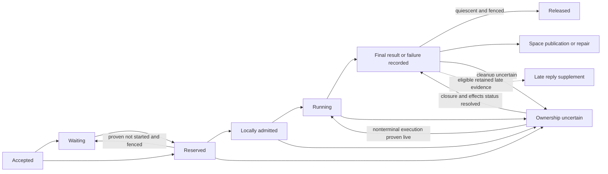
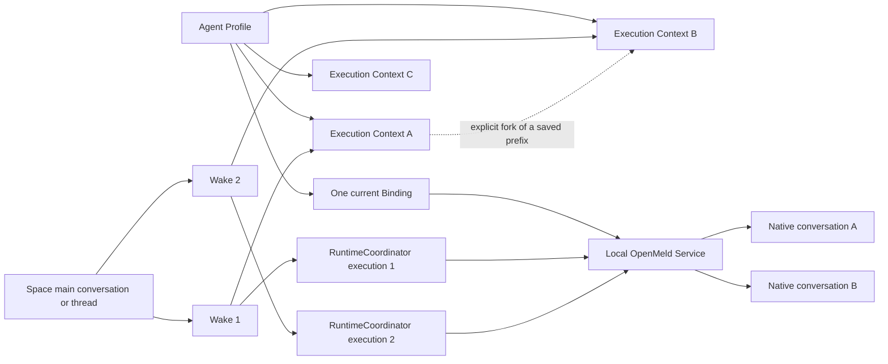

# Stable Local Agent Identity And Concurrent Work

## Agent Context

- Purpose: Propose stable Local Agent identity with independent execution contexts, native context forks, queryable work history, and bounded concurrent work.
- Read this when: Implementing or evaluating the separation of Agent Profile identity, Controller conversations, and workstation execution.
- Update this when: The proposed context ownership, admission, migration, or acceptance decisions change.
- Do not use this for: Current production behavior, release authorization, a new memory system, or Remote Agent scheduling.
- Source of truth: This is a design proposal. Existing scoped owner documents remain authoritative until implementation updates them together.

Status: IMPLEMENTED AND MERGED — PR #956 merged on 2026-09-15, so independent
execution contexts and the five-reservation concurrency ceiling are on `main`,
not awaiting a draft. Accepted context, admission, isolation, and compatibility
rules are recorded in the scoped owner documents. Local acceptance verified
concurrent Codex project tasks and Claude Space-context tasks on macOS.

Remove when this feature ships and its accepted rules, compatibility requirements,
and validation evidence have been incorporated into the scoped owner documents.

Storage update: production shared relational persistence moved to PostgreSQL
on 2026-10-04. This proposal uses that current backend; use the
[PostgreSQL workflow](../engineering/postgresql.md) for new schema work.

## One-Page Summary

| Decision | First-version behavior |
| --- | --- |
| Identity | One Agent Profile and primary Binding; many retained execution contexts, created/resumed/forked on demand. |
| Ordinary follow-up | Default to the requester's recent eligible context in the exact Profile/Organization/Space/main-or-thread scope. Show the choice; allow fresh work or fork in one action. Ambiguous parallel branches require a target choice. |
| Background | Resume for follow-up; completed-prefix native fork for independent work with inherited background; fresh for explicitly new work or confirmed absence of an eligible prior context. Include five recent work references visible in the same discussion, across requesters. |
| Capacity | Five reservations per Profile, 50 waiting Wakes; local memory/CPU and provider cooldown can admit fewer. No idle task-session pool. |
| Authority | Existing Work Coordinator schedules, RuntimeCoordinator owns execution, Space owns publication. An inherited transcript conveys no live token or approval. |
| Acknowledgement | Distinguish local proposal storage, Coordinator acceptance, and actual Space publication. Known-closed dispatches reject ordinary action submission explicitly. |
| Quiet long-running tools | A freshly verified, in-flight tool invocation owned by this execution supplies running evidence even without model output. Idle Controller/daemon presence alone does not. |
| Late result | Retain evidence. Eligible technical-loss results can appear as a labeled, non-terminal Late reply; Stop, revocation, supersession, and publication fences are not bypassed. |
| Process loss | Tool failure, confirmed Controller termination, and unknown execution ownership have different outcomes. Never infer OOM or free a Wake slot from exit 137 alone. |
| History and migration | Query existing accessible Wake/message/result records, including retained legacy work. Never reclassify a mixed-scope transcript using its last Space. |
| Delivery | Draft implementation has passed scoped local acceptance. Native file and tool checks still gate every supported local execution; guarded production rollout remains pending. |

The lifecycle below composes existing authorities; these are design labels, not
new persisted state enums or another state machine. Publication repair is tracked
separately from physical execution quiescence.

Stop and admission rejection may settle before running. Stop always fences
publication; a reservation is released only when its execution/resource evidence
permits it. An uncertain external effect can remain diagnostic/recovery evidence
after the process is proven dead; it never authorizes replay.

## Outcome And Scope

A Local Agent remains the same teammate across topics, work, process exits, and
service reconnects. Starting another task does not create another Agent Profile.
While one task runs, another member can address the same Agent in the same Space
and receive a visible acceptance and, when capacity and execution conditions
permit, an independent response without waiting for the first task to finish.

The agreed initial limit is **five concurrent work reservations per Agent
Profile**, across all its Spaces and Direct Messages, with at most **50 waiting
Wakes**. The limit is a fixed product default, not a user setting or a measured
performance guarantee. A reservation includes work that may be starting or still
executing; it is deliberately more conservative than a count of live processes.

This proposal changes ordinary workstation Agent Profiles only. It retains the
current single enabled primary Binding, computer selection, Organization scope,
Space addressing, and per-Wake final-outcome contract. It does not add automatic
multi-computer routing, a second scheduler, a public Session directory, or a
general long-term-memory implementation. Explicit independent project tasks
materialize a private Git repository and worktree from the confirmed source's
committed state; ordinary Space-context tasks do not copy repositories.
It includes explicit background inheritance through native fork and a bounded,
authorized read of existing work records. Neither creates another teammate or
automatically synchronizes private histories between contexts.

## Baseline Constraints Before Implementation

This table records the baseline that motivated the proposal. The updated scoped
owner documents describe the implementation; these rows are not current behavior.

| Current constraint | Evidence | Required change |
| --- | --- | --- |
| Binding holds one Controller conversation for a Profile. | [Binding schema](../../packages/db/src/core/agent-profile-binding.schema.ts), [Profile contract](../product/agent-profiles.md#collaboration-and-execution-connection) | Move current conversation selection to an execution context. Preserve Binding as execution connection and native launch settings. |
| The first `workItems` entry owns the only slot; all later entries wait. | [Work Coordinator](../../services/core/src/runtime-transport/application/agent-profile-work-coordinator.ts) | Separate reserved work from waiting order; support five reservations. |
| Coordinator state is a versioned Durable Object record with one recovery gate. | [Execution admission](../../services/core/src/runtime-transport/application/agent-profile-execution-admission.ts) | Upgrade persisted state and make interrupted work identifiable individually. |
| Local context lookup uses Profile, Controller, transport, and working-folder fingerprint, without a work context identifier. | [Agent context policy](../../runtime/local-execution/src/agent-context-policy.ts) | Add explicit context identity so independent work cannot resume the same native conversation accidentally. |
| Local lanes serialize a native conversation; when its ID is absent, the lane falls back to Profile identity. | [Queue routing](../../runtime/local-service/src/dispatch-queue-routing.ts), [execution slots](../../runtime/local-service/src/local-execution-slots.ts) | Preserve native single-writer behavior; use context identity before native conversation creation. |
| Local context results are committed into a durable ledger. | [Local ledger](../../runtime/local-execution/src/ledger-store.ts), [dispatch conversation handling](../../clients/openmeld-cli/src/local-service/dispatch/execute-dispatch-conversation.ts) | Version the mapping and prevent concurrent completions from overwriting a Profile-wide conversation. |
| Native fork already exists, but the product flow uses its child Session to create a Profile/Binding. The ordinary Codex wrapper does not yet accept a completed-turn cutoff. | [Profile creation strategies](../product/agent-profiles.md#agent-profile-creation-requests), [local fork operation](../../clients/openmeld-cli/src/local-service/session-control/fork-agent-session.ts), [Codex transport](../../runtime/adapters/codex/src/transport/codex-app-server-transport.ts) | Reuse native adapter operations for a context under the same Profile; add and verify a stable historical boundary without invoking Profile creation. |
| Space messages and dispatch results already retain work evidence; Agent Activity is metadata-only awareness. | [Dispatch results](../../packages/db/src/core/dispatch.schema.ts), [Space history](../../clients/openmeld-cli/src/space/history.ts), [Activity boundary](../product/agent-activity.md) | Compose an authorized work-history read model from owning records rather than infer outcomes from Activity or add a memory database. |
| The action recorder checks its local expiry and saves an unpublished proposal; the MCP tool reports that local result. | [Local record](../../clients/openmeld-cli/src/runtime/dispatch-space-action-context.ts), [MCP receipt](../../clients/openmeld-cli/src/space/action-mcp-server.ts) | Add authoritative dispatch-state acknowledgement and explicit closed/unknown outcomes; local success is not publication proof. |
| Core already retains selected token-matching late results after progress loss or local-runtime loss, and emits a recovery notice. | [Late-result eligibility](../../services/core/src/runtime-transport/application/runtime-coordinator-authority.ts), [result handling](../../services/core/src/runtime-transport/transport/do/runtime-transport-hub.ts) | Extend the existing result path with safe Late reply presentation, preserving Stop and final-outcome fences. |
| Claude CLI transport records exit/signal and classifies process termination; the Service also has a global execution limit. | [Claude CLI transport](../../runtime/adapters/claude-code/src/transport/claude-cli-transport.ts), [Service configuration](../../clients/openmeld-cli/src/config/runtime-config.ts) | Prove end-to-end visible failure and cleanup; add host-resource admission and shared transient-capacity evidence rather than assume each signal kills the whole task. |

These were baseline checkout facts, not evidence that a particular production Wake
failed. The reported busy-Agent experience still needs a trace or real-user
reproduction before attributing a concrete incident to a particular gate.
Reported long-render late actions, silent endings, subprocess exit 137, and
repeated provider 429s are required reproduction cases, not locally reproduced
incidents or evidence of a particular timeout/OOM cause.

## Domain Model

Use the existing product vocabulary. **Execution Context** names the narrow
mapping between an explicitly related group of Wakes and its native Controller
conversation. It is not a new user-visible teammate or a replacement Work object.

| Concept | Meaning and owner | Lifetime |
| --- | --- | --- |
| Agent Profile | Stable teammate identity, owner, Organization, instructions, and membership. | Independent of conversations and processes. |
| Binding | The Profile's selected Service Runtime, Controller, and native launch settings. | Changes only through the existing authorized connection/settings paths. |
| Space conversation | User-visible collaboration in a Space main conversation or thread. Space owns access, messages, and reply placement. | May contain many Wakes and many execution contexts. |
| Wake | One concrete request with an author, immutable input, authorization, and final destination. | Queueing and execution preserve this identity. |
| Execution Context | A stable, scoped context ID and its exact native conversation association. Core owns the association, including any fork provenance. | Can outlive a process and serve explicitly related Wakes; a fork creates a different context under the same Profile. |
| Execution | One RuntimeCoordinator-authorized execution of a Wake. | Existing accepted/running/stopped/failed/finalized lifecycle. |
| Runtime process | Local carrier of an execution, constrained by native Controller capabilities. | Started and released on demand. PID presence is not execution authority. |

A Profile can have many contexts over time and at most five reservations now.
Each context has at most one native conversation writer. A native conversation
belongs to one context and one Profile within its exact Runtime/Controller
namespace. A process may host several native sessions only if the Controller
supports it; that implementation choice does not change either invariant.

Profile identity does not imply that every context has the same memory. Fresh
contexts receive Profile instructions and currently authorized task context.
An explicit authorized native fork can additionally inherit a frozen historical
prefix. This is the only context-copy path in the first version; it does not
permit cross-member or cross-visibility-scope transcript copying. Later changes
are not merged or broadcast between parent and child. Authorized work-history
reads provide references to other work and results without copying transcripts.

## Request Association And User Experience

### Independent work

Task independence and background inheritance are separate decisions:

| User intent | Context handling | Profile identity |
| --- | --- | --- |
| Continue the same work | Resume the existing context, waiting for its current writer when necessary. | Same Profile. |
| Reuse a particular background for different work | Fork the specified saved history into a new context and independent Wake. | Same Profile. |
| Start unrelated work | Explicitly choose a fresh context and receive recent authorized work references; query further records as needed. | Same Profile. |
| Establish a separate teammate | Use the explicit Agent Profile creation flow. | New Profile. |

Each independent Wake receives a new execution context ID on first durable
acceptance, whether its initial background is fresh or forked. Retrying delivery
reuses that ID and the frozen initialization intent. Main conversation and thread
IDs identify visibility and reply placement; neither is a serialization key or
an automatic native-conversation key.

A new Wake without an explicit choice uses **scoped automatic continuation**.
Resolve the most recently accepted eligible context for the exact combination of
Profile, Organization, requester, Space, and main-conversation-or-thread scope.
A thread does not combine its different requesters, and a main conversation does
not borrow a context from a sibling thread or another Space. Derive the candidate
from existing accepted Wake/context associations, not a parallel preferred-context
store or wall-clock activity guess. Model output cannot select the candidate.

An eligible candidate has retained, accessible history, a compatible execution
target, and no explicit user archive/reset or unresolved context-identity issue.
An ordinary completed task remains eligible: completion does not erase discussion
continuity. Busy status alone does not make its follow-ups fresh; they wait for
the same context writer. If independent branches are still outstanding and no
explicit reference disambiguates them, show the bounded candidates and request a
choice rather than selecting whichever branch produced output most recently.

The composer shows **Continue: [work label]** before sending and offers **Start
fresh** and **Use this background for new work** in the same surface. Core
revalidates and freezes the displayed source at acceptance; stale candidates
never cause a silent switch. All new-contract clients share the same resolver.
Clients without a pre-send preview still return the resolved source in the
acceptance receipt. A confirmed absence of an eligible prior context starts a
fresh context with explicit fresh-start status. Unavailable/ambiguous history
does not count as confirmed absence; retain the unresolved association and
require clarification or an explicit fresh choice before task effects.

Thus an ordinary sequence of edits, a failure question, and a follow-up review
continues the same requester's discussion without requiring a special button on
every message. Fresh work remains one action away. Ordinary non-Wake messages
remain context under existing addressing rules; automatic continuation never
promotes them into executable work or routes another member into private history.

Space persists the message immediately. It shows `Sent` until canonical admission
is known, then the current progress or a precise waiting reason. Acceptance is a
system status; it must not invent an Agent-authored promise. Allocating a context
ID while waiting creates metadata only, not a native session or model process.

### Follow-ups and progress

Separate **related work** from **permission to reuse its native context**. Use
structured user actions and stable Wake references to establish association;
message wording, temporal proximity, Agent activity, and a shared Space do not
select a native conversation.

| User action | Association and behavior |
| --- | --- |
| Select **Continue this work** on a Wake or its result | Select that exact Wake as the continuation target, subject to server authorization. |
| Select **Use this background for new work** on an eligible Wake or its result | Select an explicit fork source. Keep the Profile, create independent work, and show the source and confirmed historical boundary. |
| Reply to a request, progress item, or final result that resolves to exactly one eligible Wake | The composer may visibly default to **Continue: [work label]**, with **Use this background for new work**, **Start fresh**, and a removable association. Sending submits that visible choice; no second confirmation dialog is required. |
| Reply to an ambiguous, ineligible, or ordinary message, or quote a document/code fragment | Keep the reference as context. Do not silently select a continuation target or infer permission from the quote. |
| Send a Wake without an explicit context choice | Visibly default to the requester's recent eligible context in the exact conversation scope; start fresh only on confirmed absence. |
| Select **Start fresh** | Admit independent work with its own context and recent authorized work references. |
| Send a context-dependent request such as "change that one" with ambiguous branches or an unresolved target | Clarify the intended work before task effects. Do not attach it to whichever execution is currently active. |

Use one discriminated shared `contextSelection` contract: `auto` (the new-contract
default), `new`, or `resume`/`fork` with an exact `sourceWakeId`. The optional
pre-send auto-resolution evidence identifies the source and revision the user
saw; it does not grant authorization. Core validates the selection and records
one resolved new/resume/fork decision. This replaces the earlier draft's two
optional association fields; do not implement both representations. **Start
fresh** selects `new` while preserving user-selected references. A fork is always
a new Wake and context, never a continuation of its parent's execution or a
Profile-creation request.

Reuse the existing contextual reply/action surface rather than adding a global
mode or requiring users to manage Sessions. A reply supplies candidate evidence
but still goes through the same visible selection and authoritative resolver.
Automatic continuation creates a subsequent Wake; it does not mutate the current
Wake's frozen prompt or grant control of another person's work.

Core resolves the referenced message/Wake relationship and execution context;
clients cannot supply a native Controller conversation ID as routing authority.
An ID appearing in message text is not a structured association. Revalidate at
send and execution admission. A removed or no-longer-authorized target produces
a clear stale-association outcome; it is never silently replaced by another
target or converted into independent execution.

Core verifies the exact Profile, source, thread/main scope, author, access, and
execution-context association. Native-context resume and fork both require the
same original requester and visibility scope in this version. Another member can
send related independent work using visible context, but cannot acquire access to a private native
transcript or redirect the original task merely by replying in the same Space.
Profile ownership alone does not waive this context-access check.

For example, Bob's screenshot reply to Alice's task is related input visible
under normal Space access. It may support Bob's independent request. Alice can
explicitly continue her task with that visible input, but Bob's reply does not
enter Alice's private context or grant Bob control over her work. General shared
task-control permissions are outside this first version.

Model reasoning may identify ambiguity or suggest candidates from context the
requester may access. It cannot create a continuation association, enumerate
private native transcripts, or switch its own dispatch to another context. The
first version adds no separate routing-model service or hidden model budget:
when clarification requires reasoning, it occurs in the request's normal Wake
and uses its normal slot before task effects. The user's explicit selection is
submitted through the same structured, server-validated continuation contract.

For the first version, an authorized continuation waits for the context's current
writer. The base Wake and its prompt stay immutable. Live steering is a separate
capability: existing authorized steering may continue where supported, but this
feature does not implement generic cross-provider interruption or infer steering
from natural language. UI copy must distinguish an accepted follow-up from one
already applied to a running Controller.

Progress can be read from the existing authorized execution projection without
starting a model or consuming a work slot. A question requiring new reasoning
is another Wake. There is no hidden sixth model slot when all five are busy.

Every dispatch brief includes up to **five** recent accessible Wakes from this
exact Profile/Organization/Space/main-or-thread discussion scope: ID, bounded
label, known outcome, and result/source links. Include requests from other
humans or Agents when the current requester may read the source and the returned
result metadata. Requester identity remains an authorization input, but is not
an equality filter for these shared-record references. Main-conversation and
thread boundaries still apply; do not gather private sibling-thread records.

For example, a human's Windows question can receive the accessible reference to
an Agent's earlier macOS question in the same discussion. It does not inherit the
earlier requester's native context, action token, or control of their Wake. Auto
continuation and raw native-history resume/fork retain their requester isolation.

This applies to fresh, resumed, and forked contexts and does not depend on the
model remembering to query history. No private native history is injected. Apply
current source and result-metadata access before selecting the five entries;
omit inaccessible titles, snippets, and links, and recheck when following a
reference. Reuse the work-history projection and its read budget; label a
partial/unavailable lookup explicitly instead of claiming there was no prior
work. Wider retrieval remains on demand.

### Fork history, lineage, and execution authority

Native fork inherits background, not the parent's live execution. For example,
after a product discussion, context A can work on a login fix while context B
uses the selected discussion history to write onboarding instructions. Both are
the same Agent Profile. A later root-cause discovery in A is not automatically
present in B; B may query the authorized work record when that discovery becomes
available through an owning source.

Before admitting a fork Wake to the queue, resolve a verifiable completed-history
boundary from the exact current source context. This is a read of retained
history, not a new model turn or native child. Bind the result to the source
context generation, native conversation reference, and provider-native completed
turn/snapshot marker. Show a friendly as-of description to the user, but use the
native boundary rather than a wall-clock timestamp as the copy instruction.
If no boundary can be verified, expose that fork cannot yet be prepared; do not
claim a captured snapshot or silently choose newer history later.

Core freezes the selected boundary at durable request acceptance. Retry,
queueing, and transport recovery retain it. Once capacity and local resource
admission permit, the Service forks exactly that prefix and journals the returned
child ID. Source progress may continue; it is not locked for the child's full
task. A provider that requires a brief native operation lock may use it only
through its demonstrated capability, without interrupting the source execution.
If the boundary was pruned, rewritten, or otherwise cannot be honored, fail the
fork explicitly and let the user select a new background.

The [Codex App Server documentation](https://developers.openai.com/codex/app-server#fork-a-thread)
defines `thread/fork` as copying stored history into a new thread and supports
`lastTurnId` for an inclusive cutoff. An in-progress cutoff is rejected; omitting
it while the source is mid-turn adds an interruption marker. OpenMeld's proposed
completed-prefix contract must therefore pass a proven completed cutoff. The
Codex wrapper enforces this at the fork call rather than per caller: a fork with
no `lastTurnId` is refused unless the caller sets `forkFullHistory`, so the
whole-history copy is a decision someone wrote down, never the shape a missing
checkpoint happens to produce. `excludeTurns` is not that decision — it trims the
response, not the inherited context. Other Controllers need their own verified
equivalent; generic native fork support is insufficient evidence for this
stronger contract. Do not simulate native Fork by injecting a summary.
The official `developers.openai.com/codex/app-server` entry was checked on
2026-09-11 and redirects to `learn.chatgpt.com/docs/app-server`. The latter is
the fetched official destination; the link here uses the recognizable original
entry rather than implying that the redirect domain is an unrelated source.

Record immutable fork provenance on the child: `sourceWakeId`,
`sourceExecutionContextId`, source context generation, the native historical
boundary, and the accepted source snapshot observation time. Retries must not
allocate a second logical child. A lost native fork acknowledgement has uncertain
creation outcome: reconcile the exact operation/journal before retrying native
creation. Do not fork again merely because the caller did not receive the ID.

The child receives its own execution identity, action/reply credentials,
requester authorization, destination, and effective native settings. Historical
tool calls and pending instructions are context, not commands to replay. Parent
tokens, grants, pending approvals, and live tool channels must not become usable
child authority. Current checks must reject use of a parent's execution identity
from a child tool channel even while the parent is still running. Do not revoke
the parent's valid credentials just to prepare its child. If a native fork
retains live tools, credentials, or settings that the adapter cannot safely
replace or isolate, do not expose this operation for that Controller.

Forking does not copy a checkout or isolate files, inherited paths, provider
accounts, or external effects. The child's own resource admission and native
permission policy still apply. Copying a historical request does not grant its
previous permission to the new work.

### Queryable work history

Include an agent-facing, read-only work-history operation in the first version,
implemented as a Core-owned composition of existing records. Reuse the normal
authenticated API/CLI and dispatch-scoped tool surfaces; do not create a memory
database, a new task ledger, or a background transcript synchronization service.
Work history is a projection, not another writer of work status or results.

The operation accepts an exact Profile and bounded filters such as time range,
accessible Space/Project, and query text. Use cursor pagination and bounded
source reads; it must not scan every native transcript or every historical
context on each request. Return only admitted metadata and source references:

| Returned fact | Owning source and limit |
| --- | --- |
| Wake ID, short work label, requester, source location, and timestamps | Persisted Space/Wake records; labels are retrieval aids, not new task instructions. |
| Current progress or final outcome | Existing RuntimeCoordinator projection and durable final-result records. Clearly distinguish active, failed, stopped, and uncertain outcomes. |
| Result links and artifact references | Existing published replies, attachments, and results. A reported PR URL does not prove that the PR was merged or deployed. |
| Fork origin and historical boundary | The accepted context association. Display the source only when the current requester may access it. |
| Observation time and coverage/retention limits | Explicit read metadata. Missing or expired records do not establish that the Agent did no work. |

For example, a query for yesterday can report an accessible login-fix Wake and
its PR reference, and an onboarding-writing Wake and its document reference.
Reading an authorized source can obtain details; it does not restore its native
session or create another execution. A natural-language synthesis uses the
current Wake's model slot rather than a hidden history agent.

Apply current requester, Profile, Organization, Space, Project, and source-access
policy before returning titles, counts, snippets, or links. Recheck authorization
when opening a result. Shared Profile identity, fork ancestry, old access, and
the Agent owner's credentials do not extend the current requester's access.
Cross-Space result retrieval can be allowed by current source policy even though
raw cross-scope native-history fork is not supported. Inaccessible records are
omitted without disclosing their existence. A failed source read is an explicit
partial/unavailable response, not an empty successful history.

Activity metadata can help locate candidates but cannot establish task success.
This first version covers work recorded by OpenMeld, not everything the local
Controller has ever done. Older Wakes remain queryable from existing records
when retained; absent fork lineage stays absent rather than being fabricated.
Retrieved text is evidence to interpret, not new execution authorization.

### Visible workload

Show one Agent identity with counts, for example `Working on 2 tasks · 1 waiting`.
The count of reservations is not necessarily the count of running tasks: a
reserved task may be starting or held by uncertain execution evidence.

Each source message keeps its own progress, Stop authority, and final reply.
Use distinct explanations for capacity, same-context occupancy, folder conflict,
service capacity, device waiting, and recovery approval. Do not claim a fixed
queue position when earlier resource-blocked work can be bypassed.

Owner diagnostics may show exact authorized work details. Other members retain
the existing neutral workload/count projection and can inspect only work whose
source they may access. Counts never authorize disclosure of private task text,
Space names, local paths, or native conversation identifiers.

Show fork lineage on the work detail within existing Profile/Space surfaces,
for example **Started from: Login investigation** plus its as-of boundary. A
fork does not add a member row or create an **Agent Profile fork** event.
Source lineage never lets a member navigate into inaccessible parent work.

Related parallel requests reuse the existing Inbox source-adapter and recipient
policy for normal updates to eligible involved humans; do not create an Agent
Inbox or notify every Space member. The source event records request acceptance
separately from confirmed native child creation. Reuse existing source/recipient
deduplication so the message, lineage, and fork do not produce duplicate notices.
Opening or dismissing an update grants no execution or context access. Preserve
existing browser/email preferences and do not add a confirmation loop or an
urgent notification merely because work is parallel.

## One Scheduler, Five Reservations

Agent Profile Work Coordinator remains the owner-shard admission and ordering
authority. RuntimeCoordinator remains the owner of every concrete execution.
The Space outbox retains request payloads. PostgreSQL remains a ledger/read projection.
Local Service enforces local resource admission; it does not create independent
work or publish its own scheduling truth.

Extend the existing Coordinator record to contain bounded reserved-work and
waiting-work references. Reuse Wake/dispatch identifiers instead of introducing
a second task identity. Store context records separately from the hot bounded
queue, and keep execution state in existing RuntimeCoordinator records.

The admission algorithm is:

1. Persist and deduplicate the exact Wake through the existing Space outbox and
   RuntimeCoordinator path; freeze source, destination, author, Binding revision,
   and context initialization/association, including a fork's historical boundary.
2. Validate current access, Wakeability, selected Controller capability, and
   applicable recovery/mutation holds.
3. In the existing owner-shard transaction, reserve capacity only if fewer than
   five reservations exist and this context has no writer. Otherwise retain it
   in the bounded waiting set. Queue overflow has an explicit visible outcome.
4. Deliver the same authorized execution intent to the exact Service. Local
   admission atomically checks its global slots, Controller maintenance, native
   conversation, and working-folder resources before starting any model or tool.
5. A proven `not_started` rejection for a local resource returns the work to
   waiting and releases only that exact reservation through RuntimeCoordinator.
   If all 50 waiting positions are occupied, exchange it with an eligible waiter
   in the same transaction; if none exists, retain it as a reserved but explicitly
   not-started item until such a transfer is possible. Never drop accepted work
   or create a 51st waiting entry. The old delivery generation is fenced before
   any transfer, so a delayed frame cannot start after its reservation moves.
   An ambiguous delivery or admission result retains the reservation until
   reconciled. Native start must never precede the local admission journal.
6. On a confirmed release, scan at most the 50 waiting entries and admit the
   oldest eligible requests up to available capacity. Provider/local resource
   release signals wake this path; an alarm repairs missed signals.

FIFO applies among eligible work. A request waiting for context A must not block
an independent request using context B. For an overlapping local resource, an
older waiting writer retains precedence over younger writers; local resource
admission reports eligibility under that rule, rather than becoming a second
work scheduler. Repeated retries retain original acceptance order.

No new fixed wall-clock deadline may kill an execution with fresh running
evidence. Approval waits, uncertain disconnects, and native-ownership uncertainty
retain their reservation and resource hold while execution may still be alive.
Receiving a Stop command does not release capacity until the existing stop
contract proves the execution can no longer perform work. A visible reply by
itself is not proof that its runtime process has stopped producing effects.

The profile ceiling, existing Service-wide capacity, and Controller/resource
limits all apply. Five is a ceiling, not a promise that every device can execute
five arbitrary requests concurrently. Do not spawn more processes to bypass a
Controller limit or allocate five idle instances in advance.
An executing forked child consumes one of the same five reservations. Its parent
consumes another only while the parent's work holds a reservation. Fork depth or
history inheritance cannot create additional concurrency outside this limit.

### Occupied-reservation handoff

When an external process holds the native conversation's writer lock, the
blocked work keeps its reservation and its `waitReason` records
`controller_conversation_occupied`. Recovering that one request must not push a
replacement to the back of the queue: it would then wait for the same blocked
queue it was meant to escape. Core therefore transfers the reservation in place
rather than releasing and re-admitting it.

`handOffOccupiedAgentProfileWork` in the
[Work Coordinator](../../services/core/src/runtime-transport/application/agent-profile-work-coordinator.ts)
puts the successor Wake into the source's slot and consumes the successor's own
waiting entry, so exactly one entry represents the work and the reserved count
never changes. The five-reservation ceiling, `serial`, and `draining` keep
holding without a special case, and no unprotected gap opens for a following
legacy item. It refuses anything that would not hold that slot, would run a
second execution in an already reserved context, or names a source that is not
both reserved and occupied — a turn that has already started is not a blocked
wait and must not be handed off.

`handOffRuntimeCoordinatorOccupiedAgentProfileWork` in
[execution admission](../../services/core/src/runtime-transport/application/agent-profile-execution-admission.ts)
is the storage entry point, reachable as `rpcHandOffOccupiedAgentProfileWork`.
Head lifecycle records are its authorization boundary: both source and
successor must exist under the same owner, dispatch, and Profile, so the RPC
cannot mint a reservation for foreign work. Idempotency keys on the successor's
`targetWakeLifecycleId` already holding the slot, matching how acceptance keys
on the same identity. The handoff never writes `activeHeadLifecycleIds`, which
follows head lifecycle status transitions rather than queue membership.

A Stop that lands while the blocked dispatch is retrying is reported by what
the retry actually did. `runtime.turn.cancelled` is the adapter's "stopped
before starting a turn" code, so the Codex adapter returns it only when the
transport cancelled ahead of `turn/start` or the `thread/resume` was refused; a
retry that already won the writer lock returns its own turn result, output
included. Reporting a cancellation for a turn that had started would hand Core
the false premise that nothing ran, which is exactly what invites the same work
being executed twice.

`handOffOccupiedAgentProfileWork` has no caller yet. The owner-facing recovery
below reaches the same outcome through the continuation path that Usage recovery
already uses, so the handoff RPC stays reachable but unused; see
[Codex session coexistence](review/2026-09-14-codex-session-coexistence.md).

### The owner's decision at the progress-stale bound

A blocked wait is not endless, and it must not end in a dishonest failure. The
existing five-minute progress-stale threshold is the bound: no new wall-clock
deadline is introduced. At that point the run closes as
`runtime.controller_conversation_occupied`, with copy naming the other app rather
than the computer, and the retired head opens a recovery gate whose status is
`awaiting_occupancy_decision`.

The gate is what keeps the queue from cascading. Without it the next waiting Wake
promotes into the same still-occupied conversation and dies the same way five
minutes later. For scoped work it holds only the occupied Execution Context and
legacy work: other contexts never enter that conversation, so they keep running
and admitting. Usage exhaustion recorded on the gate restores a Profile-wide
hold. It is opened fail-closed: only when no gate exists, so an
occupancy terminal never displaces a Usage or attention decision the owner is
already holding. A second occupied Wake settles plainly rather than queueing
behind the open gate, because a resumed follow-up would re-enter the same
occupied conversation.

The gate projects the `fork_interrupted_work` recovery action and a
`resolve_occupied_conversation` Inbox item, which offers exactly two answers:

- **Continue on a new branch.** The continuation re-posts the original message
  with `contextSelection = { mode: "fork", sourceWakeId }`, so the successor is
  minted from a verified history boundary of the occupied conversation. Because
  the gate moves to `continuation_authorized`, the successor jumps the held queue
  and reserves immediately, which is the same "must not wait for the queue it was
  meant to escape" rule the handoff was written for. `thread/fork` creates a new
  thread: the other app keeps the original and the two never rejoin, so the copy
  says *another branch*, never *restored*.
- **Skip.** The gate clears and the held work for that context promotes.

Either answer closes the Inbox item. If the execution target moved while the
decision was open, the branch cannot be taken off a conversation the current
target does not own, so the gate becomes `continuation_needs_attention` and the
review item replaces the occupancy item. Only one projection intent exists per
Profile, so the item that opens carries the stage it supersedes; two intents
would overwrite each other and leave the owner two open items for one Wake.

### Limits and how to change them

`packages/agent-runtime/src/work-policy.ts` owns the fixed
`AGENT_PROFILE_WORK_CONCURRENCY_LIMIT = 5` and
`AGENT_PROFILE_WORK_MAX_WAITING = 50`. Core admission, persisted-state validation,
Service slots, and client copy consume this shared policy. Readers retain
five reservations plus 50 waiting Wakes across policy reductions; lowering the
target must not discard accepted work. The owner-controlled serial policy can
lower new admission without changing existing Context or native identities.
Do not maintain separate editable defaults in clients. The Service's global default
(`DEFAULT_RUNTIME_DAEMON_GLOBAL_CONCURRENCY = 10`) is a different ceiling, not a
claim that this computer has resources for ten executions.

Changing 5 or 50 later is a policy/contract release with matching validation and
owner-doc updates. It needs no data migration if existing versioned records and
receivers already represent the new bounds. Otherwise upgrade their schema first.
A decrease never drops waiting work, kills running work, or invalidates a stored
record: grandfather accepted references and stop new admission until counts fit.
An increase must be capability-gated for old readers. Resource and cooldown
thresholds below are in the same policy ownership, with observations local to
the Service; there is no user-facing tuning panel in the first version.

## Wake Completion And Action Receipts

The absence of a fixed total execution deadline applies at every relevant layer:
Controller runner, action-context validity, Service, Coordinator, and finalization.
Long-running render/build work must keep its authorized result path while fresh
accepted progress continues. Security leases remain bounded but can be renewed
only from the current execution's authority. Queue/device deadlines, progress
staleness, native command timeouts, and publication-repair deadlines remain
distinct causes. Never extend a stopped/revoked execution using activity alone.
An ordinary daemon heartbeat or mere process presence is not fresh execution
progress and cannot renew execution authority by itself.

**A currently running owned tool invocation is accepted running evidence even
when it emits no stdout, model tokens, or semantic work-summary updates.** The
Controller runner/Service must observe and report that fact through the existing
execution-lifecycle evidence path; the model is not responsible for generating
keepalive text during a long render or build.

The observation must establish all of the following:

- The invocation is still in flight for the exact admitted execution/context,
  and its Controller is awaiting that tool or an official native job is active.
- The tool process/job is currently live and belongs to that invocation. Local
  process identity includes creation identity as well as PID so PID reuse or an
  unrelated descendant cannot become evidence for this Wake. A verified native
  job handle can provide equivalent ownership/liveness evidence.
- This is a new observation with its real observation time and monotonic
  sequence. Restamping a cached tool-start event or replaying an old heartbeat
  cannot refresh progress. Observation stops when the tool ends, ownership is
  lost, or the execution is fenced.
- Core admits the report only against current execution token, Service session,
  connection/lease, and context identities. Late reports cannot reopen terminal
  work, undo Stop, or keep another execution alive.

Reuse the Service's bounded lifecycle-reporting cadence, with fresh observation
comfortably inside the owning stale-progress window. Do not add one independent
scheduler per subprocess or make this depend on Space stream delivery. The
existing visual tool-activity stream remains presentation evidence; a cached
"tool started" row is not the running observation. Keep PIDs, commands, paths,
arguments, and outputs local; cloud evidence needs only admitted opaque
correlation, observation freshness, and lifecycle state.

If a Controller exposes no reliable invocation/process/job association, record
that capability gap and fail its long-tool validation gate; do not fake running
evidence from an idle parent process. Explicit native tool deadlines, authorized
Stop, confirmed termination, and revoked authority still apply. Silent output
alone is not a failure or reason to fall back to Late reply recovery.

The current local action recorder can save an unpublished proposal after a
remote dispatch closure it has not observed. Therefore add a typed receipt over
the existing Service/Coordinator path, not another publication authority:

| Receipt | Required evidence and model-visible meaning |
| --- | --- |
| Proposal saved locally | The local record exists; Coordinator acceptance and Space publication are unconfirmed. It must not be returned as generic action success. |
| Accepted for finalization | Coordinator atomically admitted this exact idempotent action against current execution authority. Publication is still pending. |
| Published | The owning Space has a durable signal/final-outcome receipt for this action. Include that reference. |
| Rejected | A known closed, stopped, superseded, revoked, or mismatched dispatch rejects a new ordinary action submission with a stable reason; MCP returns an error, not `Action recorded`. |
| Outcome unknown / awaiting authority | The caller cannot establish remote acceptance. Preserve the proposal and operation ID for reconciliation; do not report published or execute a replacement. |

A preflight "open" read cannot authorize a later write: the receiving authority
must serialize action admission with closure/Stop, and Space still fences final
publication. A closure racing a previously saved proposal must resolve its
receipt to a typed rejection or eligible retained-result state. The result must
not be replaced by a misleading "no reply or silence decision" notice when the
actual known cause is closure, transport failure, or process termination.
Existing local idempotent recording remains useful; its acknowledgement is
explicitly local-only until the remote receipt arrives. Old tools that cannot
express these semantics require a compatible update before this feature activates.
An exact idempotent replay of an operation already accepted/published returns its
original receipt plus current publication/closure status. That is receipt recovery,
not acceptance of a new action after closure; it must not create duplicate output.

### Late final actions

Use the existing `late_result_available` inbox/Coordinator recovery path. The
existing eligibility is narrow: matching prior execution proof, successful or
partial result, and terminal technical loss such as `runtime.progress_stale` or
`runtime.local_runtime_lost`. It does not accept every expired token. Correlation
with an old token is evidence for retained content, not renewed action authority.

| Closure or late submission | Proposed outcome |
| --- | --- |
| No terminal closure; publication is delayed | Continue ordinary finalization of the same result; no duplicate action or new Wake. |
| Eligible technical-loss closure; exact intended final reply is retained | After current access and final-action validation, publish one **Late reply** supplement linked to the original Wake/result. Keep the original terminal failure and timeline intact. |
| User Stop, access revocation, deleted destination, superseded execution, conflicting final reply, or publication-exhaustion fence | Reject ordinary late publication; retain only permitted diagnostic evidence. Never bypass these fences through the late path. |
| Result exists but there is no proven final reply intent, or only private model output | Retain evidence and show the existing recovery notice where allowed. Do not turn raw output into a public reply. |

The Late reply is a non-terminal retained-result presentation, not a second final
outcome or a reopened execution. Deduplicate by the existing dispatch/result
identity. It may render the validated intended reply and immutable result links;
it cannot execute retained actions that Wake agents, change membership, write an
external system, or revive other side effects. Current source/destination access
must be checked again. Any new publish operation uses current recovery authority,
never the rejected ordinary action token. Races with Stop or revocation are
resolved by the owning Space write fence. An authorized Stop/withdrawal intent
accepted before the supplement claim blocks it even if the primary execution
already has a technical-failure outcome. Terminal execution status must not
discard that newer publication fence. This deliberately improves the current
diagnostic-only notice for eligible technical losses while preserving all other
final-outcome rules.

## Local Resource Admission

Different conversations isolate model context; they do not isolate files,
credentials, or external effects. The first version keeps the configured working
folder and does not silently change a task's repository, clone files, or merge
temporary branches.

| Work access | Parallel behavior |
| --- | --- |
| No local tools; bounded, authorized Space context only | May answer while a folder-writing task runs, if the Controller demonstrably enforces that tool policy. Uses one of the five slots. |
| Enforced read-only local access | Multiple readers may run. A writer of an overlapping root excludes readers as well, so a review is not presented as a stable view while that root changes. |
| Writes within known bounded roots | One writer per overlapping root; disjoint roots may run concurrently when the native sandbox enforces those roots. |
| Unrestricted or unverified filesystem access | One writer per overlapping root: its claim covers the Git checkout containing the configured working folder (or that folder outside any checkout) and the repository's common Git directory, so sibling folders and linked worktrees of one repository take turns while independent repositories, unrelated folders, and Space-only work still run. The claim coordinates OpenMeld-launched work only; it is not isolation and does not confine native permissions that allow writes elsewhere. Unreadable Git metadata or an unknown folder overlaps every user folder. |

Access classification comes from enforceable Controller policy and admitted
tool capabilities. A prompt saying "just review" or a model's own classification
is not confinement evidence. A restricted mode must be explicit in the task's
effective execution settings; it never silently broadens the Binding's native
permission intent. Unknown support means serial resource admission, with an
honest reason, not optimistic parallel execution.

Extend the existing local slot manager for resource claims; do not add another
durable task queue. Resolve canonical roots locally, including symlinks and
ancestor/descendant overlap. Keep absolute paths on the computer. Service may
report opaque resource keys and typed wait reasons through the authenticated
execution contract. It retains claims across socket reconnect and reconciles
surviving executions before releasing claims after a Service restart.

These claims coordinate OpenMeld-launched work only. They do not lock human
editors or unrelated processes. Git metadata and other shared writable roots
also count; different subdirectories alone are not isolation. Arbitrary external
effects continue to use existing action authority and provider conflict rules;
this design does not claim to detect every external-resource conflict.

**Delivery implication:** five independent context-only requests in one Space
must be able to run concurrently on a proven Controller. Five edits of the same
custom checkout may remain serial. At least one supported Controller must prove
the responsive context-only path before this feature is presented as solving the
busy-teammate problem. Broader concurrent repository editing requires a separate
explicit working-copy isolation design, not an undocumented exception here.

### Eligibility and host budgets

Use the same local slot manager for these checks. It reports constrained local
capacity to the Coordinator; it does not create another work queue or decide
final Wakeability from CPU/memory usage.

| Declaration or evidence | Eligibility rule |
| --- | --- |
| Exact context/native conversation | One writer; a fork reads only its verified historical boundary and has its own child writer. |
| Enforced filesystem roots and tool policy | Apply the overlapping-reader/writer and unrestricted-access rules above across all local Profiles. |
| Controller/Service execution support | Apply native limits and existing global slots before using any Profile reservation. |
| Memory | Estimate the full task-owned process tree; reserve host headroom and reject additional local starts when the budget does not fit. |
| CPU or OS memory pressure | Temporarily defer starts; preserve current work and its progress. Sustained pressure is not an automatic kill request. |
| Provider throttle | Share the verified account/Controller scope's cooldown and reduced capacity; a new context cannot escape it. |
| Unknown support or unmeasurable resource envelope | Keep host execution at one concurrent task until the capability probe establishes a usable budget; do not label five sessions as supported from the Profile constant alone. |

Initial **soft admission** parameters for capability validation are memory
headroom of `max(2 GiB, 20% of physical RAM)`, using platform-appropriate available
memory rather than RSS alone, and no new starts under sustained host CPU usage
above 90% for 10 seconds. Resume CPU admission after usage stays below 80% for
10 seconds. OS pressure signals can block sooner. Recorded peak process-tree
usage from the supported workload probe supplies the task estimate; missing or
stale evidence keeps the conservative single-task host limit. Admission is atomic
against current local claims, then pressure is observed during execution.

These provisional values must be checked and, if necessary, revised in the
capability report before release. They are not hard memory/CPU sandbox limits,
an OOM guarantee, or permission to kill running jobs. No daemon may terminate
unrelated user processes to recover capacity. When pressure worsens, stop new
starts and report the wait; active-work cancellation follows existing authority.

### Process termination and uncertainty

Exit 137 alone is not proof of OOM, Controller death, or absence of earlier
effects. Preserve the observed code/signal and process role; claim OOM only from
reliable OS/native evidence. Node distinguishes process exit from stdio closure
and reports exit code versus termination signal separately; use that evidence
without assuming the whole task tree has stopped ([Node process events](https://nodejs.org/api/child_process.html#event-close)).

| Observation | Wake outcome and reservation |
| --- | --- |
| One tool subprocess dies; Controller remains active | Report the tool error to the current Controller, retain the Wake/reservation, and let it report failure or continue within existing authority. Never silently replay an effectful tool. |
| Controller/task process tree is confirmed terminated before a final result | Record explicit execution failure and publish a safe process-termination notice. Release the reservation only after native execution/children are quiescent and the old execution is fenced. |
| A final result was already durably accepted, then cleanup/process exit occurs | Preserve that result and reconcile publication/cleanup; do not overwrite it with a generic process error. |
| Service is lost, child ownership is unresolved, or a detached native job may survive | Preserve an ownership-uncertain hold and show **Execution interrupted; checking outcome**. Reconcile the exact execution rather than releasing or restarting it. |
| Execution is proven dead but an earlier external effect remains uncertain | Settle the execution as failed/interrupted and release only its proven-free local resources; preserve effect uncertainty and block unsafe replay. Effect uncertainty alone is not a permanently running process. |

The Service durably reports lifecycle failure through its existing evidence
outbox. Core retries the same visible failure publication if temporarily offline.
Do not replace a known termination cause with missing-action or silent-success
copy. Retained child/result identities survive Service restart and allow the
same reconciliation without a second execution.

### Shared provider throttling

A verified transient provider throttle temporarily reduces admission for its
known shared scope, including work from different Profiles on the same Service.
Use structured provider transport evidence, not arbitrary tool output containing
"429". Where credential/account scope is not trustworthy, use the existing
Runtime/Controller scope conservatively and report the coverage limit; do not
claim account-wide coordination across other devices.

Honor a reliable `Retry-After` before a new provider start. With a proven transient
throttle but no usable retry hint, use a 30-second initial backoff, exponential
growth capped at five minutes, and additive jitter; a longer provider retry hint
is never shortened. After the cooldown, permit one eligible work execution as
the recovery trial. Two successful provider turns without another throttle may
restore the previous ceiling, subject to resource budgets. Another throttle
extends the cooldown and retains the one-task ceiling. Persist the current
cooldown with existing local resource evidence across reconnect/restart.

Do not stop the other already-running executions, start a synthetic model probe,
or re-Wake a failed request to test recovery. Coordinate with native SDK retries
so they do not multiply retries; never automatically replay prior business work.
The Coordinator retains the original waiting requests and consumes local
eligibility evidence. This is a capacity constraint, not another Usage authority.

429 is not always transient: provider spend/quota exhaustion stays under existing
Usage/recovery rules. Anthropic documents both transient limits with retry hints
and spend-cap 429s without them; this does not prove every Claude Code transport
exposes those fields ([provider rate limits](https://platform.claude.com/docs/en/api/rate-limits)).
The Claude Code **local-cli** five-session case must be tested explicitly, as
well as any SDK path advertised separately, before claiming five-way support.

## Persistence And Single Ownership

### Execution context association

Use the existing owner-sharded RuntimeCoordinator storage boundary for canonical
context associations. This keeps context writer claims and work admission in one
transactional authority. Do not introduce another Durable Object class or a
parallel PostgreSQL scheduler.

The proposed context record contains:

- An opaque `executionContextId`, Profile ID, owner, and canonical Organization.
- The root Wake reference and its requester/Space/thread visibility scope.
- Binding and Runtime/Controller identity used for the association.
- A generation/revision and the exact native conversation reference, initially
  absent until the accepted Service reports its creation.
- Original initialization strategy (`new` or `fork`) and optional immutable
  fork provenance, including the
  exact source context/Wake and confirmed completed-history boundary. A resumed
  Wake references an existing context rather than allocating another one.
- Existing retention/recovery references needed to avoid deleting live history.

Only Core accepts updates, using the execution token, current Service session,
context generation, and exact Profile/Binding/Controller checks. Native
conversation claims are unique within Runtime plus Controller namespace. Context
records carry association and lifecycle metadata, not a second execution status.
Execution envelopes freeze the association they accepted; those historical
snapshots are not additional writers of current context identity.

Local Service journals native creation or fork before reporting it. A lost
response is reconciled against that journal and exact execution, not handled by creating a
replacement conversation and rerunning effects. If a process dies in an
unprovable native-creation window, report uncertainty and require exact recovery.

The local ledger becomes a versioned context-keyed execution journal and cache of
the accepted association. It owns local private paths and execution evidence,
not Profile-level routing truth. Provider conversation proofs remain diagnostic
evidence; an expired proof for context A must not make context B unavailable.

### PostgreSQL decision for the first version

**No new PostgreSQL scheduling or conversation table is required by this proposal.**
Existing Profile, membership, messages, and Binding target/settings rows remain.
Keep the old Binding conversation column as historical migration input for old
records; after a Profile switches, it is read-only and never selects new work.

Existing per-dispatch diagnostic envelopes should carry the context reference.
If a required existing query needs an indexed column, add a nullable projection
column through the normal generated migration. Such a column is a read model,
not context authority. Work-history filters should reuse existing dispatch and
result indexes first; add a narrow index/projection only when a required query
cannot be bounded without it. Do not add a new history table or column solely
because a new ID exists. The work-history API must not enumerate all owner-shard
context records to reconstruct ordinary historical Wake results.

Versioned Durable Object and local-ledger migrations **are required**, even when
the first implementation needs no PostgreSQL SQL schema migration. The final Contract
Impact Audit must verify the exact payload and projection changes before making
that implementation-level claim.

### Bounded lifetime

Profile count, active runtime resources, and historical context count are
different quantities. A Profile can complete 100 independent Wakes while keeping
one teammate identity and at most five reservations. It may retain 100 context
associations without keeping 100 native sessions active.

The first version has these concrete lifecycle rules:

1. Waiting work stores only its request and context association. It does not
   create/resume a native session, start a model turn, or allocate idle task
   processes. Existing installation/readiness observation is not task execution.
2. Create, resume, or fork a native session only after Coordinator reservation
   and successful local admission. Read-only fork-boundary preparation can
   inspect retained history before queue admission but does not allocate a
   child or a model turn. A historical association does not reserve a slot.
3. When execution completes, release its owned runtime handles and task-specific
   processes through the adapter lifecycle. Do not keep an active task session
   merely because a follow-up might arrive. There is no idle-session warm pool
   or preallocation of five native sessions in this version.
4. The Service itself and a Controller's legitimately shared host may remain
   online. They must not retain growing numbers of idle task sessions. A count
   of five work reservations is not a promise of exactly five OS processes;
   task-owned subprocesses must also finish or have explicit tracked ownership.
5. A later authorized continuation restores the exact saved association on
   demand. If exact resume is unavailable, expose that outcome; do not present
   a fresh conversation as restored or rerun previous effects. Failed or uncertain
   cleanup retains the relevant resource/reservation hold until reconciled.

Do not persist all historical contexts inside the Profile's queue record or
preload native sessions. Index history in bounded pages. Context records follow
the owning execution/recovery retention rules; unresolved work and retained
recovery evidence pin their associations. Garbage collection removes only
eligible OpenMeld metadata. It does not delete native transcripts or user files.
An accepted queued fork pins the OpenMeld source-association metadata needed for
its frozen boundary until the fork is resolved; it cannot prevent a user or
provider from deleting native history. Such deletion produces the explicit
unavailable-boundary outcome. Retained child lineage may outlive source content,
but an unavailable source is not reconstructed or disclosed from cached text.

## Recovery, Settings, And Invariants

Individual task errors settle only that Wake and release its proven-finished
reservation. They do not stop unrelated work. Preserve independent reply/action
tokens, source authors, attachment revisions, and permission interactions.
Concurrent replies continue to use the existing Space final-action review and
publication contracts; a common Profile ID never lets one Wake answer another.

Usage exhaustion and current credential failures are shared capability facts.
Keep the existing Core-owned Wakeability and recovery hold semantics for future
admission; do not terminate other running executions merely because one reports
exhaustion. Replace the single interrupted-work pointer with bounded references
to the actually affected Wakes. Each eligible automatic continuation remains
at-most-once, exact-source, and subject to the existing replay-safety checks.
Run such continuations serially under the hold; another Usage report cannot
create additional ones. Owner approval names the held work generation, and a
stale approval cannot release later work or a newly discovered unresolved item.

Context-specific corruption or native occupancy blocks that context. Profile
disablement, missing Binding authority, or verified shared quota/auth failure
still uses its existing broader scope. Do not turn per-context history into
Profile-wide Offline or Unavailable status.

Disruptive Binding/working-folder mutations must account for **all** reserved or
possibly running executions, not just the first. Existing owner-shard mutation
admission continues to fence new starts. Non-disruptive settings keep their
current accepted-versus-future revision behavior; proven live permission changes
target the relevant exact native sessions and report saved/applied honestly.

## Compatibility And Migration

### Transition rules

1. Add readers/receivers for the new context and admission records while keeping
   activation off. New wire fields are sent only through the repository's
   explicitly versioned/negotiated contract; strict old receivers never receive
   an unexpected field. No new separate rollout-control database is needed.
2. Publish a Service that understands both legacy serial work and context-scoped
   work. Explicitly advertise whether exact completed-prefix fork and child
   authority isolation are supported, separately from generic native fork.
   Before enabling the new mode, test new cloud/old Service and old cloud/new
   Service, including setup, dispatch, results, Stop, repair, fork, and trace.
3. Switch one Profile under its existing owner-shard mutation boundary. Freeze
   a migration acceptance boundary. Let already accepted legacy work, including
   its queued requests and recovery gates, resolve using its original context
   and semantics. New accepted requests can wait as versioned new-mode intents
   within the same 50-entry limit; they cannot jump ahead of the legacy drain.
4. After there is no possibly running legacy work or unresolved recovery hold,
   claim the old conversation, if any, as one legacy context. Re-read the exact
   Binding revision under mutation admission. Do not choose among contradictory
   cloud/local conversation records or rewrite existing duplicate ownership.
5. Atomically write the new context association, new admission record, and mode
   marker in the owner shard. A crash before commit leaves the Profile in legacy
   mode; after commit it has one new authority. New Binding/settings/result
   writers consult that marker and cannot update the historical Profile-wide
   conversation association.
6. Admit new work with the five-reservation model only on a compatible Service.
   Resume a legacy context only through an authorized exact continuation or
   recovery path whose original scope is known. New independent work uses fresh
   or explicitly forked background. A legacy context is eligible as a fork
   source only when its entire selected prefix satisfies the new provenance and
   visibility checks; Profile ownership alone cannot authorize copying old
   cross-Space private transcripts. Otherwise keep the exact legacy recovery
   path and use accessible work records as references for new work.

A legacy context that served several Spaces cannot be made single-scope by
assigning it to the last Wake's Space. That is a destination hint, not proof of
the transcript's contents or permission to reuse them. Preserve its exact
authorized recovery path, and make **all retained, currently accessible legacy
Wake records** queryable without requiring a new execution-context ID or fork
lineage. Include them in recent-work briefs when their source matches the current
scope. Missing context metadata must not exclude an otherwise valid legacy
result. Privacy and actual retention limits still apply; do not promise recovery
of deleted records or silently summarize mixed private history into a new Space.

The boundary is finite: new work cannot extend the legacy queue indefinitely.
Migration does not force-stop active work, change original requests, or bypass a
recovery approval to finish faster. A stalled legacy execution can delay that
Profile's switch and requires its ordinary visible recovery action.

Existing local ledger files must be upgraded by supported Service code with
durable writes and a validated prior-version backup, within the current lane.
Match old native identities against the accepted migration association. Do not
scan arbitrary user transcripts or clear the local home as a migration step.

### Mixed-version behavior

| Profile mode | Service capability | Behavior |
| --- | --- | --- |
| Legacy | Old or compatible new Service | Existing one-slot behavior and existing wire contract. |
| New | Compatible new Service and Controller | Five-reservation admission with context/resource guards. |
| New | Context-scoped execution supported, exact fork contract unsupported | New/resume work remains available; native background fork is explicitly unavailable. An independently chosen fresh task can use authorized result references, but is not presented as Fork. |
| New | Old or incompatible Service | Explicit required-update/recovery state; no dispatch with legacy conversation semantics. |

After a Profile switches, it never silently falls back to one Profile-wide native
conversation. Before activation, verified old Service compatibility may preserve
ordinary serial use. If that matrix cannot be proven, require the normal local
component update before switching; do not implement speculative fallbacks.

Execute each release through the existing guarded production-release process.
Receiver support may require a prior compatible cloud release; within each
coordinated release, follow the established migration/component/Worker order.
This document does not authorize deployment or replace release tooling.

### Rollback

Turn off new-mode admissions first. Do not free the five reservations or replay
their work. Drain or resolve active and held work using code that understands the
new schema. A compatible rollback build can limit new execution to one slot
while retaining per-context associations; it must not merge contexts.

The pre-feature binary is not a safe rollback target after activation because it
cannot interpret multiple active reservations or their context ownership. Retain
additive data and use a rollback build that reads the new records. Downgrading
the entire persisted model is not an automatic recovery operation.

## Implementation Sequence

These are implementation slices of one coherent feature, not separate public
products or authorization to execute them from this design task.

| Slice | Concrete scope | Exit evidence |
| --- | --- | --- |
| Context identity and compatibility | Shared Zod schemas, owner-shard association and fork provenance, local ledger key/version, completed-prefix native fork, child authority isolation, no Profile-wide result overwrite, legacy readers. | Distinct native contexts, exact continuation and fork cutoff, duplicate fencing, legacy fixture conversion. Activation remains off. |
| Admission and local execution | Five reservations, context single-writer rules, filesystem/host-resource claims, shared provider cooldown, bounded eligibility scan, termination and release/recovery handling. | Same-Space independent work progresses concurrently; sixth waits; signals and uncertainty are distinguished; constrained hosts/providers admit fewer tasks honestly. |
| Work history | Read-only API/CLI/tool projection over existing messages, Wakes, and results; bounded filters/pagination, authorization, evidence links, and lineage enrichment. | A current context can find accessible prior work and inspect its results without opening every native session or leaking another member's work. |
| Product surfaces and authority | Scoped auto-continuation and visible continue/fork/fresh choices, recent-work brief, structured target validation, typed action receipts and eligible Late reply presentation, workload counts, lineage and Inbox updates. | Repeated plain mentions retain authorized background; closed-dispatch actions are explicit; related parallel requests have one authorized update per source/recipient. |
| Migration and release readiness | Legacy drain, atomic switch, compatible component matrix, owner-doc updates, changelog, required local release validation. | State/restart/rollback tests plus real-user smoke on the exact candidate. |

Primary implementation seams are the files in the source-evidence table, shared
schemas under `packages/schemas`, the existing RuntimeCoordinator authority and
finalization paths, Profile operational-context projections, and Space
composer/progress/action surfaces. Do not create a second queue or a generic
orchestration framework to implement these slices.

## Acceptance And Evidence

The feature is not complete with a concurrency constant change or unit tests
alone. Required behavior includes:

1. **Stable identity:** five independent requests create one Profile, one
   current Binding, and independent context associations; a restart creates no
   duplicate teammate.
2. **Same-Space concurrency:** five admissible context-only tasks from at least
   two real members enter execution before a held first task completes. Replies
   have the correct request/source association and no private context mixing.
3. **Capacity:** a sixth independent request waits; a confirmed release promotes
   eligible work. At most five reservations and 50 waiting entries exist under
   concurrent submissions, Stop, completion, and reconnect.
4. **Context safety and ordinary follow-ups:** repeated plain mentions for edit,
   revision, failure explanation, and re-review continue the same requester's
   eligible context in the exact main/thread scope. The composer shows the
   choice; another requester, Space, or thread never inherits that private
   context. Two continuations serialize while unrelated work can proceed.
   **Start fresh** creates a different context and includes five accessible
   recent discussion references, including other requesters' visible work but
   not their native context. Ambiguous branches, typed IDs, stale targets, and
   model suggestions cannot select a private context. Verify both pre-send
   preview and API/CLI auto resolution, including a concurrent stale-candidate race.
5. **Resource safety:** overlapping writes and overlapping reader/writer work
   serialize; proven disjoint confined work can overlap. Unknown/unrestricted
   access is conservative. Read-only or no-tool claims require real adapter
   enforcement tests, not mocks shaped after desired behavior.
6. **Authority:** another member cannot steer, stop, resume, answer a permission
   request for, or inspect private context of someone else's Wake without the
   existing applicable authorization. Same Profile/Space is not a grant.
7. **No duplicate effects:** lost native-create, delivery, Stop, and result
   acknowledgements preserve uncertainty and exact IDs; no replacement start
   occurs while the first execution may still be running.
8. **Recovery isolation:** one task failure does not kill two unrelated tasks;
   shared usage exhaustion holds new work and preserves at-most-once recovery
   for each eligible interrupted task. An old owner action cannot release new
   recovery state.
9. **Migration:** old idle, running, queued, occupied, exhausted, and partially
   recovered fixtures preserve identities, order, settings, and source authors.
   Crash injection before/after activation leaves one owner and no replay.
10. **Mixed versions:** exercise the compatibility table, including an old
    Service reconnect after activation. It must request an update, not attach
    independent work to the old shared conversation.
11. **Lifecycle:** directory/controller changes cannot race any of the five
    active tasks; process or socket loss cannot manufacture a free slot.
12. **Bounded history:** many completed contexts do not grow the hot queue record
    or keep idle processes alive; retained unresolved work survives collection.
    A sequence of 100 completed requests leaves no task-owned warm sessions or
    abandoned subprocesses. Queueing the sixth request creates no native
    runtime, and a later continuation resumes its historical context on demand.
13. **Background inheritance:** on at least one verified Controller, a child
    writing onboarding instructions inherits the selected completed product
    discussion while its parent continues a login fix. Both retain the same
    Profile and different native conversations/Wakes; no member is created and
    the source is not interrupted. A continuation resumes instead of forking.
14. **Frozen fork boundary:** parent turns completed after fork acceptance are
    excluded even if the child waits in the queue. Parent and child do not
    automatically receive each other's later findings. Missing/rewritten history
    and unsupported cutoff APIs produce explicit outcomes, not a newer snapshot
    or a summary presented as native Fork. Lost acknowledgements do not produce
    duplicate logical children or repeat native creation without reconciliation.
15. **Child authority:** inherited parent instructions, active action tokens,
    pending approvals, and tool-call history cannot authorize child effects or
    publish against the parent Wake. The parent can continue using its own
    authority. A second member cannot fork private context through a reply,
    guessed ID, work-history result, or notification.
16. **Work-history retrieval:** a new context answers an authorized query about
    yesterday's recorded work with the correct source/result references and can
    read details without resuming the old native sessions. Access revocation,
    partial source failures, retention gaps, and uncertain outcomes remain
    explicit. Retained legacy Wakes without new context IDs/lineage remain
    discoverable with their exact source and result; a mixed three-Space legacy
    transcript is not re-scoped by its last Wake. No inaccessible title, snippet, count,
    parent link, or claim of completion leaks through search or cached results.
    In one discussion, an Agent-requested macOS check followed by a human's
    Windows check includes the first accessible result reference in the second
    brief while keeping their native contexts isolated. Repeat with revoked
    source/result access and a private sibling thread; no protected metadata
    enters the brief or its counts.
17. **Lineage and notifications:** accessible work details show the actual source
    and fork boundary. A related parallel request yields at most one eligible
    Inbox update per source/recipient through existing deduplication. Queued fork
    intent is not reported as a created native child; opening a notification
    never grants access or starts work.
18. **Closed dispatch and late final action:** hold a render task beyond the
    configured stale-progress window with no stdout/model output, an active
    owned tool, and freshly verified invocation observations; prove it stays
    live and its normal final action publishes without a Late reply. Repeat
    with an idle Controller, stale/replayed observation, PID reuse, unrelated
    live child, lost ownership, and Stop: none may falsely renew the execution.
    Separately force technical-loss closure, then submit its exact final
    action: ordinary submission reports explicit rejection/retained status,
    never generic success; an eligible validated reply appears once as a labeled
    non-terminal Late reply with original failure preserved. Repeat with Stop,
    revoked access, supersession, absent reply intent, publication exhaustion,
    and lost acknowledgements: no forbidden publication, duplicate output, or
    generic missing-action notice that hides the known cause is permitted.
19. **Process termination:** kill a tool subprocess, then the native Controller,
    then the Service in separate cases. Verify continued live work, explicit
    failed execution with proven release, and uncertain ownership with a retained
    hold respectively. Cover surviving descendants, already accepted results,
    external effects of unknown outcome, restart, and publication outage. An
    exit code of 137 alone must not be reported as OOM or silently end the Wake.
20. **Host and provider capacity:** exercise RAM headroom, sustained CPU pressure,
    Controller limits, transient 429 with/without retry hints, hard quota 429,
    and native SDK retries. Shared local Profiles must not bypass cooldown by
    opening new contexts. No synthetic model probe or replay is used to recover.
    Measure five independent **Claude Code local-cli** sessions on a real host,
    including a long task, fork/continuation, cleanup, and a sixth waiter; assess
    the SDK transport separately. A failed/unproven matrix retains the lower
    advertised capacity rather than claiming generic five-session support.
    Measure starvation while an unrelated user build saturates host CPU. Compare
    sustained deferral with a bounded-delay/single-task option only when memory,
    ownership, and provider checks permit it. This is a validation experiment,
    not an enabled fallback or permission to bypass the existing resource policy.
21. **Policy adjustment:** lower limits with five reserved and 50 waiting, then
    increase them across mixed-version peers. Accepted work remains valid and
    ordered; no dropped request, forced cancellation, or incompatible admission
    occurs. Verify schema migration is requested only if representation/receiver
    bounds actually change.

During implementation use focused behavior tests first, then affected checks as
required by the final scope. Complete the repository Contract Impact Audit and
`verify:release-ready` for changed local components. Use fresh temporary lanes
for tests. Real-user smoke must use the supported Web/CLI/Service entry points
and produce trace evidence per Wake. Local tests, candidate certification,
deployment, and real-device evidence must be reported separately.

## Owner-Document Impact And Outstanding Proof

This proposal intentionally supersedes the current Profile-wide conversation
rule and one-slot FIFO rule, strengthens action acknowledgements, and extends
eligible late-result presentation. It is **not compatible with those owner
rules as written**, so implementation must update them in the same change.
Stop, access revocation, supersession, and publication-exhaustion fences remain.

| Owner document | Required update |
| --- | --- |
| [Agent Profiles](../product/agent-profiles.md) | Context multiplicity and new/resume/fork semantics within one identity, five reservations, native conversation ownership, work-history access, legacy continuity, settings and multi-work recovery. |
| [Agent Transport](agent-transport-contract.md) | Admission/order, per-context guards, action receipts, verified in-flight-tool running evidence distinct from presentation activity, technical-loss Late reply supplements, process/finalization/release evidence, migration. |
| [Local Service](local-openmeld-service.md) | Context-keyed dispatch, native fork cutoff and child authority isolation, owned-invocation observations during silent tools, host/resource budgets, throttle evidence, process-tree cleanup, capability gating, restart and unknown-outcome handling. |
| [Space Collaboration](../product/space-collaboration.md) | Scoped automatic continuation, visible context choice, recent-work brief, author checks, ambiguity handling, progress and late-result presentation with existing fences. |
| [Shared Contracts](shared-contracts.md) | Versioned auto/new/resume/fork selection, action receipts, provenance, owned-tool lifecycle evidence, visibility-scoped recent-work briefs, capacity evidence, context/admission/result/work-history fields, and mixed-version matrix. |
| [Data And Observability](data-and-observability.md) | Context-association owner, work-history composition and evidence coverage, PostgreSQL projection limits, retention and trace selectors. |
| [Inbox](../product/inbox.md) | Related-work source projection, eligible recipients, normal importance, deduplication, and access-preserving lineage links. |
| [Web](../clients/web.md), [CLI](../clients/cli.md), [Projects](../product/projects.md) | Context choices and lineage in existing surfaces, work-history reads, diagnostics, and unchanged local-folder privacy. |
| [Agent Activity](../product/agent-activity.md) | Distinguish native session fork from Profile creation; Activity remains metadata-only evidence, not work-history outcome authority. |
| [Decisions](../decisions.md), [Glossary](../glossary.md) | Replace the superseded cardinality assumptions and define Execution Context once. |

The identity, Space, Binding target, Core Wakeability, RuntimeCoordinator, and
local trust boundaries remain. Do not claim that this draft changed current
behavior or established provider/production support.

Before implementation activation, prove the chosen initial Controller's
independent native sessions, completed-prefix fork during source work, child
authority isolation, context-only tool restriction, resource admission, and exact
stop/recovery behavior against its official API and a local smoke. Explicitly
include Claude Code local-cli five-session behavior, task-tree resource use,
signal/Service loss, native retry behavior, and long-render final actions; SDK
results cannot substitute for local-cli evidence. Also confirm
which existing diagnostic payloads and indexes can support context references
and bounded work-history reads without a PostgreSQL column migration. These are bounded
implementation evidence gates; they do not leave Profile identity or the agreed
concurrency ceiling undecided.

## Review Disposition

| Review item | Decision |
| --- | --- |
| Ordinary mentions lose prior background | Accepted: scoped automatic continuation, a visible fresh/fork alternative, and five recent authorized work references in every brief. No cross-requester or cross-Space auto-resume. |
| Closed actions report success; late content disappears | Accepted with limits: authoritative typed receipts and rejection, plus eligible non-terminal Late reply presentation through the existing retained-result path. Blanket late publication after Stop or other fences is rejected. Acceptance 18 names the long-render and late-action cases. |
| OS-killed child behavior and missing host budgets | Accepted: separate tool failure, confirmed Controller termination, and ownership uncertainty; soft RAM/CPU admission and end-to-end visible failure. No OOM conclusion from code 137 alone. |
| Shared 429 and Claude Code concurrency | Accepted: verified transient cooldown with one-task recovery admission, distinct quota treatment, and named local-cli testing rather than a generic Controller claim. |
| Assign mixed legacy context to its last Space | Rejected: the last destination cannot reclassify private transcript visibility. Preserve exact legacy recovery and require retained accessible legacy Wake coverage in work history and acceptance 16. |
| Readability, documentation domain, and configurable limits | Added summary, lifecycle diagram, eligibility table, verified official redirect, and the constant/contract/migration path for policy changes. |
| Recent-work brief across requesters | Accepted: select visible records in the same discussion/Profile scope regardless of author. Current requester/source/result authorization still filters every field; raw native contexts remain requester-isolated. |
| Silent long-running tools as progress | Accepted with exact ownership and freshness: a freshly observed in-flight tool/job renews running evidence even without model output. Idle process presence, cached start events, reused PIDs, and late fenced observations do not. Acceptance 18 covers the distinction. |
| CPU starvation under a user's unrelated build | Record as a capability-validation experiment comparing bounded delay/single-task admission when other checks allow. No runtime fallback or new CPU threshold is enabled by this revision. |

Reported incidents remain unverified reproduction inputs. Current-source support
for local proposal storage, late-result retention, and signal classification is
not proof of end-to-end production correctness. These changes complete design
decisions and mark the design ready for capability validation. No capability
probe has been run by this documentation update; it does not claim that the
incidents are fixed or validation has passed. Keep the GitHub PR in Draft until
the separately required implementation and delivery evidence make it ready.

Platform reference: Cloudflare documents transactional, strongly consistent
per-object storage in its [Durable Object storage API](https://developers.cloudflare.com/durable-objects/api/sqlite-storage-api/).
That supports the proposed single owner-shard transaction boundary; it does not
make PostgreSQL, local files, provider I/O, and Durable Object writes one transaction.
